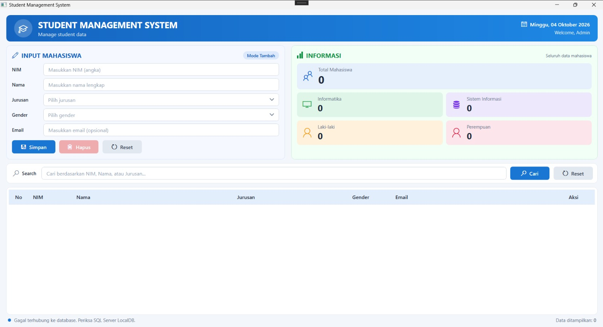

# Laporan Tugas Pertemuan 5 — Pemrograman Berbasis Kerangka Kerja (PBKK)
## Studi Kasus WPF: Student Management System (Rich UI + MVVM + Data Binding + SQL Server)

| | |
|---|---|
| **Nama** | Faizal Aldy Armiriawan |
| **NRP** | 5025231266 |
| **Kelas** | PBKK (C) |
| **Kode Program** | [github.com/fazdy/PBKK---C — Tugas Pertemuan 5](https://github.com/fazdy/PBKK---C/tree/main/Tugas/Tugas%20Pertemuan%205) |

---

### 1. Pendahuluan

**WPF (Windows Presentation Foundation)** adalah framework .NET untuk membangun aplikasi desktop Windows dengan tampilan yang kaya (*Rich UI*). Tampilan ditulis secara deklaratif menggunakan **XAML**, sedangkan logika ditulis dengan C#. Dengan pola **MVVM (Model–View–ViewModel)**, tampilan dipisahkan dari logika aplikasi, lalu keduanya dihubungkan melalui **Data Binding** dan **Command**.

Pada pertemuan ini dibuat **Student Management System**, yaitu aplikasi desktop untuk mengelola data mahasiswa (NIM, Nama, Jurusan, Gender, Email). Data disimpan di **SQL Server LocalDB** dan diakses menggunakan **ADO.NET**. Aplikasi memiliki form input, panel informasi (statistik), pencarian, serta tabel data dengan aksi edit dan hapus.

---

### 2. Tujuan

1. Membuat Rich UI dengan WPF dan XAML.
2. Menerapkan pola MVVM, Data Binding, dan Command (`ICommand`).
3. Menggunakan `ObservableCollection` dan `INotifyPropertyChanged`.
4. Mengakses SQL Server dengan ADO.NET untuk CRUD, pencarian, dan statistik.

---

### 3. Teknologi

| Komponen | Teknologi |
|---|---|
| Bahasa | C# |
| Framework | .NET 8 WPF |
| Arsitektur | MVVM |
| Database | SQL Server Express LocalDB |
| Data Access | ADO.NET (`Microsoft.Data.SqlClient` 7.1.1) |
| IDE | Visual Studio 2026 |

---

### 4. Arsitektur dan Struktur Project

```text
USER
  ↓
VIEW         MainWindow.xaml (Rich UI)
  ↓          Data Binding + Command
VIEWMODEL    StudentViewModel.cs
  ↓
MODEL        Student.cs
  ↓
REPOSITORY   StudentRepository.cs (ADO.NET)
  ↓
SQL SERVER   StudentDB → tabel Students
```

- **View** hanya berisi tampilan dan binding.
- **ViewModel** menyimpan data form, data tabel, command, pencarian, dan statistik.
- **Model** merepresentasikan satu data mahasiswa.
- **Repository** adalah satu-satunya bagian yang mengakses database.

```text
StudentManager/
├── App.xaml, MainWindow.xaml          # View dan Style
├── Models/Student.cs
├── ViewModels/StudentViewModel.cs, RelayCommand.cs
├── Data/StudentRepository.cs
├── Services/DialogService.cs          # dialog (MessageBox)
└── Converters/                        # nomor urut & ComboBox
```

---

### 5. Langkah Pengerjaan

**1) Membuat database.** Buka *View → SQL Server Object Explorer → (localdb)\MSSQLLocalDB → New Query*, lalu jalankan script berikut (lengkapnya ada di `Database/StudentDB.sql`). Jika database belum ada, aplikasi juga akan membuatnya secara otomatis.

📄 `Database/StudentDB.sql (potongan)`

```sql
CREATE TABLE Students
(
    Id INT IDENTITY(1,1) PRIMARY KEY,
    NIM VARCHAR(20) NOT NULL,
    Nama VARCHAR(100) NOT NULL,
    Jurusan VARCHAR(100) NOT NULL,
    Gender VARCHAR(20) NOT NULL,
    Email VARCHAR(100)
);

INSERT INTO Students
(NIM, Nama, Jurusan, Gender, Email)
VALUES
('23001','Budi Santoso','Informatika','Laki-laki','budi@gmail.com'),
('23002','Siti Aminah','Sistem Informasi','Perempuan','siti@gmail.com'),
('23003','Andi Wijaya','Informatika','Laki-laki','andi@gmail.com'),
('23004','Rina Sari','Sistem Informasi','Perempuan','rina@gmail.com');
```

**2) Membuat project.** Pilih *Create a new project → WPF Application*, beri nama **StudentManager**, pilih framework **.NET 8**, lalu install paket NuGet **Microsoft.Data.SqlClient**.

**3) Model.** Kelas `Student` mewakili satu baris tabel `Students`.

📄 `StudentManager/Models/Student.cs`

```csharp
namespace StudentManager.Models;

/// <summary>
/// Model: representasi satu baris data pada tabel Students.
/// </summary>
public class Student
{
    public int Id { get; set; }
    public string NIM { get; set; } = "";
    public string Nama { get; set; } = "";
    public string Jurusan { get; set; } = "";
    public string Gender { get; set; } = "";
    public string Email { get; set; } = "";

    /// <summary>
    /// Membuat salinan objek. Form mengedit salinan ini sehingga data di
    /// DataGrid tidak ikut berubah sebelum tombol Simpan/Update ditekan.
    /// </summary>
    public Student Clone() => (Student)MemberwiseClone();
}
```

**4) Repository.** Kelas ini berisi method `GetAll`, `Search`, `Insert`, `Update`, dan `Delete`. Semua query memakai parameter (`@NIM`, `@Nama`, ...) agar aman dari SQL Injection. Contoh *connection string* dan method INSERT:

📄 `StudentManager/Data/StudentRepository.cs (potongan)`

```csharp
private const string DefaultConnectionString =
    @"Server=(localdb)\MSSQLLocalDB;" +
    "Database=StudentDB;" +
    "Trusted_Connection=True;" +
    "TrustServerCertificate=True;";
```

📄 `StudentManager/Data/StudentRepository.cs (potongan)`

```csharp
public void Insert(Student student)
{
    using SqlConnection connection =
        new SqlConnection(connectionString);

    string sql =
        "INSERT INTO Students " +
        "(NIM, Nama, Jurusan, Gender, Email) " +
        "VALUES (@NIM,@Nama,@Jurusan,@Gender,@Email)";

    using SqlCommand command =
        new SqlCommand(sql, connection);

    AddStudentParameters(command, student);

    connection.Open();
    command.ExecuteNonQuery();
}
```

**5) RelayCommand.** Implementasi `ICommand` yang menghubungkan tombol di View dengan method di ViewModel.

📄 `StudentManager/ViewModels/RelayCommand.cs`

```csharp
using System.Windows.Input;

namespace StudentManager.ViewModels;

/// <summary>
/// Implementasi ICommand: menghubungkan Button di View dengan method di ViewModel
/// tanpa event Click di code-behind.
/// </summary>
public class RelayCommand : ICommand
{
    private readonly Action<object?> _execute;
    private readonly Predicate<object?>? _canExecute;

    // Command tanpa parameter, contoh: new RelayCommand(Save)
    public RelayCommand(Action execute)
        : this(_ => execute())
    {
    }

    // Command dengan parameter (CommandParameter), contoh: new RelayCommand(Edit)
    public RelayCommand(Action<object?> execute, Predicate<object?>? canExecute = null)
    {
        _execute = execute ?? throw new ArgumentNullException(nameof(execute));
        _canExecute = canExecute;
    }

    public bool CanExecute(object? parameter) => _canExecute?.Invoke(parameter) ?? true;

    public void Execute(object? parameter) => _execute(parameter);

    public event EventHandler? CanExecuteChanged;

    public void RaiseCanExecuteChanged() => CanExecuteChanged?.Invoke(this, EventArgs.Empty);
}
```

**6) ViewModel.** `StudentViewModel` menyimpan koleksi `Students` (`ObservableCollection`), data form, command (`SaveCommand`, `DeleteCommand`, `ResetCommand`, `SearchCommand`), dan statistik. Statistik dihitung dengan LINQ `Count()`, lalu `RefreshStatistics()` memberi tahu UI setiap kali data berubah:

📄 `StudentManager/ViewModels/StudentViewModel.cs (potongan)`

```csharp
public int TotalStudents => Students.Count;
public int TotalInformatika =>
    Students.Count(x => x.Jurusan == "Informatika");
public int TotalSistemInformasi =>
    Students.Count(x => x.Jurusan == "Sistem Informasi");
public int TotalLakiLaki =>
    Students.Count(x => x.Gender == "Laki-laki");
public int TotalPerempuan =>
    Students.Count(x => x.Gender == "Perempuan");
```

📄 `StudentManager/ViewModels/StudentViewModel.cs (potongan)`

```csharp
private void RefreshStatistics()
{
    OnPropertyChanged(nameof(TotalStudents));
    OnPropertyChanged(nameof(TotalInformatika));
    OnPropertyChanged(nameof(TotalSistemInformasi));
    OnPropertyChanged(nameof(TotalLakiLaki));
    OnPropertyChanged(nameof(TotalPerempuan));
}
```

**7) View (XAML).** Input form di-*bind* ke properti ViewModel, dan tombol memakai `Command`. DataGrid di-*bind* dengan `ItemsSource="{Binding Students}"` dan `SelectedItem="{Binding SelectedStudent}"`. Contoh binding pada form:

📄 `StudentManager/MainWindow.xaml (potongan)`

```xml
<TextBlock Grid.Row="0" Text="NIM" Style="{StaticResource FormLabel}"/>
<TextBox Grid.Row="0" Grid.Column="1"
         Style="{StaticResource InputTextBox}"
         Tag="Masukkan NIM (angka)"
         MaxLength="20"
         Text="{Binding CurrentStudent.NIM,
                UpdateSourceTrigger=PropertyChanged}"/>

<TextBlock Grid.Row="1" Text="Nama" Style="{StaticResource FormLabel}"/>
<TextBox Grid.Row="1" Grid.Column="1"
         Style="{StaticResource InputTextBox}"
         Tag="Masukkan nama lengkap"
         MaxLength="100"
         Text="{Binding CurrentStudent.Nama,
                UpdateSourceTrigger=PropertyChanged}"/>

<TextBlock Grid.Row="2" Text="Jurusan" Style="{StaticResource FormLabel}"/>
<ComboBox Grid.Row="2" Grid.Column="1"
          Style="{StaticResource InputComboBox}"
          Tag="Pilih jurusan"
          ItemsSource="{Binding JurusanOptions}"
          SelectedItem="{Binding CurrentStudent.Jurusan,
                         Converter={StaticResource EmptyStringToNullConverter}}"/>
```

**8) DataContext.** ViewModel dipasang sebagai sumber data untuk seluruh binding di `MainWindow`:

📄 `StudentManager/MainWindow.xaml.cs`

```csharp
using System.Windows;
using StudentManager.ViewModels;

namespace StudentManager;

public partial class MainWindow : Window
{
    public MainWindow()
    {
        InitializeComponent();

        // DataContext menentukan sumber data untuk semua Binding di MainWindow.xaml
        DataContext = new StudentViewModel();
    }
}
```

---

### 6. Hasil



*Gambar 1. Tampilan aplikasi Student Management System saat dijalankan di Windows.*

Tampilan aplikasi terdiri dari header, form **Input Mahasiswa** (NIM, Nama, Jurusan, Gender, Email, serta tombol Simpan, Hapus, dan Reset), panel **Informasi** berisi statistik mahasiswa, kolom **Search**, dan **DataGrid** dengan kolom Aksi.

Saat tangkapan layar diambil, SQL Server LocalDB belum terpasang di laptop yang digunakan. Karena itu status bar menampilkan pesan gagal terhubung dan data masih kosong. Aplikasi tetap terbuka karena error koneksi ditangani dengan `try-catch`. Setelah LocalDB terpasang, database dan data contoh akan dibuat otomatis saat aplikasi dijalankan kembali.

---

### 7. Skenario Pengujian

| Pengujian | Hasil yang Diharapkan |
|---|---|
| READ | Data contoh tampil di DataGrid |
| CREATE | Data baru tersimpan dan muncul di tabel |
| UPDATE | Perubahan data tersimpan |
| DELETE | Data terhapus, tabel dan statistik diperbarui |
| SEARCH | Data terfilter berdasarkan NIM, Nama, atau Jurusan |
| STATISTICS | Angka statistik berubah setelah CRUD |
| RESET | Form kembali ke kondisi awal |

Logika ViewModel untuk skenario di atas juga diuji dengan program uji `Tests/StudentManager.LogicTests` yang memakai database tiruan (*in-memory*). Hasilnya, 74 skenario lulus.

---

### 8. Pembahasan

- **Pemisahan tanggung jawab (MVVM).** `MainWindow.xaml.cs` hanya berisi `DataContext = new StudentViewModel();`. Tombol memakai Command, bukan event `Click`, sehingga seluruh logika berada di ViewModel.
- **Data Binding otomatis.** `ObservableCollection` membuat DataGrid langsung ter-*update* ketika data berubah. `RefreshStatistics()` mengirim notifikasi `PropertyChanged` agar angka di panel Informasi ikut berubah.
- **Perbaikan dari kode modul.** Form memakai salinan data (`CurrentStudent`) yang terpisah dari baris DataGrid (`SelectedStudent`). Pada kode modul, `SelectedStudent` masih `null` saat aplikasi dibuka, sehingga tombol Simpan tidak bekerja sebelum Reset ditekan. Pilihan ComboBox juga diisi daftar string dari ViewModel, sehingga yang tersimpan adalah nama jurusan, bukan objek `ComboBoxItem`.
- **Fitur tambahan.** Validasi input (NIM berupa angka dan tidak duplikat, format email), konfirmasi sebelum menghapus, pembuatan database otomatis, dan penanganan error koneksi.
- **Kendala.** Saat pertama dijalankan muncul error *"Unable to locate a Local Database Runtime installation"* karena SQL Server LocalDB belum terpasang. Solusinya adalah memasang komponen **SQL Server Express LocalDB** melalui *Visual Studio Installer → Modify → Individual components*.

---

### 9. Kesimpulan

Student Management System berhasil dibuat dengan WPF .NET 8 menggunakan pola MVVM. Data Binding dan Command menghubungkan tampilan dengan ViewModel tanpa logika di *code-behind*, sedangkan Repository berbasis ADO.NET menangani CRUD dan pencarian ke SQL Server LocalDB. Studi kasus ini menunjukkan bahwa kekuatan WPF terletak pada kombinasi XAML, Data Binding, Command, MVVM, dan pemisahan akses data, sehingga aplikasi lebih terstruktur dan mudah dikembangkan.

---

### Referensi

1. Materi PBKK Pertemuan 5 — *Studi Kasus WPF: Student Management System (Rich UI + MVVM + Data Binding + SQL Server)*.
2. Microsoft Learn — [Data binding overview (WPF .NET)](https://learn.microsoft.com/en-us/dotnet/desktop/wpf/data/)
3. Microsoft Learn — [Commanding Overview](https://learn.microsoft.com/en-us/dotnet/desktop/wpf/advanced/commanding-overview)
4. Microsoft Learn — [SQL Server Express LocalDB](https://learn.microsoft.com/en-us/sql/database-engine/configure-windows/sql-server-express-localdb)
