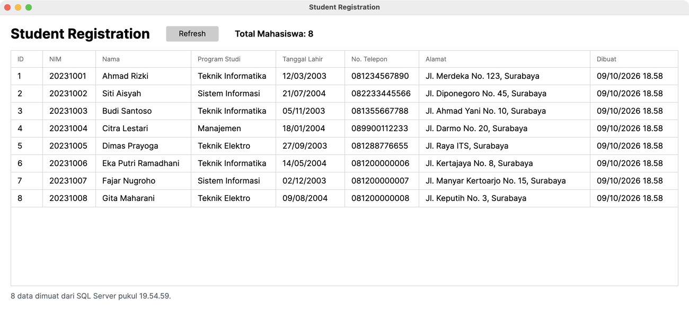

# Laporan Tugas Pertemuan 6 — Pemrograman Berbasis Kerangka Kerja (PBKK)
## Student Registration: SQL Server dan ADO.NET (Avalonia UI di macOS)

| | |
|---|---|
| **Nama** | Faizal Aldy Armiriawan |
| **NRP** | 5025231266 |
| **Kelas** | PBKK (C) |
| **Kode Program** | [github.com/fazdy/PBKK---C — Tugas Pertemuan 6](https://github.com/fazdy/PBKK---C/tree/main/Tugas/Tugas%20Pertemuan%206) |

---

### 1. Pendahuluan

Pertemuan 6 terdiri dari dua *hands-on lab*. **Lab 1** membangun database `StudentRegistrationDB` di **SQL Server** dengan tabel `Programs` dan `Students` yang berelasi **1:N**. **Lab 2** membuat aplikasi desktop C# yang terhubung ke database tersebut menggunakan **ADO.NET**, lalu menampilkan data mahasiswa pada **DataGrid**.

Modul praktikum menggunakan WPF, SQL Server Express, dan SSMS yang hanya tersedia di Windows. Tugas ini dikerjakan di MacBook, sehingga (dengan izin dosen) aplikasi desktop dibuat menggunakan **Avalonia UI**, framework XAML lintas platform yang konsepnya hampir sama dengan WPF. SQL Server dijalankan di dalam **Docker**.

---

### 2. Tujuan

1. Menyiapkan SQL Server dan membuat database menggunakan T-SQL.
2. Membuat tabel dengan PRIMARY KEY, UNIQUE KEY, dan FOREIGN KEY (relasi 1:N).
3. Menjalankan query SELECT, JOIN, WHERE, COUNT, dan GROUP BY.
4. Menghubungkan aplikasi desktop C# ke SQL Server dengan `SqlConnection`, `SqlCommand`, dan `SqlDataReader`.
5. Menampilkan data dari database ke DataGrid melalui `List<Student>`.

---

### 3. Lingkungan dan Alat

| Komponen | Keterangan |
|---|---|
| Perangkat | MacBook Pro 2020, Intel Core i5, RAM 8 GB, SSD 256 GB |
| Sistem operasi | macOS Sequoia 15.8.1 |
| SDK | .NET 8 (8.0.425) |
| Editor | Visual Studio Code + C# Dev Kit + Avalonia for VS Code |

Karena beberapa alat di modul hanya tersedia untuk Windows, digunakan pengganti berikut:

| Di modul (Windows) | Pengganti di macOS | Alasan |
|---|---|---|
| WPF | Avalonia UI 11.3.12 | Berbasis XAML seperti WPF dan berjalan di macOS |
| SQL Server Express/Developer | SQL Server 2022 Developer di Docker | SQL Server tidak tersedia native untuk macOS |
| Docker Desktop | Colima + Docker CLI | Lebih ringan untuk RAM 8 GB dan sisa disk yang terbatas |
| SSMS | DBeaver / `sqlcmd` | SSMS hanya tersedia untuk Windows |
| Windows Authentication | SQL Server Authentication (user `sa`) | SQL Server di Docker tidak mendukung login Windows |

---

### 4. Instalasi dan Persiapan

**1) Install Colima dan Docker CLI** melalui Homebrew (jika belum ada Homebrew, pasang dari [brew.sh](https://brew.sh)):

```bash
brew install colima docker
```

**2) Nyalakan Colima** dengan 2 CPU, RAM 4 GB, dan disk 20 GB:

```bash
colima start --cpu 2 --memory 4 --disk 20 --vm-type vz
```

**3) Jalankan SQL Server 2022** sebagai container. Image berukuran sekitar 1,6 GB dan hanya diunduh sekali. `MSSQL_MEMORY_LIMIT_MB` membatasi pemakaian RAM agar Mac tetap ringan, sedangkan `TZ=Asia/Jakarta` membuat waktu di SQL Server (misalnya `CreatedAt`) mengikuti WIB, bukan UTC.

```bash
docker run -d --name sqlserver \
  -e "ACCEPT_EULA=Y" \
  -e "MSSQL_SA_PASSWORD=Pbkk@2026" \
  -e "MSSQL_MEMORY_LIMIT_MB=2048" \
  -e "TZ=Asia/Jakarta" \
  -p 1433:1433 \
  -v sqlserver-data:/var/opt/mssql \
  mcr.microsoft.com/mssql/server:2022-latest
```

```text
$ docker ps
NAMES       IMAGE                                        STATUS          PORTS
sqlserver   mcr.microsoft.com/mssql/server:2022-latest   Up 34 seconds   0.0.0.0:1433->1433/tcp, [::]:1433->1433/tcp

$ docker logs sqlserver | grep ready
2026-10-09 18:58:27.52 spid24s     SQL Server is now ready for client connections. This is an informational message; no user action is required.
```

**4) Hubungkan DBeaver ke SQL Server** sebagai pengganti SSMS (unduh di [dbeaver.io](https://dbeaver.io/download/) jika belum ada): *New Database Connection → SQL Server*, isi Host `localhost`, Port `1433`, *SQL Server Authentication* dengan user `sa` dan password `Pbkk@2026`, lalu aktifkan *Trust Server Certificate*.

**5) Siapkan template Avalonia.** Avalonia 12 membutuhkan .NET SDK yang lebih baru, sehingga untuk .NET 8 digunakan template Avalonia 11.3.12:

```bash
dotnet new install Avalonia.Templates::11.3.12
```

---

### 5. Hands-On Lab 1 — Database StudentRegistrationDB

Seluruh script praktikum ada di `Database/StudentRegistrationDB.sql`. Script ini dijalankan lewat DBeaver, atau langsung dengan `sqlcmd` di dalam container:

```bash
docker cp Database/StudentRegistrationDB.sql sqlserver:/tmp/StudentRegistrationDB.sql
docker exec sqlserver /opt/mssql-tools18/bin/sqlcmd -S localhost -U sa -P "Pbkk@2026" -C -i /tmp/StudentRegistrationDB.sql
```

Struktur dan relasi tabel:

```text
┌──────────────────┐
│     PROGRAMS     │
├──────────────────┤
│ PK ProgramId     │
│ UK ProgramCode   │
│ ProgramName      │
│ IsActive         │
│ CreatedAt        │
└────────┬─────────┘
         │ 1
         │
         │ N
┌────────▼─────────┐
│     STUDENTS     │
├──────────────────┤
│ PK StudentId     │
│ UK NIM           │
│ Name             │
│ FK ProgramId     │
│ BirthDate        │
│ Address          │
│ PhoneNumber      │
│ CreatedAt        │
│ UpdatedAt        │
└──────────────────┘
```

Tabel `Students` dihubungkan ke `Programs` melalui FOREIGN KEY `ProgramId`, sedangkan `NIM` dibuat UNIQUE:

📄 `Database/StudentRegistrationDB.sql (potongan)`

```sql
CREATE TABLE Students
(
    StudentId INT IDENTITY(1,1)
        CONSTRAINT PK_Students PRIMARY KEY,

    NIM VARCHAR(20) NOT NULL
        CONSTRAINT UQ_Students_NIM UNIQUE,

    Name VARCHAR(100) NOT NULL,

    ProgramId INT NOT NULL,

    BirthDate DATE NULL,

    Address VARCHAR(250) NULL,

    PhoneNumber VARCHAR(20) NULL,

    CreatedAt DATETIME2 NOT NULL
        CONSTRAINT DF_Students_CreatedAt
        DEFAULT SYSDATETIME(),

    UpdatedAt DATETIME2 NULL,

    CONSTRAINT FK_Students_Programs
        FOREIGN KEY (ProgramId)
        REFERENCES Programs(ProgramId)
);
```

**Hasil JOIN Students dan Programs (LAB 18):**

```text
StudentId  NIM       Name           ProgramCode  ProgramName         BirthDate   PhoneNumber
---------  --------  -------------  -----------  ------------------  ----------  ------------
1          20231001  Ahmad Rizki    TI           Teknik Informatika  2003-03-12  081234567890
2          20231002  Siti Aisyah    SI           Sistem Informasi    2004-07-21  082233445566
3          20231003  Budi Santoso   TI           Teknik Informatika  2003-11-05  081355667788
4          20231004  Citra Lestari  MNJ          Manajemen           2004-01-18  089900112233
5          20231005  Dimas Prayoga  TE           Teknik Elektro      2003-09-27  081288776655

(5 rows affected)
```

**Jumlah mahasiswa per program studi (Challenge 4, `LEFT JOIN` + `GROUP BY`):**

```text
ProgramName               JumlahMahasiswa
------------------------  ---------------
Teknik Informatika        2
Sistem Informasi          1
Manajemen                 1
Teknik Elektro            1
Desain Komunikasi Visual  0

(5 rows affected)
```

**Pengujian constraint (LAB 19 dan LAB 20).** Kedua INSERT ini memang harus ditolak oleh SQL Server:

```text
Msg 547, Level 16, State 1, Line 7
The INSERT statement conflicted with the FOREIGN KEY constraint "FK_Students_Programs". The conflict occurred in database "StudentRegistrationDB", table "dbo.Programs", column 'ProgramId'.
The statement has been terminated.

Msg 2627, Level 14, State 1, Line 7
Violation of UNIQUE KEY constraint 'UQ_Students_NIM'. Cannot insert duplicate key in object 'dbo.Students'. The duplicate key value is (20231001).
The statement has been terminated.
```

Pesan pertama membuktikan bahwa FOREIGN KEY menolak `ProgramId` 99 yang tidak ada di tabel `Programs`. Pesan kedua membuktikan bahwa UNIQUE KEY menolak NIM `20231001` yang sudah dipakai.

**Mini assignment.** Tiga mahasiswa baru ditambahkan (Teknik Informatika, Sistem Informasi, Teknik Elektro), lalu ditampilkan dengan JOIN yang diurutkan berdasarkan nama:

```text
NIM       Name                 ProgramName         BirthDate   PhoneNumber
--------  -------------------  ------------------  ----------  ------------
20231001  Ahmad Rizki          Teknik Informatika  2003-03-12  081234567890
20231003  Budi Santoso         Teknik Informatika  2003-11-05  081355667788
20231004  Citra Lestari        Manajemen           2004-01-18  089900112233
20231005  Dimas Prayoga        Teknik Elektro      2003-09-27  081288776655
20231006  Eka Putri Ramadhani  Teknik Informatika  2004-05-14  081200000006
20231007  Fajar Nugroho        Sistem Informasi    2003-12-02  081200000007
20231008  Gita Maharani        Teknik Elektro      2004-08-09  081200000008
20231002  Siti Aisyah          Sistem Informasi    2004-07-21  082233445566

(8 rows affected)
```

---

### 6. Hands-On Lab 2 — Aplikasi Student Registration (Avalonia)

**1) Membuat project dan memasang paket:**

```bash
dotnet new avalonia.app -f net8.0 -o StudentRegistration
cd StudentRegistration
dotnet add package Avalonia.Controls.DataGrid --version 11.3.12
dotnet add package Microsoft.Data.SqlClient --version 7.1.1
```

Kemudian dibuat folder `Models` dan `Repositories`, sesuai struktur target pada modul.

**2) Model.** `Student.cs` merepresentasikan tabel `Students`, sedangkan `ProgramName` menampung hasil JOIN. `Models/Program.cs` adalah model program studi, berbeda dengan `Program.cs` di folder utama yang merupakan *entry point* Avalonia.

📄 `StudentRegistration/Models/Student.cs`

```csharp
namespace StudentRegistration.Models;

/// <summary>
/// Model data mahasiswa (tabel Students).
/// ProgramName menampung hasil JOIN dengan tabel Programs.
/// </summary>
public class Student
{
    public int StudentId { get; set; }

    public string NIM { get; set; } = string.Empty;

    public string Name { get; set; } = string.Empty;

    public int ProgramId { get; set; }

    public string ProgramName { get; set; } = string.Empty;

    public DateTime? BirthDate { get; set; }

    public string Address { get; set; } = string.Empty;

    public string PhoneNumber { get; set; } = string.Empty;

    public DateTime CreatedAt { get; set; }

    public DateTime? UpdatedAt { get; set; }
}
```

**3) Repository.** `StudentRepository` membuka koneksi dengan `SqlConnection`, menjalankan query JOIN dengan `SqlCommand`, lalu membaca setiap baris dengan `SqlDataReader` menjadi objek `Student`. Karena SQL Server berjalan di Docker, *connection string* memakai login `sa`, bukan Windows Authentication:

📄 `StudentRegistration/Repositories/StudentRepository.cs (potongan)`

```csharp
private readonly string _connectionString =
    Environment.GetEnvironmentVariable("STUDENT_DB_CONNECTION")
    ?? "Server=localhost,1433;" +
       "Database=StudentRegistrationDB;" +
       "User Id=sa;" +
       "Password=Pbkk@2026;" +
       "TrustServerCertificate=True;";
```

📄 `StudentRegistration/Repositories/StudentRepository.cs (potongan)`

```csharp
using var connection =
    new SqlConnection(_connectionString);

using var command =
    new SqlCommand(sql, connection);

connection.Open();

using var reader = command.ExecuteReader();

while (reader.Read())
{
    students.Add(new Student
    {
        StudentId = reader.GetInt32(
            reader.GetOrdinal("StudentId")),

        NIM = reader.GetString(
            reader.GetOrdinal("NIM")),
```

Method `GetTotalStudents()` menjalankan `SELECT COUNT(*) FROM Students` dengan `ExecuteScalar()` untuk *mini challenge* Total Mahasiswa.

**4) Tampilan (`MainWindow.axaml`).** Kolom DataGrid di-*bind* ke properti `Student`. Kolom Alamat dan Dibuat adalah *mini challenge* 1 dan 2:

📄 `StudentRegistration/MainWindow.axaml (potongan)`

```xml
<DataGrid x:Name="StudentDataGrid"
          Grid.Row="1"
          x:DataType="models:Student"
          AutoGenerateColumns="False"
          IsReadOnly="True"
          GridLinesVisibility="All"
          BorderThickness="1"
          BorderBrush="#D0D7DE">

    <DataGrid.Columns>

        <DataGridTextColumn
            Header="ID"
            Binding="{Binding StudentId}"
            Width="60"/>

        <DataGridTextColumn
            Header="NIM"
            Binding="{Binding NIM}"
            Width="100"/>

        <DataGridTextColumn
            Header="Nama"
            Binding="{Binding Name}"
            Width="180"/>

        <DataGridTextColumn
            Header="Program Studi"
            Binding="{Binding ProgramName}"
            Width="160"/>

        <DataGridTextColumn
            Header="Tanggal Lahir"
            Binding="{Binding BirthDate, StringFormat={}{0:dd/MM/yyyy}}"
            Width="130"/>

        <DataGridTextColumn
            Header="No. Telepon"
            Binding="{Binding PhoneNumber}"
            Width="140"/>

        <!-- Mini Challenge 1 -->
        <DataGridTextColumn
            Header="Alamat"
            Binding="{Binding Address}"
            Width="*"
            MinWidth="280"/>

        <!-- Mini Challenge 2 -->
        <DataGridTextColumn
            Header="Dibuat"
            Binding="{Binding CreatedAt, StringFormat={}{0:dd/MM/yyyy HH:mm}}"
            Width="165"/>

    </DataGrid.Columns>
</DataGrid>
```

**5) Menghubungkan repository dengan UI (`MainWindow.axaml.cs`).** Data diambil dari repository lalu dijadikan `ItemsSource` DataGrid. Tombol Refresh memanggil ulang method yang sama:

📄 `StudentRegistration/MainWindow.axaml.cs (potongan)`

```csharp
private void LoadStudents()
{
    try
    {
        var students = _studentRepository.GetAll();

        StudentDataGrid.ItemsSource = students;

        TotalTextBlock.Text =
            $"Total Mahasiswa: {_studentRepository.GetTotalStudents()}";

        StatusTextBlock.Text =
            $"{students.Count} data dimuat dari SQL Server pukul {DateTime.Now:HH:mm:ss}.";
    }
    catch (Exception ex)
    {
        StatusTextBlock.Text = "Gagal memuat data dari database.";

        ShowMessage(ex.Message, "Database Error");
    }
}

private void RefreshButton_Click(
    object? sender,
    RoutedEventArgs e)
{
    LoadStudents();
}
```

**6) Menjalankan aplikasi:**

```bash
dotnet run --project StudentRegistration
```

---

### 7. Hasil



*Gambar 1. Aplikasi Student Registration menampilkan data mahasiswa dari SQL Server.*

Aplikasi berhasil terhubung ke SQL Server dan menampilkan **8 data mahasiswa**: 5 data awal dan 3 data *mini assignment*. Kolom Program Studi berisi hasil JOIN dengan tabel `Programs`, sedangkan Tanggal Lahir dan Dibuat ditampilkan dengan format tanggal Indonesia. Label **Total Mahasiswa: 8** berasal dari query `COUNT(*)`, dan baris status menunjukkan waktu terakhir data dimuat.

Tombol **Refresh** diuji dengan menambahkan satu baris mahasiswa langsung di database, lalu mengamati DataGrid:

| Langkah | Data di DataGrid | Total Mahasiswa |
|---|---|---|
| Aplikasi dibuka | 8 | 8 |
| Tambah 1 baris lewat SQL (belum klik Refresh) | 8 | 8 |
| Klik Refresh | 9 | 9 |
| Hapus baris uji, lalu klik Refresh | 8 | 8 |

Data baru hanya muncul setelah Refresh, karena setiap klik memanggil `LoadStudents()` yang mengambil ulang data dari SQL Server.

---

### 8. Pengujian (Checkpoint)

| Checkpoint | Status | Bukti |
|---|---|---|
| SQL Server berjalan dan dapat diakses | ✅ | `docker ps` dan log *ready for client connections* |
| Database `StudentRegistrationDB` | ✅ | `SELECT DB_NAME()` menghasilkan `StudentRegistrationDB` |
| Tabel `Programs` (5 program studi) dan `Students` | ✅ | Hasil JOIN pada LAB 18 |
| PRIMARY KEY, UNIQUE KEY, FOREIGN KEY | ✅ | Error Msg 547 (FK) dan Msg 2627 (UNIQUE) |
| Query SELECT, JOIN, WHERE, COUNT, GROUP BY | ✅ | Challenge 1–4 pada script |
| Mini assignment: 3 mahasiswa baru (TI, SI, TE) | ✅ | 8 baris diurutkan berdasarkan nama |
| `Student.cs`, `Program.cs`, `StudentRepository.cs` | ✅ | Folder `Models` dan `Repositories` |
| `Microsoft.Data.SqlClient`, `SqlConnection`, `SqlCommand`, `SqlDataReader` | ✅ | Method `GetAll()` |
| `List<Student>` ditampilkan di DataGrid | ✅ | Gambar 1 |
| Tombol Refresh | ✅ | Tabel pengujian Refresh |
| Mini challenge: kolom Alamat, kolom Dibuat, Total Mahasiswa | ✅ | Gambar 1 |

---

### 9. Pembahasan

**Alur data dari SQL Server ke DataGrid.** Saat aplikasi dibuka, `MainWindow` membuat `StudentRepository`. Repository membuka `SqlConnection`, `SqlCommand` menjalankan query JOIN, lalu `SqlDataReader` membaca hasilnya baris demi baris. Setiap baris dipetakan menjadi objek `Student` dan dimasukkan ke `List<Student>`. List ini menjadi `ItemsSource` DataGrid, dan binding pada kolom menampilkan setiap properti.

**Perbedaan WPF dan Avalonia yang ditemui:**

| WPF (modul) | Avalonia (tugas ini) |
|---|---|
| `xmlns="http://schemas.microsoft.com/winfx/2006/xaml/presentation"` | `xmlns="https://github.com/avaloniaui"` |
| DataGrid sudah bawaan | Paket `Avalonia.Controls.DataGrid` dan `StyleInclude` tema di `App.axaml` |
| `MessageBox.Show(...)` | Tidak ada MessageBox bawaan, sehingga dibuat jendela dialog sederhana |
| Data dimuat di konstruktor | Dimuat pada event `Opened`, karena dialog error membutuhkan jendela utama yang sudah tampil |
| `StringFormat=dd/MM/yyyy` | `StringFormat={}{0:dd/MM/yyyy}` |
| Binding berbasis *reflection* | *Compiled binding* dengan `x:DataType`, sehingga salah ketik nama properti terdeteksi saat kompilasi |
| `CanUserAddRows="False"` | Tidak diperlukan, karena DataGrid Avalonia tidak membuat baris kosong untuk input |

**Kendala dan solusi:**

- **Avalonia 12 gagal dikompilasi dengan .NET SDK 8.** Template Avalonia terbaru (12.x) memakai *source generator* yang membutuhkan compiler C# lebih baru (SDK 9.0.300 ke atas), sehingga `InitializeComponent()` tidak terbentuk. Solusinya memakai Avalonia 11.3.12 yang kompatibel dengan .NET 8.
- **Windows Authentication tidak tersedia.** SQL Server di Docker memakai SQL Server Authentication, sehingga *connection string* menggunakan `User Id=sa` dan `Password`. Password ini hanya berlaku untuk SQL Server lokal. Bila dijalankan di Windows, *connection string* dapat diganti melalui environment variable `STUDENT_DB_CONNECTION`.
- **Unduhan image SQL Server sempat terputus** (`unexpected EOF`) karena koneksi tidak stabil. Masalah teratasi dengan menjalankan ulang `docker pull`.
- **Sumber daya terbatas (RAM 8 GB, sisa disk ±16 GB).** Docker dijalankan dengan Colima, VM dibatasi 4 GB RAM, dan SQL Server dibatasi 2 GB melalui `MSSQL_MEMORY_LIMIT_MB`. Setelah selesai, Colima dimatikan dengan `colima stop`.

---

### 10. Kesimpulan

Database `StudentRegistrationDB` berhasil dibuat di SQL Server dengan relasi 1:N antara `Programs` dan `Students`. Integritas data terbukti dijaga oleh PRIMARY KEY, UNIQUE KEY, dan FOREIGN KEY. Aplikasi Student Registration berhasil mengambil data dari SQL Server menggunakan ADO.NET (`SqlConnection`, `SqlCommand`, `SqlDataReader`) dan menampilkannya pada DataGrid, lengkap dengan tombol Refresh, kolom Alamat, kolom Dibuat, dan Total Mahasiswa. Walaupun modul ditujukan untuk Windows, seluruh praktikum dapat dikerjakan di macOS menggunakan Avalonia UI dan SQL Server di Docker, dengan kode ADO.NET yang sama seperti di modul.

---

### Referensi

1. Materi PBKK Pertemuan 6 — *Hands-On Lab: Membangun Database Student Registration dengan SQL Server*.
2. Materi PBKK Pertemuan 6 — *Hands-On Lab 2: Membuat Aplikasi WPF + C# Terhubung SQL Server dengan ADO.NET*.
3. Microsoft Learn — [Quickstart: Run SQL Server Linux container images with Docker](https://learn.microsoft.com/en-us/sql/linux/quickstart-install-connect-docker)
4. Avalonia Docs — [DataGrid](https://docs.avaloniaui.net/docs/reference/controls/datagrid/)
5. Colima — [github.com/abiosoft/colima](https://github.com/abiosoft/colima)
