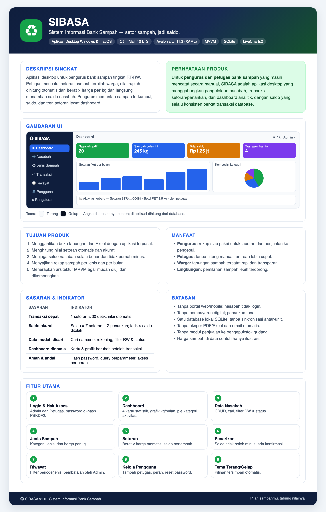
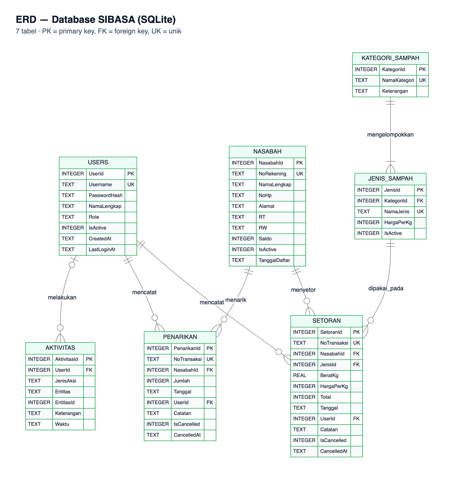
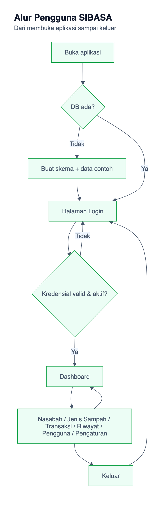

# Tugas Pertemuan 7 PBKK — SIBASA: Aplikasi Desktop Bank Sampah dengan Avalonia UI, MVVM, dan SQLite

| Identitas | Keterangan |
|---|---|
| **Nama** | Faizal Aldy Armiriawan |
| **NRP** | 5025231266 |
| **Kelas** | Pemrograman Berbasis Kerangka Kerja (PBKK) — C |
| **Tugas** | Tugas Pertemuan 7 — Proyek aplikasi desktop (persiapan UTS) |
| **Kelompok** | Perorangan (1 anggota) |

> **Ringkasan.** SIBASA adalah aplikasi desktop untuk mencatat tabungan bank sampah warga. Setiap setoran sampah terpilah ditimbang, nilainya dihitung otomatis (berat × harga per kg), lalu masuk ke saldo nasabah. Aplikasi dibangun dengan C# dan .NET 10, Avalonia UI (XAML), pola MVVM, dan database SQLite. Fiturnya meliputi login berbasis peran, CRUD, pencarian dan filter, dashboard berisi kartu statistik dan grafik, serta tema terang/gelap. Postingan ini memuat seluruh pengerjaan dari infografis, PRD, rancangan, implementasi, hasil, sampai pengujian. **Tautan repository, unduhan aplikasi, dan video demo ada di bagian paling bawah.**

**Daftar isi**

1. [Pendahuluan](#1-pendahuluan)
2. [Mengapa Avalonia UI, Bukan WPF](#2-mengapa-avalonia-ui-bukan-wpf)
3. [Persiapan Lingkungan Kerja](#3-persiapan-lingkungan-kerja)
4. [Infografis Ruang Lingkup](#4-infografis-ruang-lingkup)
5. [Product Requirement Document (PRD)](#5-product-requirement-document-prd)
6. [Rancangan Database dan ERD](#6-rancangan-database-dan-erd)
7. [Arsitektur MVVM dan Struktur Folder](#7-arsitektur-mvvm-dan-struktur-folder)
8. [Langkah Pengerjaan dan Potongan Kode](#8-langkah-pengerjaan-dan-potongan-kode)
9. [Hasil Aplikasi](#9-hasil-aplikasi)
10. [Pengujian](#10-pengujian)
11. [Kendala dan Solusi](#11-kendala-dan-solusi)
12. [Kesimpulan](#12-kesimpulan)
13. [Tautan: Repository, Unduhan, dan Video Demo](#13-tautan-repository-unduhan-dan-video-demo)

---

## 1. Pendahuluan

### 1.1 Latar belakang tugas

Pada Tugas Pertemuan 7, mahasiswa diminta membangun proyek aplikasi desktop sebagai persiapan UTS. Acuannya adalah contoh PRD **SISMA (Sistem Informasi Mahasiswa)** dari dosen, mulai dari struktur dokumen, gaya tampilan, sampai pembagian lapisan arsitekturnya. Ketentuan yang harus dipenuhi:

1. Tema bebas, tetapi tidak boleh SISMA dan tidak boleh sama dengan kelompok lain.
2. Aplikasi desktop dengan tampilan modern. Dosen memakai WPF, tetapi framework lain yang kompatibel dengan Mac diperbolehkan.
3. Wajib ada operasi CRUD yang terhubung ke database. Database boleh selain SQL Server.
4. Wajib ada dashboard berisi kartu statistik dan grafik.
5. Tampilan modern: sidebar navigasi, tabel data, formulir terstruktur, serta tema terang dan gelap.
6. Tampilan dipisahkan dari logika dengan arsitektur MVVM.
7. Minimal 5 kebutuhan fungsional (FR).
8. Ruang lingkup wajar untuk dikerjakan satu orang.

Yang dikumpulkan adalah satu tautan postingan Blogspot berisi PRD dan dokumentasi, ditambah tautan repository, unduhan aplikasi, dan video demo.

### 1.2 Tema yang dipilih: bank sampah

**Bank sampah** adalah tempat warga menyetorkan sampah anorganik yang sudah dipilah. Sampah ditimbang, dihargai per kilogram sesuai jenisnya, lalu nilainya dicatat sebagai tabungan yang bisa ditarik. Di tingkat RT/RW, pencatatan biasanya masih memakai buku tabungan kertas atau Excel. Akibatnya hitungan berat × harga sering keliru, saldo sulit dicek, dan pengurus kesulitan merekap berapa kilogram sampah yang terkumpul tiap bulan.

Tema ini dipilih karena:

- **Bermanfaat bagi masyarakat.** Aplikasi ini mendorong pemilahan sampah dan memberi nilai ekonomi bagi warga.
- **Strukturnya sebanding dengan SISMA.** Nasabah setara dengan Mahasiswa, dan Jenis Sampah setara dengan Program Studi, ditambah transaksi dan aktivitas. Dengan begitu, kelengkapan PRD dan aplikasinya bisa mengikuti referensi tanpa membengkak.
- **Angka dashboard bermakna.** Kilogram, rupiah, dan komposisi sampah adalah data yang benar-benar berguna untuk grafik.
- **Ada aturan bisnis nyata.** Saldo bertambah saat setor dan tidak boleh minus saat tarik. Aturan ini menuntut transaksi database, sehingga konsep integritas data benar-benar dipraktikkan.

### 1.3 Hasil yang dikumpulkan

| Hasil | Lokasi |
|---|---|
| Infografis dan PRD | Postingan ini (Bagian 4 dan 5) |
| Source code, skrip database, dokumentasi, tes otomatis | Repository GitHub (Bagian 13) |
| Aplikasi siap pakai: Windows `.exe` dan macOS `.app` | Google Drive (Bagian 13) |
| Video demo | Bagian 13 |

---

## 2. Mengapa Avalonia UI, Bukan WPF

Saya mengerjakan tugas ini di **MacBook Pro 2020 dengan prosesor Intel Core i5** (macOS Sequoia). WPF hanya berjalan di Windows, jadi saya memilih **Avalonia UI**, framework desktop *open source* yang paling mirip dengan WPF. Avalonia sama-sama memakai **XAML + C#**, *data binding*, `ICommand`, `DataTemplate`, dan pola MVVM, sehingga materi WPF di kelas tetap terpakai. Bedanya, Avalonia berjalan di Windows, macOS, dan Linux.

| Aspek | WPF | Avalonia UI |
|---|---|---|
| Platform | Hanya Windows | Windows, macOS, Linux |
| File tampilan | `.xaml` | `.axaml` (sintaks XAML hampir sama) |
| Binding dan MVVM | `Binding`, `ICommand`, `INotifyPropertyChanged` | Sama, ditambah *compiled binding* yang dicek saat build |
| Styling | `Style`, `Trigger` | `Style` dengan selector mirip CSS, mis. `Button.primary:pointerover` |
| Tabel data | `DataGrid` bawaan | Paket `Avalonia.Controls.DataGrid` |
| Dikembangkan di Mac | Tidak bisa | Bisa, termasuk membuat `.exe` Windows langsung dari Mac |

Keputusan versi dan teknologi pendukung:

- **.NET 10 (LTS).** .NET 8 memang LTS, tetapi dukungannya berakhir 10 November 2026. .NET 10 didukung sampai November 2028 dan mendukung macOS Intel (x64).
- **Avalonia 11.3, bukan 12.** Avalonia 12 sudah rilis, tetapi pustaka grafik **LiveCharts2** versi stabil masih dibuat untuk Avalonia 11. Supaya grafik dashboard pasti berjalan, versi dikunci di 11.3 (patch terbaru 11.3.22).
- **CommunityToolkit.Mvvm** untuk MVVM: `[ObservableProperty]` dan `[RelayCommand]` mengurangi kode berulang.
- **SQLite** sebagai database, karena dosen mengizinkan database selain SQL Server. SQLite tidak butuh Docker (hemat RAM laptop 8 GB), dan file aplikasi yang diunduh dari Google Drive bisa langsung dipakai tanpa memasang server. Query berparameter, *foreign key*, *constraint*, dan transaksi tetap tersedia.

---

## 3. Persiapan Lingkungan Kerja

| Komponen | Yang dipakai |
|---|---|
| Perangkat | MacBook Pro 2020, Intel Core i5-8257U (`x86_64`), RAM 8 GB |
| Sistem operasi | macOS Sequoia 15.8.1 |
| SDK | .NET SDK 10 (installer **x64**, bukan Arm64) |
| Editor | Visual Studio Code + C# Dev Kit + Avalonia for VSCode |
| Template proyek | `Avalonia.Templates` 11.3.12 |
| Melihat isi database | Perintah `sqlite3` bawaan macOS, atau DB Browser for SQLite versi Intel (opsional) |
| Version control | Git 2.48 + GitHub |

Langkah ringkasnya:

1. **Pastikan prosesor Intel.** Buka menu Apple → *About This Mac*, atau jalankan `uname -m` di Terminal. Hasilnya harus `x86_64`.
2. **Pasang .NET SDK 10 x64** dari [dotnet.microsoft.com](https://dotnet.microsoft.com/download/dotnet/10.0), lalu cek dengan `dotnet --list-sdks`.
3. **Pasang VS Code** beserta ekstensi C# Dev Kit dan Avalonia for VSCode.
4. **Pasang template Avalonia** dengan `dotnet new install Avalonia.Templates::11.3.12`.
5. **Siapkan database.** Untuk SQLite, tidak ada server yang perlu dipasang. Isi file `sibasa.db` dapat dilihat dengan perintah `sqlite3` yang sudah tersedia di macOS, atau dengan DB Browser for SQLite.
6. **Hubungkan Git ke GitHub** dengan `git config` dan `gh auth login`.

> **Temuan di laptop saya.** Installer resmi memasang SDK .NET 10 di `/usr/local/share/dotnet`. Namun, file `~/.zshrc` berisi `export PATH="$HOME/.dotnet:$PATH"`, sehingga folder `~/.dotnet` (berisi SDK 6–8 dari tugas sebelumnya) dibaca lebih dulu dan perintah `dotnet` tidak menemukan SDK 10. Solusinya: pasang SDK 10 ke `~/.dotnet` memakai skrip resmi `dotnet-install.sh`, atau jalankan dengan path lengkap `/usr/local/share/dotnet/dotnet`.

Panduan instalasi lengkap untuk pemula, termasuk tabel masalah umum dan solusinya, ada di repository: `docs/Panduan-Instalasi.md`.

---

## 4. Infografis Ruang Lingkup



Ringkasan isi infografis:

- **Produk:** SIBASA, aplikasi desktop (Windows & macOS) untuk bank sampah tingkat RT/RW. Slogannya *setor sampah, jadi saldo*.
- **Tujuan:** menggantikan buku tabungan dan Excel, menghitung nilai setoran otomatis, menjaga saldo selalu benar, menyajikan rekap per jenis dan per bulan, serta menerapkan MVVM.
- **Pengguna:** Admin (pengurus) dan Petugas (teller). Warga nasabah hanya tercatat sebagai data.
- **Manfaat:** rekap siap pakai bagi pengurus, antrean lebih cepat bagi petugas, tabungan transparan bagi warga, dan pemilahan sampah yang lebih terdorong.
- **Batasan:** tanpa portal web/mobile, tanpa pembayaran digital, dan memakai satu database lokal.
- **Fitur utama:** login dan hak akses, dashboard, data nasabah (CRUD), jenis sampah dan harga, setoran, penarikan, riwayat dan pembatalan, kelola pengguna, serta tema terang/gelap.

---

## 5. Product Requirement Document (PRD)

Berikut PRD lengkap SIBASA (19 bagian). Strukturnya mengikuti PRD SISMA dari dosen, dan nomor bagiannya diberi awalan 5 agar tidak tertukar dengan nomor bagian laporan. Ringkasan isinya:

| Bagian PRD | Isi singkat |
|---|---|
| Kebutuhan fungsional (5.7) | **24 FR**: 16 Must, 8 Should |
| User stories (5.8) | **13 user story** dengan kriteria penerimaan ber-ID (AC-01.1 dst.) |
| Kebutuhan non-fungsional (5.10) | **13 NFR**: performa, async, keamanan, keandalan, integritas data, dan lainnya |
| Rancangan data (5.11) | **7 tabel** SQLite beserta relasi dan ERD |
| Strategi pengujian (5.15) | **37 skenario uji manual** dan **54 tes otomatis** |
| Rencana kerja (5.14) | 9 fase (Fase 0–8), ± 12 hari kerja untuk satu orang |

**PRODUCT REQUIREMENTS DOCUMENT — SIBASA (Sistem Informasi Bank Sampah).** *Aplikasi desktop Rich UI berbasis Avalonia UI, C#, dan SQLite.*

### 5.1 Informasi Dokumen

| Informasi dokumen | Deskripsi |
|---|---|
| Nama produk | SIBASA — Sistem Informasi Bank Sampah |
| Jenis dokumen | Product Requirements Document (PRD) |
| Versi | 1.0 — Draft untuk pengembangan |
| Tanggal | 19 Oktober 2026 |
| Penyusun | Faizal Aldy Armiriawan (NRP 5025231266), PBKK (C) |
| Platform | Desktop Windows 10/11 (x64) dan macOS 15+ (Intel x64) |
| Teknologi utama | C#, XAML (Avalonia UI 11.3), .NET 10 LTS, MVVM (CommunityToolkit.Mvvm 8.4), SQLite (Microsoft.Data.Sqlite 10.0), LiveCharts2 2.0 |
| Referensi | PRD SISMA (Sistem Informasi Mahasiswa) dari dosen sebagai acuan struktur dan gaya UI |
| Dokumen terkait | `Infografis.md`, `Panduan-Instalasi.md`, skrip `database/*.sql` |

Dokumen ini menjadi acuan desain, implementasi, dan pengujian SIBASA.

### 5.2 Ringkasan Eksekutif

SIBASA adalah aplikasi desktop untuk membantu **bank sampah unit tingkat RT/RW** mengelola nasabah (warga penabung sampah), harga jenis sampah, transaksi setoran dan penarikan saldo, serta ringkasan analitik. Antarmukanya modern (Rich UI): sidebar navigasi, kartu statistik, tabel data, grafik, aktivitas terbaru, formulir terstruktur, dan pilihan tema terang/gelap. Kode dipisahkan dengan pola MVVM.

#### 5.2.1 Tujuan Produk

1. Menyediakan satu aplikasi desktop untuk mencatat dan mengelola tabungan sampah warga.
2. Mempercepat pekerjaan petugas melalui perhitungan otomatis (berat × harga per kg), pencarian, filter, dan operasi CRUD.
3. Menjaga saldo nasabah selalu konsisten: bertambah saat setor, berkurang saat tarik, dan tidak pernah minus.
4. Menyajikan ringkasan sampah terkumpul, saldo, dan tren setoran dalam kartu statistik dan grafik.
5. Memberikan pengalaman penggunaan yang konsisten, jelas, dan mudah dipelajari.
6. Menerapkan pemisahan kode yang terstruktur (View, ViewModel, Model, Repository, Service) agar mudah diuji dan dikembangkan.

#### 5.2.2 Pernyataan Produk

> Untuk **pengurus dan petugas bank sampah** yang masih mencatat tabungan sampah warga di buku dan spreadsheet, **SIBASA** adalah aplikasi desktop terintegrasi yang menggabungkan pengelolaan nasabah, transaksi setoran/penarikan, dan dashboard analitik dalam satu lingkungan kerja. Berbeda dengan pencatatan manual, SIBASA menghitung nilai setoran otomatis, menjaga konsistensi saldo dengan transaksi database, dan menampilkan statistik langsung dari data.

#### 5.2.3 Latar Belakang dan Permasalahan

Bank sampah adalah tempat warga menyetorkan sampah anorganik yang sudah dipilah. Sampah ditimbang, dihargai per kilogram sesuai jenisnya, lalu nilainya dicatat sebagai tabungan yang bisa ditarik. Di tingkat RT/RW, pencatatan biasanya masih manual. Masalah yang muncul:

| No | Masalah | Dampak |
|---|---|---|
| 1 | Nilai setoran dihitung manual (berat × harga) | Sering salah hitung, terutama untuk berat desimal dan saat harga berubah |
| 2 | Saldo tercatat di buku tabungan kertas | Saldo sulit dicek, buku bisa hilang atau rusak, dan rawan selisih |
| 3 | Daftar harga per jenis tersebar | Petugas memakai harga lama dan tidak ada riwayat harga yang dipakai di tiap transaksi |
| 4 | Tidak ada rekap per jenis dan per bulan | Pengurus kesulitan menyusun laporan dan menentukan jadwal penjualan ke pengepul |
| 5 | Siapa yang mencatat apa tidak tercatat | Sulit menelusuri kesalahan, dan tidak ada pembatasan siapa boleh mengubah harga |

### 5.3 Sasaran, Indikator Keberhasilan, dan Batasan

#### 5.3.1 Sasaran dan Indikator

| Sasaran | Indikator keberhasilan awal |
|---|---|
| Pengelolaan nasabah | Pengguna berwenang dapat menambah, melihat, mengubah, menonaktifkan, dan menghapus nasabah |
| Pencatatan transaksi cepat | Satu setoran dapat dicatat dalam ≤ 30 detik, dan nilai rupiah tampil otomatis sebelum disimpan |
| Saldo akurat | Untuk setiap nasabah, `Saldo` = Σ setoran aktif − Σ penarikan aktif. Penarikan melebihi saldo selalu ditolak |
| Pencarian data | Pencarian nama atau nomor rekening menampilkan data relevan, tanpa membedakan huruf besar/kecil |
| Dashboard | Kartu statistik dan grafik memakai hasil query database dan berubah setelah transaksi baru |
| Kualitas UI | Navigasi konsisten, teks terbaca, serta tema terang dan gelap berfungsi di semua halaman |
| Keandalan | Kesalahan validasi atau database ditangani dengan pesan yang dapat dipahami, tanpa aplikasi tertutup |
| Keamanan dasar | Akses berbasis peran, query berparameter, dan password disimpan sebagai hash PBKDF2 |

Angka seperti "20 nasabah" atau "245 kg" pada infografis dan mockup hanya contoh tampilan, bukan target. Semua angka harus dihitung dari database.

#### 5.3.2 Batasan

- Aplikasi bersifat **lokal untuk satu unit bank sampah**: satu instalasi memakai satu file database SQLite di komputer tersebut.
- Hanya pengurus dan petugas yang memakai aplikasi. Nasabah tidak memiliki akun.
- Satu transaksi setoran mencatat **satu jenis sampah**. Warga yang menyetor tiga jenis sampah dicatat sebagai tiga setoran.
- Nilai uang disimpan dalam **rupiah bulat** (tanpa sen). Hasil berat × harga dibulatkan ke rupiah terdekat.
- Harga pada data contoh hanyalah ilustrasi.

### 5.4 Pengguna dan Hak Akses

#### 5.4.1 Peran

| Peran | Kebutuhan utama | Hak akses |
|---|---|---|
| **Admin** (pengurus/ketua bank sampah) | Mengelola akun, master data kategori/jenis sampah dan harga, memantau laporan, membatalkan transaksi yang salah | Akses penuh ke semua halaman dan aksi |
| **Petugas** (teller) | Melayani warga: mendaftarkan nasabah, mencatat setoran dan penarikan, mencari data | CRUD nasabah, catat setoran/penarikan, lihat jenis sampah, riwayat, dan dashboard. Tidak dapat mengubah harga, mengelola pengguna, atau membatalkan transaksi |
| **Pengguna belum login** | Masuk ke aplikasi | Hanya halaman login |

#### 5.4.2 Matriks Izin per Fitur

| Fitur / Aksi | Admin | Petugas | Belum login |
|---|:---:|:---:|:---:|
| Login | ✔ | ✔ | ✔ |
| Melihat dashboard | ✔ | ✔ | ✘ |
| Melihat, mencari, dan memfilter nasabah | ✔ | ✔ | ✘ |
| Menambah dan mengubah nasabah | ✔ | ✔ | ✘ |
| Menonaktifkan dan menghapus nasabah | ✔ | ✔ | ✘ |
| Melihat kategori, jenis sampah, dan harga | ✔ | ✔ (baca saja) | ✘ |
| Menambah, mengubah, dan menghapus kategori/jenis sampah | ✔ | ✘ | ✘ |
| Mencatat setoran dan penarikan | ✔ | ✔ | ✘ |
| Melihat riwayat transaksi | ✔ | ✔ | ✘ |
| Membatalkan transaksi | ✔ | ✘ | ✘ |
| Mengelola pengguna | ✔ | ✘ | ✘ |
| Mengganti tema dan password sendiri | ✔ | ✔ | ✘ |

Pembatasan akses **tidak hanya dengan menyembunyikan menu**. Setiap aksi yang dibatasi diperiksa ulang di lapisan Service. Kalau aksi tetap dipanggil, Service melempar `UnauthorizedAccessException` dan UI menampilkan pesan "Akses ditolak".

### 5.5 Ruang Lingkup Produk

#### 5.5.1 In Scope — Rilis 1.0

- Login dan logout pengguna dengan peran Admin dan Petugas.
- Dashboard: 4 kartu statistik, grafik batang setoran (kg) per bulan, grafik pie komposisi kategori, dan aktivitas terbaru.
- Daftar nasabah dengan pencarian, filter (RW dan status), dan pengurutan kolom.
- Tambah, lihat, ubah, nonaktifkan/aktifkan, dan hapus data nasabah.
- Pengelolaan kategori sampah dan jenis sampah beserta harga per kg.
- Transaksi setoran (perhitungan otomatis) dan penarikan saldo (validasi saldo).
- Riwayat transaksi dengan filter periode, jenis, dan kata kunci, serta pembatalan transaksi oleh Admin.
- Pengelolaan akun pengguna oleh Admin: tambah, ubah, aktif/nonaktif, reset password.
- Navigasi sidebar: Dashboard, Nasabah, Jenis Sampah, Transaksi, Riwayat, Pengguna, Pengaturan.
- Tema terang dan gelap yang tersimpan sebagai preferensi.
- Pintasan keyboard Ctrl/⌘ + 1…7 untuk berpindah halaman.
- Ganti password sendiri.
- Validasi form, konfirmasi aksi penting, notifikasi hasil operasi, dan penanganan error.
- Penyimpanan data di SQLite yang dibuat otomatis (skema + data contoh) saat aplikasi pertama kali berjalan.
- Paket aplikasi siap unduh: Windows `.exe` (x64, self-contained) dan macOS `.app` (Intel x64).
- Tes otomatis (xUnit) untuk lapisan Service, aturan saldo, hak akses, dan inisialisasi database.

#### 5.5.2 Out of Scope — Perlu Keputusan atau Rilis Berikutnya

- Portal atau aplikasi mobile untuk nasabah (cek saldo mandiri).
- Pembayaran digital, transfer bank, atau integrasi e-wallet.
- Modul penjualan ke pengepul, stok gudang, dan laba/rugi bank sampah.
- Ekspor PDF/Excel dan pengiriman laporan lewat email.
- Sinkronisasi antar-unit, server database terpusat, atau multi-tenant.
- Pemulihan password lewat email dan penguncian akun otomatis setelah gagal login berulang.
- Cetak struk atau buku tabungan.
- Riwayat perubahan harga sebagai tabel tersendiri. Harga saat transaksi tetap tersimpan di setiap setoran.

### 5.6 Struktur Navigasi dan Daftar Halaman

```
Layar awal (menyiapkan database) ──► Login ──► Shell (sidebar + header)
            ├── Dashboard
            ├── Nasabah ──► Panel Form Nasabah (Tambah/Ubah)
            ├── Jenis Sampah (tab Jenis Sampah | tab Kategori)
            ├── Transaksi (tab Setoran | tab Penarikan)
            ├── Riwayat Transaksi
            ├── Pengguna          (khusus Admin)
            ├── Pengaturan
            └── Keluar ──► Login
```

Setiap menu dapat dibuka dengan pintasan **Ctrl/⌘ + angka** (1 Dashboard … 7 Pengaturan). Menu Pengguna (6) tidak tampil untuk Petugas; bila dibuka lewat pintasan, yang muncul adalah halaman **Akses Ditolak**.

| Halaman | Elemen UI utama | Tujuan |
|---|---|---|
| Layar awal | Logo, indikator proses "Menyiapkan database…", pesan error + lokasi database + tombol **Coba lagi** | Membuat/memeriksa database sebelum login |
| Login | Logo, judul aplikasi, username, password, opsi tampilkan password, tombol **Masuk**, pesan error, indikator proses, kotak akun demo (bisa dimatikan di konfigurasi) | Memverifikasi identitas pengguna |
| Dashboard | 4 kartu statistik, grafik batang kg per bulan (6 bulan terakhir), grafik pie komposisi kategori, daftar aktivitas terbaru, tombol muat ulang | Memberikan ringkasan kondisi bank sampah |
| Nasabah | Kotak cari, filter RW, filter status, DataGrid (no. rekening, nama, RT/RW, no. HP, saldo, status), tombol Tambah/Ubah/Nonaktifkan/Hapus, jumlah hasil, empty state | Mengelola data nasabah |
| Form Nasabah (panel samping) | No. rekening (otomatis, baca saja), nama lengkap, no. HP, alamat, RT, RW, status aktif, Simpan, Batal, pesan validasi per kolom | Membuat atau memperbarui nasabah |
| Jenis Sampah | Tab **Jenis Sampah**: cari, filter kategori, DataGrid (nama jenis, kategori, harga/kg, status), form tambah/ubah. Tab **Kategori**: DataGrid kategori (nama, keterangan, jumlah jenis), form tambah/ubah | Mengelola master data dan harga |
| Transaksi | Panel kiri: cari dan pilih nasabah aktif (dengan saldo). Panel kanan, tab **Setoran**: jenis sampah (dengan harga), berat (kg), catatan, pratinjau harga × berat = total, Simpan. Tab **Penarikan**: jumlah, tombol "Tarik semua", catatan, pratinjau saldo setelah penarikan (merah bila melebihi saldo), Simpan dengan konfirmasi. Tabel 10 transaksi terakhir hari ini | Mencatat transaksi |
| Riwayat Transaksi | Rentang tanggal, jenis (Semua/Setoran/Penarikan), kata kunci, opsi tampilkan transaksi batal, DataGrid, ringkasan total, tombol **Batalkan** (Admin) | Menelusuri dan mengoreksi transaksi |
| Pengguna | DataGrid pengguna (username, nama, peran, status), form tambah/ubah, reset password, aktif/nonaktif | Mengelola akun |
| Pengaturan | Pilihan tema (Terang/Gelap), info profil, form ganti password, info lokasi database dan versi aplikasi | Mengatur preferensi pengguna |
| Akses Ditolak | Ikon, pesan, tombol kembali ke Dashboard | Status UI ketika aksi atau halaman tidak diizinkan |

### 5.7 Kebutuhan Fungsional (FR)

| ID | Persyaratan | Deskripsi | Prioritas |
|---|---|---|---|
| FR-01 | Autentikasi | Sistem memverifikasi username dan password terhadap hash di database. Kredensial salah ditolak dengan pesan generik "Username atau password salah". Akun nonaktif ditolak dengan pesan "Akun tidak aktif" | Must |
| FR-02 | Logout | Pengguna dapat keluar. Data sesi (pengguna aktif) dibersihkan dan aplikasi kembali ke halaman login | Must |
| FR-03 | Hak akses berbasis peran | Menu dan tombol menyesuaikan peran, dan Service menolak aksi yang tidak diizinkan (lihat matriks 5.4.2) | Must |
| FR-04 | Dashboard statistik | Sistem menghitung jumlah nasabah aktif, total berat setoran bulan ini (kg), total saldo seluruh nasabah (Rp), dan jumlah transaksi hari ini dari database | Must |
| FR-05 | Grafik dashboard | Sistem menampilkan grafik batang total kg setoran per bulan selama 6 bulan terakhir (bulan tanpa data bernilai 0) dan grafik pie komposisi kg per kategori pada periode yang sama | Must |
| FR-06 | Aktivitas terbaru | Sistem menampilkan 8 aktivitas terakhir (login, tambah/ubah/hapus data, setoran, penarikan, pembatalan) beserta pelaku dan waktu | Should |
| FR-07 | Daftar nasabah | Sistem menampilkan nasabah dalam DataGrid dengan kolom no. rekening, nama, RT/RW, no. HP, saldo, dan status | Must |
| FR-08 | Pencarian nasabah | Pengguna dapat mencari nasabah berdasarkan nama atau no. rekening, tanpa membedakan huruf besar/kecil. Hasil diperbarui saat mengetik | Must |
| FR-09 | Filter dan urut nasabah | Pengguna dapat memfilter berdasarkan RW dan status (Semua/Aktif/Nonaktif), serta mengurutkan kolom dengan mengklik header | Should |
| FR-10 | Tambah nasabah | Pengguna dapat menyimpan nasabah baru setelah validasi berhasil. No. rekening dibuat otomatis dengan format `BS-0001` | Must |
| FR-11 | Ubah nasabah | Pengguna dapat memilih nasabah, mengubah datanya di form, lalu menyimpan. No. rekening dan saldo tidak dapat diubah lewat form | Must |
| FR-12 | Hapus/nonaktifkan nasabah | Penghapusan meminta konfirmasi. Nasabah yang sudah punya transaksi tidak dapat dihapus, dan sistem menyarankan nonaktifkan. Nasabah dengan saldo > 0 tidak dapat dinonaktifkan | Must |
| FR-13 | Validasi form | Sistem memvalidasi kolom wajib, format (no. HP, RT/RW, angka), panjang data, nilai unik (nama jenis, nama kategori, username), dan menampilkan pesan per kolom | Must |
| FR-14 | Kelola kategori dan jenis sampah | Admin dapat menambah, mengubah, menonaktifkan, dan menghapus kategori/jenis sampah beserta harga per kg. Data yang sudah dipakai transaksi tidak dapat dihapus | Must |
| FR-15 | Catat setoran | Pengguna memilih nasabah aktif dan jenis sampah aktif, lalu memasukkan berat (kg). Sistem menampilkan total = berat × harga/kg (dibulatkan ke rupiah). Saat disimpan, setoran tercatat dan saldo bertambah dalam **satu transaksi database** | Must |
| FR-16 | Catat penarikan | Pengguna memilih nasabah dan memasukkan jumlah. Sistem menolak jumlah ≤ 0 atau melebihi saldo, meminta konfirmasi, lalu mencatat penarikan dan mengurangi saldo dalam satu transaksi database | Must |
| FR-17 | Riwayat transaksi | Pengguna dapat melihat gabungan setoran dan penarikan dengan filter rentang tanggal, jenis transaksi, kata kunci (nama/no. rekening/no. transaksi), beserta ringkasan total kg, total setoran, dan total penarikan | Should |
| FR-18 | Pembatalan transaksi | Admin dapat membatalkan transaksi dengan konfirmasi. Saldo dikoreksi dalam satu transaksi database. Pembatalan setoran ditolak bila membuat saldo minus. Transaksi batal tetap tersimpan dengan status "Dibatalkan" | Should |
| FR-19 | Kelola pengguna | Admin dapat menambah pengguna, mengubah nama dan peran, mengaktifkan/menonaktifkan, dan me-reset password. Admin tidak dapat menonaktifkan atau menurunkan perannya sendiri | Should |
| FR-20 | Ganti password | Pengguna dapat mengganti password sendiri setelah memasukkan password lama dengan benar | Should |
| FR-21 | Tema UI | Pengguna dapat beralih tema terang/gelap dari header atau Pengaturan. Pilihan disimpan dan dipakai lagi saat aplikasi dibuka | Should |
| FR-22 | Notifikasi | Sistem menampilkan notifikasi *toast* berhasil/gagal setelah aksi penting (simpan, hapus, transaksi, login gagal) | Must |
| FR-23 | Penanganan error | Sistem menangani error database (file terkunci, rusak, constraint dilanggar) dan error tak terduga tanpa menutup aplikasi, menampilkan pesan yang dapat ditindaklanjuti, serta mencatat detail teknis ke file log | Must |
| FR-24 | Inisialisasi database | Saat dijalankan pertama kali, atau ketika file database tidak ada, sistem membuat tabel dan mengisi data contoh secara otomatis | Must |

Total: **24 FR** (16 Must, 8 Should).

### 5.8 User Stories dan Kriteria Penerimaan

Setiap kriteria penerimaan (AC) diberi ID supaya bisa dikaitkan dengan skenario uji di Bagian 5.15 (daftar lengkapnya di Bagian 10.2).

**US-01 — Login**\
*Sebagai petugas atau admin, saya ingin masuk dengan username dan password agar hanya orang berwenang yang bisa mengakses data bank sampah.*
- AC-01.1 Username dan password benar untuk akun aktif membuka Dashboard dan menampilkan nama serta peran di header.
- AC-01.2 Username atau password salah menampilkan "Username atau password salah" tanpa menyebut bagian mana yang salah.
- AC-01.3 Akun nonaktif ditolak dengan pesan "Akun tidak aktif. Hubungi admin."
- AC-01.4 Kolom kosong ditolak sebelum database dihubungi, dengan pesan "Username dan password wajib diisi."
- AC-01.5 Kalau database tidak dapat diakses, tampil pesan error yang jelas dan aplikasi tidak tertutup.

**US-02 — Melihat dashboard**\
*Sebagai pengguna yang sudah login, saya ingin melihat ringkasan data agar memahami kondisi bank sampah dengan cepat.*
- AC-02.1 Keempat kartu menampilkan nilai hasil query database.
- AC-02.2 Grafik batang menampilkan 6 bulan terakhir; bulan tanpa setoran bernilai 0.
- AC-02.3 Grafik pie menampilkan komposisi kg per kategori. Kalau belum ada setoran, tampil empty state "Belum ada data setoran".
- AC-02.4 Kalau database kosong, kartu bernilai 0 atau Rp0, bukan error.
- AC-02.5 Setelah transaksi baru, membuka atau memuat ulang dashboard menampilkan angka yang sudah diperbarui.

**US-03 — Mencari dan memfilter nasabah**\
*Sebagai petugas, saya ingin mencari nasabah berdasarkan nama atau nomor rekening agar data cepat ditemukan saat warga datang.*
- AC-03.1 Pencarian tidak membedakan huruf besar/kecil ("siti" menemukan "Siti Aminah").
- AC-03.2 Pencarian no. rekening sebagian ("0012") menemukan "BS-0012".
- AC-03.3 Filter RW dan status dapat digabung dengan kata kunci.
- AC-03.4 Kalau tidak ada hasil, tampil pesan "Tidak ada nasabah yang cocok dengan pencarian".
- AC-03.5 Klik header kolom mengurutkan data naik/turun.

**US-04 — Menambah nasabah**\
*Sebagai petugas, saya ingin mendaftarkan warga sebagai nasabah baru agar setorannya bisa dicatat.*
- AC-04.1 Nama lengkap, RT, dan RW wajib diisi. Pesan muncul di bawah kolom yang salah.
- AC-04.2 No. HP (opsional) harus 10–15 digit dan diawali `08` atau `+62`.
- AC-04.3 RT/RW berupa angka 1–3 digit dan disimpan dengan format dua digit (mis. `3` menjadi `03`).
- AC-04.4 No. rekening dibuat otomatis dan unik. Saldo awal Rp0.
- AC-04.5 Setelah tersimpan, nasabah muncul di tabel, notifikasi berhasil tampil, dan aktivitas tercatat.

**US-05 — Mengubah nasabah**\
*Sebagai petugas, saya ingin memperbarui data nasabah agar data tetap benar.*
- AC-05.1 Memilih baris lalu klik **Ubah** mengisi form dengan data baris tersebut.
- AC-05.2 Validasi yang sama dengan US-04 berlaku.
- AC-05.3 **Batal** menutup form tanpa mengubah data.
- AC-05.4 Perubahan tersimpan dan tabel diperbarui.

**US-06 — Menghapus atau menonaktifkan nasabah**\
*Sebagai petugas, saya ingin menghapus data yang salah input atau menonaktifkan nasabah yang pindah.*
- AC-06.1 Dialog konfirmasi muncul sebelum penghapusan. Memilih **Batal** tidak mengubah data.
- AC-06.2 Nasabah tanpa transaksi terhapus dan hilang dari tabel serta statistik.
- AC-06.3 Nasabah yang sudah punya transaksi ditolak untuk dihapus dengan pesan "Nasabah sudah memiliki transaksi. Nonaktifkan saja."
- AC-06.4 Nasabah dengan saldo > 0 tidak dapat dinonaktifkan, dengan pesan "Saldo masih Rp…, lakukan penarikan terlebih dahulu."
- AC-06.5 Nasabah nonaktif tidak muncul di pilihan nasabah pada halaman Transaksi.

**US-07 — Mengelola jenis sampah dan harga**\
*Sebagai admin, saya ingin mengatur kategori, jenis sampah, dan harga per kg agar petugas memakai harga terbaru.*
- AC-07.1 Admin dapat menambah, mengubah, dan menghapus kategori serta jenis sampah.
- AC-07.2 Nama jenis dan nama kategori harus unik. Harga harus bilangan bulat Rp1–Rp1.000.000.
- AC-07.3 Jenis/kategori yang sudah dipakai ditolak untuk dihapus, dengan saran menonaktifkan.
- AC-07.4 Mengubah harga tidak mengubah total setoran lama, karena harga disimpan di setiap transaksi.
- AC-07.5 Petugas hanya dapat melihat. Tombol ubah tidak tampil, dan pemanggilan Service ditolak.

**US-08 — Mencatat setoran**\
*Sebagai petugas, saya ingin mencatat setoran sampah agar saldo warga bertambah sesuai nilai sampahnya.*
- AC-08.1 Total pratinjau berubah otomatis saat jenis atau berat diubah (mis. 2,5 kg × Rp4.000 = Rp10.000).
- AC-08.2 Berat harus 0,01–1.000 kg. Nasabah dan jenis wajib dipilih.
- AC-08.3 Setelah disimpan, saldo nasabah bertambah sebesar total, no. transaksi tampil di notifikasi, dan form dikosongkan.
- AC-08.4 Kalau penyimpanan gagal, setoran tidak tercatat **dan** saldo tidak berubah (rollback).
- AC-08.5 Kalau belum ada nasabah aktif atau jenis aktif, form menampilkan empty state dengan petunjuk.

**US-09 — Mencatat penarikan**\
*Sebagai petugas, saya ingin mencatat penarikan saldo saat warga mengambil tabungannya.*
- AC-09.1 Saldo nasabah terpilih tampil sebelum jumlah diisi.
- AC-09.2 Jumlah ≤ 0 atau melebihi saldo ditolak dengan pesan yang menyebut saldo tersedia.
- AC-09.3 Dialog konfirmasi menampilkan nama nasabah dan jumlah. **Batal** tidak mengubah data.
- AC-09.4 Setelah disimpan, saldo berkurang tepat sebesar jumlah penarikan.

**US-10 — Melihat riwayat dan membatalkan transaksi**\
*Sebagai admin, saya ingin menelusuri transaksi dan membatalkan transaksi yang salah input.*
- AC-10.1 Default filter adalah awal bulan berjalan sampai hari ini, jenis "Semua".
- AC-10.2 Filter tanggal, jenis, dan kata kunci dapat digabung. Ringkasan total sesuai baris yang tampil.
- AC-10.3 Kalau tidak ada data pada periode, tampil "Tidak ada transaksi pada periode ini".
- AC-10.4 Admin dapat membatalkan transaksi setelah konfirmasi. Status menjadi "Dibatalkan" dan saldo dikoreksi.
- AC-10.5 Pembatalan setoran yang membuat saldo minus ditolak dengan pesan yang jelas.
- AC-10.6 Petugas tidak melihat tombol **Batalkan**.

**US-11 — Mengelola pengguna**\
*Sebagai admin, saya ingin menambah akun petugas dan mengatur aksesnya.*
- AC-11.1 Username 4–30 karakter (huruf kecil, angka, titik, garis bawah) dan unik.
- AC-11.2 Password baru minimal 8 karakter dan mengandung huruf serta angka. Password disimpan sebagai hash.
- AC-11.3 Admin tidak dapat menonaktifkan atau menurunkan peran akunnya sendiri.
- AC-11.4 Menu Pengguna tidak tampil untuk Petugas. Bila Petugas membukanya lewat pintasan Ctrl/⌘ + 6, tampil halaman "Akses ditolak", dan pemanggilan `UserService` oleh Petugas juga ditolak.

**US-12 — Mengganti tema**\
*Sebagai pengguna, saya ingin memilih tema tampilan yang nyaman untuk mata.*
- AC-12.1 Toggle di header atau Pengaturan langsung mengganti tema seluruh halaman, termasuk tabel dan grafik.
- AC-12.2 Kontras teks dan kontrol tetap terbaca di kedua tema.
- AC-12.3 Tema terakhir dipakai lagi saat aplikasi dibuka ulang.

**US-13 — Logout**\
*Sebagai pengguna, saya ingin keluar agar akun saya tidak dipakai orang lain.*
- AC-13.1 Klik **Keluar** meminta konfirmasi, lalu kembali ke halaman login.
- AC-13.2 Setelah logout, halaman terlindungi tidak dapat diakses tanpa login ulang, dan form login kosong.

### 5.9 Kebutuhan UI/UX dan Design System

| Aspek | Ketentuan desain |
|---|---|
| Gaya visual | Desktop modern, profesional, bersih, dan berorientasi produktivitas. Nuansa "eco" lewat aksen hijau tanpa meninggalkan kesan profesional |
| Warna | **Navy** (`#0F1E3D`) untuk sidebar. **Biru** (`#2563EB`) untuk aksi utama. **Hijau** (`#16A34A`) untuk identitas, aksen, dan status sukses. **Merah** (`#DC2626`) untuk aksi berbahaya dan error. **Kuning/amber** (`#D97706`) untuk peringatan. Kartu statistik berwarna berbeda: hijau, biru, amber, ungu |
| Tema terang | Latar `#F1F5F9`, kartu `#FFFFFF`, teks utama `#0F172A`, teks sekunder `#475569`, garis `#E2E8F0` |
| Tema gelap | Latar `#0B1220`, kartu `#111A2E`, teks utama `#E2E8F0`, teks sekunder `#94A3B8`, garis `#1E293B`. Sidebar tetap navy yang lebih gelap |
| Layout | Sidebar tetap (lebar 232 px) dengan logo, menu, profil, dan tombol Keluar. Header berisi judul halaman, toggle tema, dan nama/peran. Area konten bisa di-scroll. Ukuran jendela minimum 1100 × 680 |
| Tipografi | Font sans-serif **Inter** (dibundel lewat paket Avalonia.Fonts.Inter). Judul halaman 22 px semibold, subjudul kartu 13 px, isi 14 px, helper/error 12 px |
| Komponen | Tombol primary/secondary/danger, TextBox, ComboBox, NumericUpDown, CalendarDatePicker, ToggleSwitch, DataGrid, TabControl, dialog konfirmasi, badge status (Aktif/Nonaktif/Dibatalkan), toast, kartu statistik, grafik (LiveCharts2) |
| Status UI | **Loading:** progress bar di header dan tombol nonaktif saat proses. **Sukses:** toast hijau. **Error:** toast merah atau banner dengan tombol "Coba lagi". **Data kosong:** teks dan ikon di tengah tabel/grafik. **Akses ditolak:** halaman khusus |
| Konsistensi | Warna, radius (8 px kontrol, 12 px kartu), padding (16/24 px), dan ukuran kontrol didefinisikan sebagai resource bersama: `Styles/Theme.axaml` (design tokens terang/gelap), `Styles/Controls.axaml` (gaya tombol, kartu, badge, tabel), dan `Styles/Icons.axaml` (ikon vektor) |
| Aksesibilitas | Kontras teks minimal setara WCAG AA. Setiap input punya label dan setiap tombol ikon punya nama aksesibilitas (terbaca VoiceOver). Enter menjalankan login, Esc menutup dialog, dan Ctrl/⌘ + 1…7 berpindah halaman. Status tidak hanya dibedakan warna, tetapi juga teks badge (mis. "Aktif"). Palet grafik divalidasi aman untuk buta warna, dan grafik donat dilengkapi legenda berisi nilai |
| Responsivitas | Kartu statistik memakai `UniformGrid` dan grafik berbagi lebar secara proporsional. Tabel dapat di-scroll dan tidak menutupi panel pada ukuran minimum |
| Format angka | Rupiah: `Rp12.500`. Berat: `2,50 kg`. Tanggal: `19 Okt 2026 14:05` (budaya `id-ID`) |

### 5.10 Kebutuhan Non-Fungsional (NFR)

| ID | Kategori | Persyaratan |
|---|---|---|
| NFR-01 | Performa | Pada laptop acuan (Intel i5-8257U, RAM 8 GB), aplikasi tampil ≤ 5 detik setelah dibuka, dan perpindahan halaman beserta pemuatan data ≤ 1 detik untuk 1.000 nasabah dan 10.000 transaksi |
| NFR-02 | Responsif / async | Semua operasi database berjalan di thread latar dengan `async/await` (`Task.Run`), karena metode async Microsoft.Data.Sqlite sebenarnya sinkron. UI tidak boleh membeku. Tombol aksi nonaktif selama proses berjalan (`IsBusy`) |
| NFR-03 | Keamanan — query | Semua query memakai parameter (`$nama`). Tidak ada penggabungan string dari input pengguna ke SQL |
| NFR-04 | Keamanan — password | Password di-hash dengan PBKDF2-HMAC-SHA256, 600.000 iterasi, salt acak 16 byte per pengguna. Perbandingan hash memakai `CryptographicOperations.FixedTimeEquals`. Password tidak pernah dicatat di log |
| NFR-05 | Keamanan — least privilege | Hak akses diperiksa di Service, bukan hanya di UI. File database disimpan di folder data milik pengguna (bukan folder program), dan aplikasi tidak memerlukan hak administrator |
| NFR-06 | Keandalan | Kegagalan membuka database (file terkunci, rusak, tidak bisa ditulis) ditangani dengan pesan yang dapat ditindaklanjuti dan tombol "Coba lagi". Exception yang tidak tertangani dicatat dan ditampilkan tanpa aplikasi tertutup |
| NFR-07 | Integritas data | Primary key, foreign key (`Foreign Keys=True`), `UNIQUE`, dan `CHECK` (`Saldo >= 0`, `BeratKg > 0`, `Jumlah > 0`). Setoran, penarikan, dan pembatalan dijalankan dalam transaksi database |
| NFR-08 | Pemeliharaan | Lapisan View, ViewModel, Model, Repository, dan Service dipisahkan. Code-behind View hanya berisi `InitializeComponent()`. Nama kelas dan folder mengikuti lapisannya |
| NFR-09 | Kompatibilitas | Berjalan di Windows 10/11 x64 dan macOS 15+ Intel (x64). Target .NET 10 LTS (didukung sampai 14 November 2028) |
| NFR-10 | Portabilitas / deployment | Paket rilis bersifat *self-contained*, jadi pengguna tidak perlu memasang .NET maupun server database. Database dibuat otomatis saat pertama kali dijalankan |
| NFR-11 | Logging | Error teknis dicatat ke `…/SIBASA/logs/sibasa-YYYYMMDD.log` tanpa password atau data sensitif. Pengguna hanya melihat pesan yang ramah |
| NFR-12 | Konfigurasi | Connection string disimpan di `appsettings.json`, bukan di kode. Repository hanya menyertakan `appsettings.example.json`, sedangkan `appsettings.json` di-*ignore* Git |
| NFR-13 | Usability | Tugas utama (login, cari nasabah, catat setoran) dapat diselesaikan pengguna baru tanpa pelatihan, berbekal label, placeholder, dan pesan yang jelas |

### 5.11 Rancangan Data

SQLite hanya punya kelas penyimpanan `INTEGER`, `REAL`, dan `TEXT`. Tanggal disimpan sebagai `TEXT` berformat ISO `yyyy-MM-dd HH:mm:ss` (waktu lokal), sehingga bisa diurutkan dan diolah dengan `strftime`. Nilai boolean disimpan sebagai `INTEGER` 0/1, dan uang sebagai `INTEGER` rupiah.

#### 5.11.1 Entitas dan Atribut

**Users** — akun pengguna aplikasi

| Atribut | Tipe | Constraint | Keterangan |
|---|---|---|---|
| UserId | INTEGER | PK, AUTOINCREMENT | |
| Username | TEXT | NOT NULL, UNIQUE (COLLATE NOCASE) | 4–30 karakter |
| PasswordHash | TEXT | NOT NULL | Format `PBKDF2-SHA256$iterasi$salt$hash` (Base64) |
| NamaLengkap | TEXT | NOT NULL | |
| Role | TEXT | NOT NULL, CHECK IN ('Admin','Petugas') | |
| IsActive | INTEGER | NOT NULL, DEFAULT 1, CHECK IN (0,1) | |
| CreatedAt | TEXT | NOT NULL, DEFAULT waktu lokal | |
| LastLoginAt | TEXT | NULL | |

**Nasabah** — warga penabung sampah

| Atribut | Tipe | Constraint | Keterangan |
|---|---|---|---|
| NasabahId | INTEGER | PK, AUTOINCREMENT | |
| NoRekening | TEXT | NOT NULL, UNIQUE | Format `BS-0001`, otomatis |
| NamaLengkap | TEXT | NOT NULL | 3–100 karakter |
| NoHp | TEXT | NULL | 10–15 digit |
| Alamat | TEXT | NULL | ≤ 200 karakter |
| RT | TEXT | NOT NULL | Dua digit, mis. `03` |
| RW | TEXT | NOT NULL | Dua digit |
| Saldo | INTEGER | NOT NULL, DEFAULT 0, CHECK (Saldo >= 0) | Rupiah, hanya diubah oleh transaksi |
| IsActive | INTEGER | NOT NULL, DEFAULT 1 | |
| TanggalDaftar | TEXT | NOT NULL | |

**KategoriSampah** — kelompok jenis sampah

| Atribut | Tipe | Constraint | Keterangan |
|---|---|---|---|
| KategoriId | INTEGER | PK, AUTOINCREMENT | |
| NamaKategori | TEXT | NOT NULL, UNIQUE (NOCASE) | ≤ 40 karakter |
| Keterangan | TEXT | NULL | ≤ 150 karakter |

**JenisSampah** — jenis sampah beserta harga

| Atribut | Tipe | Constraint | Keterangan |
|---|---|---|---|
| JenisId | INTEGER | PK, AUTOINCREMENT | |
| KategoriId | INTEGER | NOT NULL, FK → KategoriSampah, ON DELETE RESTRICT | |
| NamaJenis | TEXT | NOT NULL, UNIQUE (NOCASE) | ≤ 60 karakter |
| HargaPerKg | INTEGER | NOT NULL, CHECK (HargaPerKg BETWEEN 1 AND 1000000) | Rupiah |
| IsActive | INTEGER | NOT NULL, DEFAULT 1 | |

**Setoran** — transaksi setor sampah

| Atribut | Tipe | Constraint | Keterangan |
|---|---|---|---|
| SetoranId | INTEGER | PK, AUTOINCREMENT | |
| NoTransaksi | TEXT | NOT NULL, UNIQUE | Format `STR-yyyyMMdd-00001` |
| NasabahId | INTEGER | NOT NULL, FK → Nasabah, RESTRICT | |
| JenisId | INTEGER | NOT NULL, FK → JenisSampah, RESTRICT | |
| BeratKg | REAL | NOT NULL, CHECK (BeratKg > 0 AND BeratKg <= 1000) | |
| HargaPerKg | INTEGER | NOT NULL | Salinan harga saat transaksi |
| Total | INTEGER | NOT NULL, CHECK (Total >= 0) | ROUND(BeratKg × HargaPerKg) |
| Tanggal | TEXT | NOT NULL | |
| UserId | INTEGER | NOT NULL, FK → Users | Petugas pencatat |
| Catatan | TEXT | NULL | |
| IsCancelled | INTEGER | NOT NULL, DEFAULT 0 | |
| CancelledAt | TEXT | NULL | |

**Penarikan** — transaksi tarik saldo

| Atribut | Tipe | Constraint | Keterangan |
|---|---|---|---|
| PenarikanId | INTEGER | PK, AUTOINCREMENT | |
| NoTransaksi | TEXT | NOT NULL, UNIQUE | Format `TRK-yyyyMMdd-00001` |
| NasabahId | INTEGER | NOT NULL, FK → Nasabah, RESTRICT | |
| Jumlah | INTEGER | NOT NULL, CHECK (Jumlah > 0) | Rupiah |
| Tanggal | TEXT | NOT NULL | |
| UserId | INTEGER | NOT NULL, FK → Users | |
| Catatan | TEXT | NULL | |
| IsCancelled | INTEGER | NOT NULL, DEFAULT 0 | |
| CancelledAt | TEXT | NULL | |

**Aktivitas** — catatan aktivitas (audit ringan)

| Atribut | Tipe | Constraint | Keterangan |
|---|---|---|---|
| AktivitasId | INTEGER | PK, AUTOINCREMENT | |
| UserId | INTEGER | NULL, FK → Users, ON DELETE SET NULL | |
| JenisAksi | TEXT | NOT NULL | Login, Logout, Tambah, Ubah, Hapus, Aktifkan, Nonaktifkan, Setoran, Penarikan, Batal |
| Entitas | TEXT | NOT NULL | Nasabah, JenisSampah, Kategori, Pengguna, Transaksi, Sesi |
| EntitasId | INTEGER | NULL | |
| Keterangan | TEXT | NOT NULL | Tanpa password atau rahasia |
| Waktu | TEXT | NOT NULL | |

Indeks tambahan: `Setoran(Tanggal)`, `Setoran(NasabahId)`, `Penarikan(Tanggal)`, `Penarikan(NasabahId)`, `Nasabah(NamaLengkap)`, `Aktivitas(Waktu)`.

#### 5.11.2 Relasi dan Kardinalitas

| Relasi | Kardinalitas | Aturan |
|---|---|---|
| KategoriSampah → JenisSampah | 1 : N | Kategori tidak dapat dihapus selama masih punya jenis |
| JenisSampah → Setoran | 1 : N | Jenis tidak dapat dihapus selama sudah dipakai setoran |
| Nasabah → Setoran | 1 : N | Nasabah tidak dapat dihapus selama punya transaksi |
| Nasabah → Penarikan | 1 : N | Sama seperti di atas |
| Users → Setoran / Penarikan | 1 : N | Mencatat siapa petugasnya |
| Users → Aktivitas | 1 : N (opsional) | Kalau user dihapus, `UserId` menjadi NULL |

#### 5.11.3 Diagram ERD



> Tabel `KategoriSampah` dan `JenisSampah` ditulis dengan garis bawah di diagram (`KATEGORI_SAMPAH`, `JENIS_SAMPAH`) supaya mudah dibaca. Nama tabel di database tetap `KategoriSampah` dan `JenisSampah`.

### 5.12 Arsitektur MVVM

```
┌─────────────────────────────────────────────────────────────────────┐
│ View (.axaml)        Tampilan & binding, tanpa logika bisnis        │
│   ▲ binding / command                                               │
│ ViewModel            State UI, ICommand, validasi tampilan          │
│   ▼ memanggil                                                       │
│ Service              Aturan bisnis, hak akses, transaksi, aktivitas │
│   ▼ memanggil                                                       │
│ Repository           Query SQL berparameter & pemetaan ke Model     │
│   ▼ ADO.NET                                                         │
│ Database             SQLite: sibasa.db (constraint, FK, transaksi)  │
└─────────────────────────────────────────────────────────────────────┘
            Model (POCO) dipakai bersama oleh semua lapisan
```

| Lapisan | Tanggung jawab | Contoh di SIBASA |
|---|---|---|
| View | Presentasi dan interaksi visual. Code-behind hanya `InitializeComponent()` | `MainWindow`, `StartupView`, `LoginView`, `ShellView`, `DashboardView`, `NasabahView`, `JenisSampahView`, `TransaksiView`, `RiwayatView`, `PenggunaView`, `PengaturanView`, `AksesDitolakView` |
| ViewModel | State UI, `[ObservableProperty]`, `[RelayCommand]`, validasi input, memanggil Service | `MainWindowViewModel`, `StartupViewModel`, `LoginViewModel`, `ShellViewModel`, `DashboardViewModel`, `NasabahViewModel`, `JenisSampahViewModel`, `TransaksiViewModel`, `RiwayatViewModel`, `PenggunaViewModel`, `PengaturanViewModel`, `AksesDitolakViewModel` |
| Model | Representasi entitas dan data tampilan | `User`, `Nasabah`, `KategoriSampah`, `JenisSampah`, `Setoran`, `Penarikan`, `RiwayatTransaksi`, `Aktivitas`, `DashboardRingkasan` |
| Repository | Query SQL berparameter dan pemetaan hasil ke Model | `RepositoryBase` (kelas dasar), `UserRepository`, `NasabahRepository`, `SampahRepository` (kategori dan jenis sampah), `TransaksiRepository`, `AktivitasRepository`, `DashboardRepository` |
| Service | Aturan bisnis lintas repository, otorisasi, pencatatan aktivitas, dan layanan UI | `AuthService`, `SessionService`, `PasswordHasher`, `NasabahService`, `JenisSampahService`, `TransaksiService`, `UserService`, `DashboardService`, `ThemeService`, `SettingsService`, `DialogService`, `NotificationService` |
| Data / infrastruktur | Koneksi, inisialisasi skema, data contoh, logging, dan kontrol pendukung | `SqliteConnectionFactory`, `DbInitializer`, skrip `database/*.sql` (di-embed sebagai resource sehingga satu sumber dipakai aplikasi dan dokumentasi), helper `Log` (file log), `SafeButton` |
| Database | Persistensi, constraint, dan query | SQLite `sibasa.db` |

**Teknologi pendukung:** `ObservableObject` dan `INotifyPropertyChanged` (CommunityToolkit.Mvvm), `ICommand`/`RelayCommand` (termasuk async), `ObservableCollection`, `DataTemplate` untuk memetakan ViewModel ke View, dan *composition root* sederhana di kelas `AppServices` untuk merakit dependensi tanpa container DI.

### 5.13 Alur Pengguna (Login sampai Logout)

1. Pengguna membuka SIBASA. Pada saat pertama dijalankan, `DbInitializer` membuat database dan data contoh.
2. Halaman login tampil. Pengguna mengisi username dan password, lalu menekan **Masuk** (atau Enter).
3. `AuthService` mengambil data user, memverifikasi hash PBKDF2 di thread latar, dan memeriksa status aktif.
   - Kalau gagal: pesan error tampil, dan pengguna tetap di halaman login.
4. Kalau berhasil: sesi disimpan di `SessionService`, aktivitas "Login" dicatat, dan Shell tampil dengan menu sesuai peran.
5. Dashboard memuat statistik, grafik, dan aktivitas dari database.
6. Pengguna membuka **Nasabah**, mencari atau memfilter, lalu memilih **Tambah**, atau memilih baris untuk **Ubah/Hapus**.
7. Untuk transaksi, pengguna membuka **Transaksi → Setoran**, memilih nasabah dan jenis, lalu mengisi berat. Total tampil otomatis, kemudian **Simpan**.
8. Service memvalidasi input dan hak akses, lalu menjalankan operasi database berparameter dalam transaksi.
9. Sistem menampilkan toast, memperbarui tabel, dan mencatat aktivitas. Dashboard menampilkan angka baru saat dibuka atau dimuat ulang.
10. (Admin) Pengguna membuka **Riwayat** untuk menelusuri atau membatalkan transaksi, atau membuka **Pengguna** untuk mengelola akun.
11. Pengguna dapat mengganti tema lewat toggle di header. Preferensi tersimpan.
12. Pengguna menekan **Keluar** lalu mengonfirmasi. Sesi dibersihkan dan aplikasi kembali ke halaman login.



### 5.14 Rencana Implementasi per Fase (1 orang, ±12 hari kerja)

| Fase | Hari | Aktivitas | Deliverable |
|---|---|---|---|
| Fase 0 — Perencanaan | 1 | Memilih tema, menyusun infografis dan PRD, menyiapkan lingkungan (.NET 10, VS Code, Git) | Infografis, PRD, panduan instalasi |
| Fase 1 — Fondasi | 2 | Proyek Avalonia, struktur folder MVVM, resource tema terang/gelap, MainWindow + Shell + navigasi sidebar | Shell aplikasi dengan navigasi kosong |
| Fase 2 — Database | 3 | Skrip tabel dan seed, `DbInitializer`, `SqliteConnectionFactory`, konfigurasi `appsettings.json` | `sibasa.db` terbentuk otomatis dan koneksi teruji |
| Fase 3 — Autentikasi | 4 | `PasswordHasher`, `AuthService`, `SessionService`, `LoginView`, hak akses menu | Login/logout berfungsi |
| Fase 4 — Data nasabah | 5–6 | Model, Repository, Service, DataGrid, cari/filter, form, validasi, CRUD | Modul nasabah lengkap |
| Fase 5 — Jenis sampah dan transaksi | 7–8 | CRUD kategori/jenis, setoran dan penarikan dengan transaksi DB | Transaksi berfungsi dan saldo konsisten |
| Fase 6 — Dashboard dan riwayat | 9 | Query agregasi, kartu, LiveCharts2, aktivitas, riwayat + pembatalan | Dashboard dinamis dan riwayat |
| Fase 7 — UX dan keamanan | 10 | Halaman Pengguna dan Pengaturan, toast, dialog, empty state, penanganan error, logging | UI lengkap dan aman |
| Fase 8 — QA dan rilis | 11–12 | Uji skenario, perbaikan bug, publish Windows/macOS, upload GDrive, screenshot, README, laporan Blogspot, video demo | Paket rilis, dokumentasi, dan link postingan |

### 5.15 Strategi Pengujian

Pengujian dilakukan secara manual (*black-box*) berdasarkan kriteria penerimaan. Kolom **Hasil** diisi setelah pengujian benar-benar dilakukan.

Daftar lengkap 37 skenario uji (TC-01 sampai TC-37) beserta kolom hasilnya ditempatkan di **Bagian 10.2**, supaya seluruh hasil pengujian terkumpul di satu tempat.

#### 5.15.1 Pengujian Otomatis

Selain uji manual, proyek menyertakan **54 tes otomatis xUnit** di `tests/SIBASA.Tests` yang dijalankan dengan `dotnet test SIBASA.sln`. Setiap tes memakai database SQLite sementara yang dibuat dari skrip SQL yang sama dengan aplikasi. Rincian per kelompok beserta hasilnya ada di **Bagian 10.1**.

### 5.16 Risiko dan Mitigasi

| Risiko | Dampak | Kemungkinan | Mitigasi |
|---|---|---|---|
| Versi Avalonia tidak cocok dengan LiveCharts2 | Grafik gagal tampil dan dashboard tertunda | Sedang | Mengunci Avalonia 11.3.x yang cocok dengan LiveCharts 2.0.5, dan menguji grafik di awal Fase 1 |
| Saldo tidak konsisten (setoran tersimpan tetapi saldo gagal diperbarui) | Kepercayaan warga hilang | Rendah | Transaksi database untuk setiap operasi saldo, `CHECK (Saldo >= 0)`, dan uji TC-22–TC-28 |
| Query tidak berparameter | SQL injection | Rendah | Semua query memakai parameter; dicek saat review kode |
| Logika bisnis bocor ke code-behind | Kode sulit diuji dan dipelihara | Sedang | Code-behind hanya `InitializeComponent()`; logika di ViewModel/Service |
| Hak akses hanya disembunyikan di UI | Petugas bisa menjalankan aksi admin | Sedang | `SessionService.RequireRole()` dipanggil di Service sebelum aksi |
| UI membeku saat akses database | Pengalaman buruk, terkesan *hang* | Sedang | `Task.Run` + `async/await`, indikator `IsBusy` |
| File database terkunci atau rusak | Data tidak bisa diakses | Rendah | Pesan yang dapat ditindaklanjuti, logging, opsi buat ulang database, dan anjuran backup file `.db` |
| Data dashboard statis | Informasi menyesatkan | Rendah | Semua angka dari query agregasi; uji TC-06, TC-07 |
| `.exe` diblokir SmartScreen atau `.app` diblokir Gatekeeper | Dosen kesulitan membuka aplikasi | Tinggi | Petunjuk "More info → Run anyway" dan "Open Anyway" di README dan postingan blog |
| Build Windows tidak dapat diuji langsung di Mac | Bug khusus Windows lolos | Sedang | Publish self-contained, lalu uji TC-36 di laptop Windows lab/teman sebelum dikumpulkan |
| Waktu pengerjaan satu orang terbatas | Fitur Should tidak selesai | Sedang | Mengerjakan Must lebih dulu sesuai fase; fitur Should boleh ditunda tanpa mengganggu inti |
| RAM laptop 8 GB | Build lambat | Rendah | SQLite (tanpa Docker), menutup aplikasi lain saat build |
| Tombol nonaktif ditekan lewat aksesibilitas (VoiceOver/otomasi) membuat aplikasi tertutup di macOS | Aplikasi crash bagi pengguna pembaca layar | Rendah (ditemukan saat pengujian) | Kontrol `SafeButton` mengabaikan permintaan pada tombol nonaktif; input yang tidak boleh diubah dibuat *read-only*, bukan dinonaktifkan |

### 5.17 Asumsi dan Keputusan yang Masih Terbuka

#### 5.17.1 Asumsi

1. Dosen mengizinkan framework selain WPF (Avalonia UI) karena pengembang memakai macOS, serta database selain SQL Server (SQLite).
2. Satu bank sampah unit memakai satu komputer. Tidak ada akses bersamaan dari beberapa komputer ke satu database.
3. Volume data kecil sampai menengah (≤ 1.000 nasabah, ≤ 10.000 transaksi per tahun), sehingga DataGrid dengan virtualisasi sudah cukup tanpa pagination.
4. Satu setoran = satu jenis sampah.
5. Nilai uang berupa rupiah bulat. Pembulatan memakai pembulatan ke bilangan bulat terdekat (*away from zero*).
6. Harga per kg ditetapkan pengurus. Harga di data contoh hanya ilustrasi.
7. Saldo disimpan sebagai kolom `Saldo` yang hanya diubah lewat transaksi database (bukan dihitung ulang setiap kali), demi performa dan kesederhanaan.
8. Waktu yang dipakai adalah waktu lokal komputer.
9. Akun contoh `admin`/`Admin#123` dan `petugas`/`Petugas#123` hanya untuk demo dan penilaian. Pada pemakaian nyata, password wajib diganti lewat Pengaturan.
10. Tema terang/gelap disimpan per komputer (file `settings.json`), bukan per pengguna.
11. Data nasabah (nama, alamat, no. HP) pada data contoh adalah fiktif.

#### 5.17.2 Keputusan yang Masih Terbuka

| No | Keputusan | Pilihan saat ini (sementara) |
|---|---|---|
| 1 | Apakah penarikan perlu minimal nominal (mis. Rp10.000)? | Tidak; cukup > 0 dan ≤ saldo |
| 2 | Apakah perlu ekspor laporan PDF/Excel pada rilis berikutnya? | Di luar scope 1.0 |
| 3 | Apakah perlu penguncian akun setelah beberapa kali gagal login? | Di luar scope 1.0 |
| 4 | Kebijakan backup file `sibasa.db` (manual atau otomatis)? | Manual: salin file `.db` |
| 5 | Apakah riwayat perubahan harga perlu tabel tersendiri? | Tidak; harga disalin ke setiap setoran |
| 6 | Apakah perlu build macOS Apple Silicon (`osx-arm64`)? | Hanya `osx-x64` (berjalan di Apple Silicon lewat Rosetta 2) |

### 5.18 Definition of Done

- [ ] Semua FR berprioritas **Must** telah diimplementasikan.
- [ ] Operasi CRUD nasabah, jenis/kategori sampah, transaksi, dan pencarian lulus skenario uji terkait.
- [ ] Statistik dan grafik bersumber dari query database, bukan angka statis.
- [ ] Validasi, pesan error, empty state, loading, dan akses ditolak tersedia.
- [ ] Semua query memakai parameter, dan password disimpan sebagai hash PBKDF2.
- [ ] Akses fitur mengikuti matriks peran dan diperiksa di Service.
- [ ] UI konsisten dengan design system, serta tema terang dan gelap berfungsi dan tersimpan.
- [ ] `dotnet build` tanpa error, dan aplikasi berjalan dengan `dotnet run` di macOS Intel.
- [ ] Seluruh tes otomatis (`dotnet test SIBASA.sln`) lulus.
- [ ] Paket rilis Windows (`.exe`) dan macOS (`.app`) dibuat dan diunggah ke Google Drive.
- [ ] Kode, skrip database, panduan instalasi, README, dan hasil pengujian didokumentasikan.
- [ ] Postingan Blogspot memuat infografis, PRD, laporan, serta link repository, unduhan, dan video demo.

### 5.19 Lembar Pengesahan

Proyek ini dikerjakan oleh kelompok beranggotakan satu orang, sehingga semua peran dipegang oleh orang yang sama.

| Peran | Nama | NRP | Tanggal | Status | Tanda tangan |
|---|---|---|---|---|---|
| Pemilik Produk | Faizal Aldy Armiriawan | 5025231266 | [ISI TANGGAL] | Disetujui | |
| Perwakilan Pengguna / Penguji | Faizal Aldy Armiriawan | 5025231266 | [ISI TANGGAL] | Disetujui | |
| Lead Developer | Faizal Aldy Armiriawan | 5025231266 | [ISI TANGGAL] | Disetujui | |

Dokumen ini adalah draft kebutuhan produk SIBASA versi 1.0. Perubahan kebutuhan setelah pengesahan dicatat dengan menaikkan nomor versi dokumen.

---

## 6. Rancangan Database dan ERD

Database SQLite SIBASA terdiri dari **7 tabel**. Atribut lengkap tiap tabel ada di Bagian 5.11 (PRD). Bagian ini membahas keputusan rancangannya dan wujud skripnya.


| Keputusan rancangan | Alasan |
|---|---|
| Saldo disimpan sebagai kolom `Nasabah.Saldo` dengan `CHECK (Saldo >= 0)` | Cepat dibaca di daftar nasabah. Saldo hanya diubah di dalam transaksi database bersama baris setoran/penarikan |
| Harga disalin ke setiap baris `Setoran` (`HargaPerKg`) | Perubahan harga tidak mengubah nilai setoran lama |
| Pembatalan memakai `IsCancelled` (bukan dihapus) | Jejak transaksi tetap ada untuk audit, sementara saldo dikoreksi |
| Nomor rekening dan nomor transaksi dibuat dari `sqlite_sequence` | Nomor seperti `BS-0021` dan `STR-20261019-00121` unik dan tidak dipakai ulang walau ada data yang dihapus |
| Tanggal disimpan sebagai `TEXT` `yyyy-MM-dd HH:mm:ss`, uang sebagai `INTEGER` rupiah | Bisa diurutkan dan dibandingkan langsung di SQL, tanpa pembulatan pecahan |
| `PRAGMA journal_mode = WAL` dan `Foreign Keys=True` di connection string | Penulisan lebih tahan gangguan, dan relasi antartabel benar-benar ditegakkan |

Skripnya dipisah menjadi tiga file di folder `database/` dan **di-embed ke aplikasi**, jadi satu sumber yang sama dipakai aplikasi dan dokumentasi. Contoh tabel `Setoran` dengan *constraint*-nya:

```sql
CREATE TABLE IF NOT EXISTS Setoran (
    SetoranId     INTEGER PRIMARY KEY AUTOINCREMENT,
    NoTransaksi   TEXT    NOT NULL UNIQUE,                   -- format STR-yyyyMMdd-00001
    NasabahId     INTEGER NOT NULL REFERENCES Nasabah (NasabahId) ON DELETE RESTRICT,
    JenisId       INTEGER NOT NULL REFERENCES JenisSampah (JenisId) ON DELETE RESTRICT,
    BeratKg       REAL    NOT NULL CHECK (BeratKg > 0 AND BeratKg <= 1000),
    HargaPerKg    INTEGER NOT NULL CHECK (HargaPerKg > 0),
    Total         INTEGER NOT NULL CHECK (Total >= 0),       -- ROUND(BeratKg x HargaPerKg)
    Tanggal       TEXT    NOT NULL,
    UserId        INTEGER NOT NULL REFERENCES Users (UserId) ON DELETE RESTRICT,
    Catatan       TEXT,
    IsCancelled   INTEGER NOT NULL DEFAULT 0 CHECK (IsCancelled IN (0, 1)),
    CancelledAt   TEXT
);
```

Data contoh (20 nasabah, 16 jenis sampah, 120 setoran) dibuat dengan *recursive CTE*. Tanggalnya **relatif terhadap hari ini**, sehingga dashboard selalu menampilkan grafik enam bulan terakhir kapan pun database dibuat:

```sql
WITH RECURSIVE seq(n) AS (
    SELECT 1
    UNION ALL
    SELECT n + 1 FROM seq WHERE n < 120
),
pola AS (
    SELECT n,
           ((n * 11) % 19) + 1 AS NasabahId,
           -- ... JenisId dan BeratDasar juga diturunkan dari angka n
           MAX(0, ((115 - n) * 3) / 2) AS HariLalu
    FROM seq
)
-- ... tanggal tiap setoran dihitung mundur dari hari ini:
--     datetime(date('now', 'localtime'), printf('-%d days', p.HariLalu), printf('+%d hours', 8 + (p.n % 9)), ...)
```

---

## 7. Arsitektur MVVM dan Struktur Folder

```
 View (.axaml)       ── binding & command ──►  ViewModel (C#)
  tampilan saja,                               state UI, validasi tampilan,
  code-behind kosong                           [ObservableProperty], [RelayCommand]
                                                    │ memanggil
                                                    ▼
                                               Service
                                               aturan bisnis, hak akses (RequireRole),
                                               pencatatan aktivitas
                                                    │ memanggil
                                                    ▼
                                               Repository
                                               SQL berparameter, transaksi database
                                                    │ Microsoft.Data.Sqlite
                                                    ▼
                                               SQLite (sibasa.db)
```

- **View** hanya berisi XAML. Seluruh file `*.axaml.cs` cuma memanggil `InitializeComponent()`. Pemetaan ViewModel ke View dilakukan dengan `DataTemplate` di `App.axaml`.
- **ViewModel** mewarisi `ObservableObject`. Properti diberi `[ObservableProperty]` dan aksi diberi `[RelayCommand]` (keduanya dari CommunityToolkit.Mvvm). ViewModel tidak pernah menulis SQL.
- **Service** memegang aturan: validasi per kolom, saldo tidak boleh minus, Petugas tidak boleh mengubah harga, Admin tidak boleh menonaktifkan diri sendiri, dan seterusnya.
- **Repository** berisi query SQL berparameter dan transaksi database.
- **`AppServices`** adalah *composition root*: semua Repository dan Service dirakit satu kali, lalu diberikan ke ViewModel lewat constructor (*dependency injection* manual).

Contoh alur ketika petugas menekan **Simpan Setoran**:

1. Tombol memanggil `SimpanSetoranCommand` di `TransaksiViewModel`.
2. ViewModel memanggil `TransaksiService.SimpanSetoranAsync(...)`. Service memvalidasi berat, nasabah, dan jenis, mengambil harga terbaru dari database, lalu menghitung total.
3. `TransaksiRepository.SimpanSetoranAsync(...)` menjalankan **satu transaksi database**: simpan setoran → tambah saldo → catat aktivitas. Bila salah satu langkah gagal, semuanya di-*rollback*.
4. ViewModel menampilkan *toast* "Setoran STR-… tersimpan", mengosongkan form, dan memuat ulang daftar nasabah serta transaksi hari ini.

Struktur folder proyek:

```
Tugas Pertemuan 7/
├── README.md, .gitignore, SIBASA.sln
├── docs/            PRD, infografis, panduan instalasi, laporan, images/, screenshots/
├── database/        01_create_database.sql, 02_create_tables.sql, 03_seed_data.sql
├── scripts/         publish.sh (membuat zip Windows & macOS), BACA-SAYA.txt
├── src/SIBASA/
│   ├── Views/          LoginView, ShellView, DashboardView, NasabahView, TransaksiView, ...
│   ├── ViewModels/     LoginViewModel, ShellViewModel, DashboardViewModel, NasabahViewModel, ...
│   ├── Models/         User, Nasabah, KategoriSampah, JenisSampah, Setoran, Penarikan, Aktivitas
│   ├── Repositories/   RepositoryBase, NasabahRepository, TransaksiRepository, DashboardRepository, ...
│   ├── Services/       AuthService, NasabahService, TransaksiService, ThemeService, DialogService, ...
│   ├── Data/           SqliteConnectionFactory, DbInitializer
│   ├── Styles/         Theme.axaml (warna terang/gelap), Controls.axaml, Icons.axaml
│   ├── Converters/, Helpers/, Controls/, Assets/, Packaging/
│   └── appsettings.example.json, SIBASA.csproj
└── tests/SIBASA.Tests/   54 tes otomatis xUnit
```

---

## 8. Langkah Pengerjaan dan Potongan Kode

Kode lengkap ada di repository. Potongan di bawah adalah bagian terpenting di setiap tahap.

### 8.1 Membuat proyek dan memasang paket

Proyek Avalonia dibuat dengan target .NET 10. *Compiled binding* diaktifkan, sehingga salah ketik nama properti di XAML langsung ketahuan saat build. Skrip SQL di folder `database/` di-embed sebagai resource.

```xml
<PropertyGroup>
  <OutputType>WinExe</OutputType>
  <TargetFramework>net10.0</TargetFramework>
  <!-- Binding dicek saat kompilasi (x:DataType wajib), sehingga salah ketik nama properti langsung ketahuan. -->
  <AvaloniaUseCompiledBindingsByDefault>true</AvaloniaUseCompiledBindingsByDefault>
  <!-- ... properti lain: Nullable, ikon aplikasi, versi -->
</PropertyGroup>

<ItemGroup>
  <PackageReference Include="Avalonia" Version="11.3.22" />
  <PackageReference Include="Avalonia.Desktop" Version="11.3.22" />
  <PackageReference Include="Avalonia.Themes.Fluent" Version="11.3.22" />
  <PackageReference Include="Avalonia.Fonts.Inter" Version="11.3.22" />
  <PackageReference Include="Avalonia.Controls.DataGrid" Version="11.3.13" />
  <!-- ... Avalonia.Diagnostics (DevTools, hanya untuk build Debug) -->
  <PackageReference Include="CommunityToolkit.Mvvm" Version="8.4.2" />
  <PackageReference Include="LiveChartsCore.SkiaSharpView.Avalonia" Version="2.0.5" />
  <PackageReference Include="Microsoft.Data.Sqlite" Version="10.0.13" />
  <PackageReference Include="Microsoft.Extensions.Configuration.Json" Version="10.0.13" />
</ItemGroup>

<ItemGroup>
  <EmbeddedResource Include="..\..\database\*.sql" LogicalName="Database.%(Filename)%(Extension)" />
</ItemGroup>
```

### 8.2 Connection string di file konfigurasi

Connection string disimpan di `appsettings.json`, tidak ditulis langsung di kode. File asli di-*ignore* Git, dan yang di-commit hanya `appsettings.example.json`. Token `{DataDir}` diganti dengan folder data pengguna (`~/Library/Application Support/SIBASA` di macOS, `%LOCALAPPDATA%\SIBASA` di Windows), sehingga aplikasi tidak perlu hak administrator.

```json
{
  "ConnectionStrings": {
    "SibasaDb": "Data Source={DataDir}/sibasa.db;Foreign Keys=True;Default Timeout=5"
  },
  "Database": { "SeedSampleData": true },
  "App": { "ShowDemoAccounts": true }
}
```

```csharp
public static SqliteConnectionFactory FromConfiguration(IConfiguration configuration)
{
    var raw = configuration.GetConnectionString(ConnectionStringName);
    if (string.IsNullOrWhiteSpace(raw))
    {
        throw new InvalidOperationException(
            $"Connection string '{ConnectionStringName}' tidak ditemukan di appsettings.json.");
    }

    var resolved = raw.Replace("{DataDir}", AppPaths.DataDirectory, StringComparison.OrdinalIgnoreCase);
    return new SqliteConnectionFactory(resolved);
}
```

### 8.3 Database dibuat otomatis saat aplikasi pertama kali dibuka

`DbInitializer` memeriksa apakah tabel sudah ada. Bila belum, ketiga skrip SQL dijalankan berurutan. Skrip tabel dan data contoh berada dalam satu transaksi, jadi database tidak pernah setengah jadi.

```csharp
// Database baru: PRAGMA journal_mode tidak boleh di dalam transaksi, jadi skrip 01 dijalankan terpisah.
await ExecuteScriptAsync(connection, null, "01_create_database.sql");

await using var transaction = connection.BeginTransaction();
try
{
    await ExecuteScriptAsync(connection, transaction, "02_create_tables.sql");
    if (_seedSampleData)
    {
        await ExecuteScriptAsync(connection, transaction, "03_seed_data.sql");
    }

    await EnsureDefaultAdminAsync(connection, transaction);
    await transaction.CommitAsync();
}
catch
{
    await transaction.RollbackAsync();
    throw;
}
```

### 8.4 Repository: query berparameter dan UI yang tidak membeku

Semua nilai dari pengguna dikirim sebagai **parameter** (`$kata`, `$rw`, ...), tidak pernah digabung ke teks SQL, sehingga aman dari SQL injection. Karakter `%` dan `_` pada kata kunci juga di-*escape* agar dicari sebagai huruf biasa.

Satu hal penting: metode `*Async` milik Microsoft.Data.Sqlite sebenarnya berjalan **sinkron**. Karena itu semua pekerjaan database dibungkus `Task.Run` di `RepositoryBase`, supaya benar-benar berjalan di thread latar dan UI tetap responsif.

```csharp
protected Task<T> RunAsync<T>(Func<SqliteConnection, Task<T>> work) =>
    Task.Run(async () =>
    {
        await using var connection = Factory.Create();
        await connection.OpenAsync();
        return await work(connection);
    });
```

```csharp
public Task<List<Nasabah>> GetAllAsync(NasabahFilter filter) =>
    RunAsync(c => QueryAsync(c, null,
        $"""
        SELECT {SelectColumns}
        FROM Nasabah n
        WHERE ($kata IS NULL OR n.NamaLengkap LIKE $kata ESCAPE '\' OR n.NoRekening LIKE $kata ESCAPE '\')
          AND ($rw IS NULL OR n.RW = $rw)
          AND ($aktif IS NULL OR n.IsActive = $aktif)
        ORDER BY n.NamaLengkap COLLATE NOCASE;
        """,
        Map,
        ("$kata", LikePattern(filter.KataKunci)),
        ("$rw", filter.RW),
        ("$aktif", filter.IsActive is null ? null : filter.IsActive.Value ? 1 : 0)));
```

### 8.5 Transaksi: saldo selalu konsisten

Total setoran dihitung di Service dengan harga terbaru dari database dan dibulatkan ke rupiah terdekat:

```csharp
public static long HitungTotal(decimal beratKg, long hargaPerKg) =>
    (long)Math.Round(beratKg * hargaPerKg, 0, MidpointRounding.AwayFromZero);
```

Operasi yang mengubah saldo selalu berjalan di dalam `InTransactionAsync`. `BEGIN IMMEDIATE` (`deferred: false`) mengambil kunci tulis sejak awal, sehingga pola "baca saldo lalu ubah saldo" aman:

```csharp
await using var transaction = connection.BeginTransaction(deferred: false);
try
{
    var result = await work(connection, transaction);
    await transaction.CommitAsync();
    return result;
}
catch
{
    try
    {
        await transaction.RollbackAsync();
    }
    catch
    {
        // Abaikan kegagalan rollback agar error aslinya yang dilaporkan.
    }

    throw;
}
```

Pada penarikan, saldo dikurangi dengan syarat **saldo masih mencukupi**. Ini pengaman ganda, selain `CHECK (Saldo >= 0)` di tabel:

```csharp
var berubah = await ExecuteAsync(c, tx,
    "UPDATE Nasabah SET Saldo = Saldo - $jumlah WHERE NasabahId = $id AND Saldo >= $jumlah;",
    ("$jumlah", penarikan.Jumlah), ("$id", penarikan.NasabahId));
if (berubah == 0)
{
    throw new AppException("Saldo tidak cukup untuk penarikan ini.");
}
```

### 8.6 Keamanan: hash password dan hak akses

Password disimpan sebagai hash **PBKDF2-HMAC-SHA256** (600.000 iterasi, salt acak 16 byte). Saat login, hash dibandingkan dengan `CryptographicOperations.FixedTimeEquals` agar waktu prosesnya tidak membocorkan informasi.

```csharp
public static string Hash(string password)
{
    ArgumentNullException.ThrowIfNull(password);
    var salt = RandomNumberGenerator.GetBytes(SaltSize);
    var hash = Rfc2898DeriveBytes.Pbkdf2(password, salt, Iterations, HashAlgorithmName.SHA256, HashSize);
    return $"{Prefix}${Iterations}${Convert.ToBase64String(salt)}${Convert.ToBase64String(hash)}";
}
```

Hak akses diperiksa di Service, **tidak hanya dengan menyembunyikan menu**. Contohnya, setiap aksi ubah harga dimulai dengan `Session.RequireRole(UserRole.Admin)`:

```csharp
public User RequireRole(UserRole role)
{
    var user = RequireLogin();
    if (user.Role != role)
    {
        throw new UnauthorizedAccessException($"Akses ditolak. Fitur ini khusus {role}.");
    }

    return user;
}
```

Login juga sengaja memberi pesan yang sama untuk username yang tidak ada maupun password yang salah ("Username atau password salah"). Status akun nonaktif baru diperiksa setelah password terbukti benar.

### 8.7 ViewModel: state, command, dan validasi per kolom

ViewModel memakai CommunityToolkit.Mvvm. Saat Service melempar `ValidationException`, pesan tiap kolom ditampilkan tepat di bawah kolomnya, lalu hilang sendiri ketika kolom itu diubah (potongan dari `NasabahViewModel`):

```csharp
[ObservableProperty] private string _formNamaLengkap = string.Empty;
[ObservableProperty] private string? _namaLengkapError;

// Pesan error kolom hilang begitu kolom tersebut diubah.
partial void OnFormNamaLengkapChanged(string value) => NamaLengkapError = null;

[RelayCommand]
private async Task SimpanAsync()
{
    var input = new Nasabah
    {
        NasabahId = _idSedangDiubah,
        NamaLengkap = FormNamaLengkap,
        NoHp = FormNoHp,
        Alamat = FormAlamat,
        RT = FormRt,
        RW = FormRw,
        IsActive = FormIsActive
    };

    await RunAsync(async () =>
    {
        var tersimpan = await Services.Nasabah.SaveAsync(input);
        IsFormOpen = false;
        Notifications.Success(input.NasabahId == 0
            ? $"Nasabah {tersimpan.NamaLengkap} terdaftar dengan nomor rekening {tersimpan.NoRekening}."
            : $"Data {tersimpan.NamaLengkap} berhasil diperbarui.");
        await MuatPilihanRwAsync();
        await MuatDaftarAsync(tersimpan.NasabahId);
    }, TampilkanErrorKolom);
}

private void TampilkanErrorKolom(ValidationException ex)
{
    NamaLengkapError = ex[nameof(Nasabah.NamaLengkap)];
    NoHpError = ex[nameof(Nasabah.NoHp)];
    // ... kolom lain dengan pola yang sama
}
```

`RunAsync` di `PageViewModelBase` menyeragamkan penanganan error. Selama aksi berjalan, indikator proses menyala. Error validasi diteruskan ke kolom masing-masing (disertai *toast* "Perhatian"), error aturan bisnis tampil sebagai *toast*, dan error teknis dicatat ke file log sementara pengguna melihat pesan yang ramah. Error database ditangkap di sini sehingga tidak menutup aplikasi.

### 8.8 View: XAML tanpa logika

Pesan validasi di View hanya hasil *binding* ke properti ViewModel:

```xml
<TextBox Text="{Binding FormNamaLengkap}" Watermark="mis. Siti Aminah" MaxLength="100"
         Classes.invalid="{Binding NamaLengkapError, Converter={x:Static StringConverters.IsNotNullOrEmpty}}" />
<TextBlock Classes="error" Text="{Binding NamaLengkapError}"
           IsVisible="{Binding NamaLengkapError, Converter={x:Static StringConverters.IsNotNullOrEmpty}}" />
```

Pemetaan ViewModel ke View di `App.axaml` membuat navigasi cukup dengan mengganti properti `CurrentPage` di `ShellViewModel`:

```xml
<Application.DataTemplates>
    <DataTemplate DataType="vm:DashboardViewModel"><v:DashboardView /></DataTemplate>
    <DataTemplate DataType="vm:NasabahViewModel"><v:NasabahView /></DataTemplate>
    <DataTemplate DataType="vm:TransaksiViewModel"><v:TransaksiView /></DataTemplate>
    <!-- ... halaman lain -->
</Application.DataTemplates>
```

### 8.9 Dashboard: query agregasi dan grafik LiveCharts2

Semua angka dashboard berasal dari query, bukan angka statis. Contohnya total berat per bulan untuk grafik batang (bulan tanpa setoran tetap ditampilkan dengan nilai 0):

```sql
SELECT strftime('%Y-%m', Tanggal) AS Bulan, SUM(BeratKg) AS Kg, SUM(Total) AS Nilai
FROM Setoran
WHERE IsCancelled = 0 AND Tanggal >= $a AND Tanggal < $b
GROUP BY Bulan;
```

```csharp
BarSeries =
[
    new ColumnSeries<double>
    {
        Name = "Berat setoran",
        Values = bulanan.Select(b => Math.Round(b.Kg, 1)).ToArray(),
        Fill = new SolidColorPaint(SKColor.Parse(palet[0])),
        Rx = 4,
        Ry = 4,
        MaxBarWidth = 40,
        Padding = 8,
        YToolTipLabelFormatter = point => $"{Format.Angka(point.Coordinate.PrimaryValue, 1)} kg"
    }
];
```

Warna grafik donat memakai palet kategorikal yang sudah divalidasi aman untuk buta warna, di tema terang maupun gelap. Warna **mengikuti kategori**, bukan urutan besar-kecilnya. Grafik juga dilengkapi legenda berisi berat dan persentase, sehingga informasinya tidak bergantung pada warna saja.

### 8.10 Tema terang dan gelap

Semua warna didefinisikan sebagai *design token* dengan dua varian di `Styles/Theme.axaml`, lalu dipakai lewat `{DynamicResource ...}`:

```xml
<ResourceDictionary.ThemeDictionaries>
    <ResourceDictionary x:Key="Light">
        <SolidColorBrush x:Key="AppBackgroundBrush" Color="#F1F5F9" />
        <SolidColorBrush x:Key="SurfaceBrush" Color="#FFFFFF" />
        <!-- ... warna teks, garis, status, dan kartu -->
        <SolidColorBrush x:Key="SidebarBrush" Color="#0F1E3D" />
    </ResourceDictionary>
    <ResourceDictionary x:Key="Dark">
        <SolidColorBrush x:Key="AppBackgroundBrush" Color="#0B1220" />
        <SolidColorBrush x:Key="SurfaceBrush" Color="#111A2E" />
        <!-- ... kunci yang sama dengan nilai versi gelap -->
        <SolidColorBrush x:Key="SidebarBrush" Color="#08111F" />
    </ResourceDictionary>
</ResourceDictionary.ThemeDictionaries>
```

`ThemeService` cukup mengganti `RequestedThemeVariant`, sehingga seluruh tampilan langsung berubah tanpa restart. Pilihannya disimpan di `settings.json`:

```csharp
private void Apply(bool dark)
{
    IsDark = dark;
    if (Application.Current is { } app)
    {
        app.RequestedThemeVariant = dark ? ThemeVariant.Dark : ThemeVariant.Light;
    }

    ThemeChanged?.Invoke(this, EventArgs.Empty);
}
```

### 8.11 Tes otomatis

Lapisan Service diuji dengan **54 tes xUnit**. Setiap tes memakai database SQLite sementara yang dibuat dari skrip yang sama dengan aplikasi. Contoh tes aturan saldo:

```csharp
[Fact]
public async Task Penarikan_MelebihiSaldo_DitolakDenganInfoSaldo()
{
    using var env = new TestEnvironment();
    await env.LoginPetugasAsync();
    var saldo = (await env.Services.Nasabah.GetByIdAsync(3))!.Saldo;

    var ex = await Assert.ThrowsAsync<ValidationException>(() =>
        env.Services.Transaksi.SimpanPenarikanAsync(3, saldo + 1, null));

    Assert.Equal($"Saldo tidak cukup. Saldo tersedia {Format.Rupiah(saldo)}.", ex["Jumlah"]);
    Assert.Equal(saldo, (await env.Services.Nasabah.GetByIdAsync(3))!.Saldo);
}
```

### 8.12 Membuat paket unduhan Windows dan macOS

Skrip `scripts/publish.sh` membuat dua paket *self-contained*, jadi penguji tidak perlu memasang .NET maupun server database. File `.exe` Windows dibangun langsung dari Mac:

```bash
dotnet publish src/SIBASA/SIBASA.csproj -c Release -r win-x64 --self-contained true \
  -p:PublishSingleFile=true -p:IncludeNativeLibrariesForSelfExtract=true \
  -p:DebugType=None -p:DebugSymbols=false -o publish/win-x64
```

Untuk macOS, hasil `dotnet publish -r osx-x64` disusun menjadi bundle `SIBASA.app` (folder `Contents/MacOS`, `Info.plist`, dan ikon `.icns`), lalu diberi tanda tangan ad-hoc. Hasil akhirnya dua file zip: `SIBASA-1.0.0-Windows-x64.zip` dan `SIBASA-1.0.0-macOS-Intel.zip`.

---

## 9. Hasil Aplikasi

Tangkapan layar berikut diambil dari aplikasi yang berjalan di MacBook dengan data contoh bawaan.

### 9.1 Halaman login

[SCREENSHOT: Halaman login tema terang — panel kiri berisi logo SIBASA, slogan "Setor sampah, jadi saldo.", dan tiga keunggulan; panel kanan berisi form "Masuk ke akun Anda" dan kotak "Akun demo". Simpan sebagai docs/screenshots/01-login.png]

Login memakai akun Admin atau Petugas. Password salah ditolak dengan pesan generik, dan tombol Enter langsung menjalankan login.

### 9.2 Dashboard (tema terang dan gelap)

[SCREENSHOT: Dashboard tema terang — 4 kartu statistik (Nasabah aktif, Sampah bulan ini, Total saldo nasabah, Transaksi hari ini), grafik batang "Setoran per bulan", dan grafik donat "Komposisi kategori". Simpan sebagai docs/screenshots/02-dashboard-terang.png]

[SCREENSHOT: Dashboard yang sama setelah ikon bulan di header diklik (tema gelap); gulir sedikit agar panel "Aktivitas terbaru" ikut terlihat. Simpan sebagai docs/screenshots/03-dashboard-gelap.png]

Semua angka dan grafik dihitung dari database. Setelah ada setoran baru, kartu "Sampah bulan ini" dan "Transaksi hari ini" ikut berubah.

### 9.3 Data nasabah (CRUD, pencarian, filter)

[SCREENSHOT: Halaman Data Nasabah — tabel berisi kolom No. Rekening, Nama Lengkap, RT/RW, No. HP, Saldo, Status, Transaksi, beserta kotak pencarian dan filter RW/status. Simpan sebagai docs/screenshots/04-nasabah.png]

[SCREENSHOT: Panel "Tambah Nasabah" terbuka di sisi kanan setelah tombol Simpan ditekan dengan kolom kosong — pesan merah muncul di bawah kolom Nama lengkap, RT, dan RW, dan toast "Perhatian" di pojok kanan atas. Simpan sebagai docs/screenshots/05-nasabah-validasi.png]

[SCREENSHOT: Dialog konfirmasi "Hapus nasabah?" dengan tombol merah Hapus. Simpan sebagai docs/screenshots/06-nasabah-hapus.png]

Nomor rekening dibuat otomatis (contoh: BS-0021). Input dirapikan sebelum disimpan: RT `2` menjadi `02` dan tanda strip pada nomor HP dihapus. Nasabah yang sudah bertransaksi tidak bisa dihapus, dan nasabah yang masih bersaldo tidak bisa dinonaktifkan.

### 9.4 Jenis sampah dan harga

[SCREENSHOT: Halaman Jenis Sampah sebagai Admin — tabel jenis sampah dengan harga per kg dan badge status, panel "Ubah Jenis Sampah" terbuka. Simpan sebagai docs/screenshots/07-jenis-sampah.png]

### 9.5 Transaksi setoran dan penarikan

[SCREENSHOT: Halaman Transaksi tab Setoran — nasabah dipilih di panel kiri, jenis "Botol PET Bening" dan berat 2,5 diisi, kotak ringkasan menampilkan Harga, Berat, dan "Total masuk saldo" Rp10.000. Simpan sebagai docs/screenshots/08-setoran.png]

[SCREENSHOT: Tab Penarikan dengan jumlah melebihi saldo — pesan "Saldo tidak cukup. Saldo tersedia Rp…" di bawah kolom dan angka "Saldo setelah penarikan" berwarna merah. Simpan sebagai docs/screenshots/09-penarikan-ditolak.png]

### 9.6 Riwayat dan pembatalan transaksi

[SCREENSHOT: Halaman Riwayat Transaksi dengan centang "Tampilkan yang dibatalkan" — empat kotak ringkasan (Transaksi berhasil, Berat disetor, Total setoran, Total penarikan), tombol "Batalkan transaksi", dan satu baris berstatus "Dibatalkan" (badge merah). Simpan sebagai docs/screenshots/10-riwayat.png]

Admin dapat membatalkan transaksi yang salah input. Transaksi tidak dihapus, melainkan diberi status "Dibatalkan", dan saldo nasabah dikoreksi di dalam satu transaksi database.

### 9.7 Kelola pengguna dan pengaturan

[SCREENSHOT: Halaman Kelola Pengguna dengan panel "Ubah Akun Saya" terbuka. Simpan sebagai docs/screenshots/11-pengguna.png]

[SCREENSHOT: Halaman Pengaturan — pilihan tema Terang/Gelap, profil, form ganti password, dan lokasi database SQLite. Simpan sebagai docs/screenshots/12-pengaturan.png]

### 9.8 Hak akses Petugas

[SCREENSHOT: Login sebagai petugas, lalu tekan Ctrl/⌘ + 6 — halaman "Akses ditolak" tampil dan menu Pengguna tidak ada di sidebar. Simpan sebagai docs/screenshots/13-akses-ditolak.png]

### 9.9 Database, tes otomatis, dan paket rilis

[SCREENSHOT: Isi tabel Setoran di file sibasa.db, dilihat lewat Terminal dengan perintah sqlite3 (atau DB Browser for SQLite, tab Browse Data). Simpan sebagai docs/screenshots/14-isi-database.png]

[SCREENSHOT: Terminal setelah menjalankan `dotnet test SIBASA.sln` — baris "Passed! - Failed: 0, Passed: 54". Simpan sebagai docs/screenshots/15-dotnet-test.png]

[SCREENSHOT: Finder memperlihatkan folder release berisi SIBASA-1.0.0-Windows-x64.zip dan SIBASA-1.0.0-macOS-Intel.zip, atau SIBASA.exe yang sedang berjalan di laptop Windows. Simpan sebagai docs/screenshots/16-paket-rilis.png]

---

## 10. Pengujian

### 10.1 Tes otomatis

Tes otomatis dijalankan dengan perintah berikut dari folder `Tugas Pertemuan 7`:

```bash
dotnet test SIBASA.sln
```

| Kelompok tes | Yang diuji | AC/FR terkait | Jumlah tes | Hasil |
|---|---|---|---|---|
| Keamanan password | Hash/verify, salt acak, format rusak, hash di skrip seed cocok dengan akun demo | NFR-04 | 7 | Lulus |
| Database | Skema dan data contoh terbentuk, tidak dibuat ulang, admin awal tanpa data contoh, saldo seed konsisten | FR-24, NFR-07 | 4 | Lulus |
| Autentikasi | Login benar/salah/kosong/nonaktif, logout mengosongkan sesi | AC-01.1–01.4, AC-13.2 | 6 | Lulus |
| Nasabah | Normalisasi input, validasi per kolom, cari dan filter, aturan hapus/nonaktif, nomor rekening tidak dipakai ulang | AC-03, AC-04, AC-06 | 8 | Lulus |
| Transaksi | Pembulatan total, setoran, rentang berat, jenis nonaktif, penarikan, pembatalan, hak akses, filter riwayat | AC-08, AC-09, AC-10 | 15 | Lulus |
| Jenis sampah | Hak akses ubah harga, nama duplikat, harga baru tidak mengubah setoran lama, hapus kategori berisi jenis | AC-07 | 4 | Lulus |
| Pengguna | Tambah petugas, password lemah, admin tidak bisa menonaktifkan diri, akses Petugas, ganti password | AC-11, FR-20 | 7 | Lulus |
| Dashboard | Angka sesuai database, berubah setelah setoran, nol pada database kosong | AC-02 | 3 | Lulus |
| **Total** | | | **54** | **54 lulus, 0 gagal** |

Jumlah tes dihitung per kasus uji, jadi satu tes `[Theory]` dengan beberapa `[InlineData]` dihitung sesuai jumlah datanya. Tes otomatis terakhir dijalankan pada 19 Oktober 2026 di MacBook (macOS Intel) dengan hasil **54 lulus, 0 gagal** dalam ± 6 detik.

### 10.2 Uji manual (black-box)

Skenario berikut mengacu pada kriteria penerimaan (AC) di Bagian 5.8. Kolom **Hasil** diisi setelah pengujian manual dilakukan.

| ID | Skenario | Langkah | Hasil yang diharapkan | AC | Hasil |
|---|---|---|---|---|---|
| TC-01 | Login valid (Admin) | Isi `admin` / `Admin#123`, lalu Masuk | Dashboard tampil, header menampilkan "Administrator · Admin", semua menu terlihat | AC-01.1 | [ISI SETELAH DIUJI] |
| TC-02 | Login valid (Petugas) | Isi `petugas` / `Petugas#123` | Dashboard tampil; menu Pengguna tidak terlihat | AC-01.1, FR-03 | [ISI SETELAH DIUJI] |
| TC-03 | Login password salah | Isi `admin` / `salah123` | Pesan "Username atau password salah" | AC-01.2 | [ISI SETELAH DIUJI] |
| TC-04 | Login kolom kosong | Kosongkan keduanya, lalu Masuk | Pesan "Username dan password wajib diisi." | AC-01.4 | [ISI SETELAH DIUJI] |
| TC-05 | Login akun nonaktif | Admin menonaktifkan `petugas`, lalu login sebagai `petugas` | Pesan "Akun tidak aktif. Hubungi admin." | AC-01.3 | [ISI SETELAH DIUJI] |
| TC-06 | Dashboard berisi data | Login dengan data contoh | 4 kartu bernilai > 0, grafik batang 6 bulan, pie terisi, aktivitas tampil | AC-02.1–02.3 | [ISI SETELAH DIUJI] |
| TC-07 | Dashboard berubah setelah setoran | Catat setoran 2 kg, lalu buka Dashboard | Kartu "Sampah bulan ini" dan "Transaksi hari ini" bertambah | AC-02.5 | [ISI SETELAH DIUJI] |
| TC-08 | Cari nasabah (huruf kecil) | Ketik `siti` | Baris "Siti …" tampil | AC-03.1 | [ISI SETELAH DIUJI] |
| TC-09 | Cari no. rekening sebagian | Ketik `0012` | Baris `BS-0012` tampil | AC-03.2 | [ISI SETELAH DIUJI] |
| TC-10 | Cari tanpa hasil | Ketik `zzzz` | Pesan "Tidak ada nasabah yang cocok dengan pencarian" | AC-03.4 | [ISI SETELAH DIUJI] |
| TC-11 | Filter gabungan | Pilih RW 02 + status Aktif + kata kunci | Hanya baris yang memenuhi semua kriteria | AC-03.3 | [ISI SETELAH DIUJI] |
| TC-12 | Tambah nasabah valid | Tambah, isi nama/RT/RW/HP valid, lalu Simpan | Muncul di tabel dengan no. rekening baru dan saldo Rp0; toast berhasil | AC-04.4, 04.5 | [ISI SETELAH DIUJI] |
| TC-13 | Tambah nasabah tidak valid | Kosongkan nama, isi HP `12ab` | Pesan di bawah kolom; data tidak tersimpan | AC-04.1, 04.2 | [ISI SETELAH DIUJI] |
| TC-14 | Ubah nasabah | Pilih baris, Ubah alamat, Simpan | Data di tabel berubah | AC-05.1, 05.4 | [ISI SETELAH DIUJI] |
| TC-15 | Batal ubah | Ubah lalu Batal | Data tidak berubah | AC-05.3 | [ISI SETELAH DIUJI] |
| TC-16 | Hapus nasabah tanpa transaksi | Tambah nasabah baru, Hapus, lalu Ya | Baris hilang dan jumlah nasabah berkurang | AC-06.1, 06.2 | [ISI SETELAH DIUJI] |
| TC-17 | Hapus nasabah bertransaksi | Hapus `BS-0001` | Ditolak dengan pesan saran nonaktifkan | AC-06.3 | [ISI SETELAH DIUJI] |
| TC-18 | Nonaktifkan nasabah bersaldo | Nonaktifkan nasabah dengan saldo > 0 | Ditolak dengan pesan saldo | AC-06.4 | [ISI SETELAH DIUJI] |
| TC-19 | Ubah harga jenis (Admin) | Ubah harga "Botol PET Bening", lalu Simpan | Harga baru tampil; total setoran lama tidak berubah di Riwayat | AC-07.1, 07.4 | [ISI SETELAH DIUJI] |
| TC-20 | Nama jenis duplikat | Tambah jenis dengan nama yang sudah ada | Pesan "Nama jenis sudah dipakai" | AC-07.2 | [ISI SETELAH DIUJI] |
| TC-21 | Petugas tidak bisa ubah harga | Login petugas, buka Jenis Sampah | Tabel baca saja, tanpa tombol Tambah/Ubah/Hapus | AC-07.5 | [ISI SETELAH DIUJI] |
| TC-22 | Setoran valid | Pilih nasabah dan jenis Rp4.000/kg, berat 2,5 | Pratinjau Rp10.000; setelah Simpan saldo bertambah Rp10.000 | AC-08.1, 08.3 | [ISI SETELAH DIUJI] |
| TC-23 | Setoran berat tidak valid | Berat 0 atau 2000 | Ditolak dengan pesan rentang berat | AC-08.2 | [ISI SETELAH DIUJI] |
| TC-24 | Penarikan melebihi saldo | Saldo Rp10.000, tarik Rp15.000 | Ditolak: "Saldo tidak cukup. Saldo tersedia Rp10.000" | AC-09.2 | [ISI SETELAH DIUJI] |
| TC-25 | Penarikan valid | Tarik Rp5.000, lalu Ya pada konfirmasi | Saldo berkurang Rp5.000 | AC-09.3, 09.4 | [ISI SETELAH DIUJI] |
| TC-26 | Riwayat filter kosong | Pilih rentang tanggal tahun lalu | Pesan "Tidak ada transaksi pada periode ini" | AC-10.3 | [ISI SETELAH DIUJI] |
| TC-27 | Batalkan penarikan (Admin) | Pilih penarikan, Batalkan, lalu Ya | Status "Dibatalkan", saldo kembali bertambah | AC-10.4 | [ISI SETELAH DIUJI] |
| TC-28 | Batalkan setoran yang sudah ditarik | Setor Rp10.000, tarik Rp10.000, batalkan setoran | Ditolak karena saldo akan minus | AC-10.5 | [ISI SETELAH DIUJI] |
| TC-29 | Tambah pengguna | Admin menambah `petugas2` dengan password `Petugas2026` | User tersimpan dan bisa login | AC-11.1, 11.2 | [ISI SETELAH DIUJI] |
| TC-30 | Admin menonaktifkan diri sendiri | Pilih akun sendiri, lalu Nonaktifkan | Ditolak dengan pesan | AC-11.3 | [ISI SETELAH DIUJI] |
| TC-31 | Ganti tema | Klik toggle tema | Seluruh halaman, tabel, dan grafik berganti tema dan tetap terbaca | AC-12.1, 12.2 | [ISI SETELAH DIUJI] |
| TC-32 | Tema tersimpan | Pilih Gelap, tutup aplikasi, buka lagi | Aplikasi langsung tampil gelap | AC-12.3 | [ISI SETELAH DIUJI] |
| TC-33 | Logout | Klik Keluar, lalu Ya | Kembali ke login dengan form kosong | AC-13.1, 13.2 | [ISI SETELAH DIUJI] |
| TC-34 | Database terkunci | Kunci database dari luar: di Terminal buka `sibasa.db` dengan `sqlite3` lalu ketik `BEGIN IMMEDIATE;` (atau ubah data di DB Browser tanpa *Write Changes*). Kemudian simpan nasabah di SIBASA | Setelah ± 5 detik muncul pesan error yang jelas; aplikasi tetap berjalan | AC-01.5, FR-23 | [ISI SETELAH DIUJI] |
| TC-35 | Database dibuat ulang | Tutup aplikasi, hapus `sibasa.db`, buka lagi | Skema dan data contoh terbentuk; login admin berhasil | FR-24 | [ISI SETELAH DIUJI] |
| TC-36 | Paket Windows | Ekstrak zip Windows di laptop Windows, jalankan `SIBASA.exe` | Aplikasi terbuka tanpa memasang .NET; login berhasil | NFR-10 | [ISI SETELAH DIUJI] |
| TC-37 | Akses ditolak lewat pintasan | Login sebagai `petugas`, tekan Ctrl/⌘ + 6 | Menu Pengguna tidak tampil; halaman "Akses ditolak" muncul | AC-11.4 | [ISI SETELAH DIUJI] |

Rekap uji manual: **[ISI SETELAH DIUJI]** dari 37 skenario lulus.

---

## 11. Kendala dan Solusi

| No | Kendala | Penyebab | Solusi |
|---|---|---|---|
| 1 | WPF tidak bisa dipakai di macOS | WPF hanya untuk Windows | Memakai Avalonia UI (XAML + C#, konsep sama dengan WPF) |
| 2 | Dukungan .NET 8 segera berakhir | .NET 8 LTS berakhir 10 November 2026 | Memakai .NET 10 LTS (didukung sampai 2028) |
| 3 | `dotnet` tidak mengenali SDK 10 padahal sudah terpasang | `~/.dotnet` (SDK lama) berada di urutan pertama PATH | Memasang SDK 10 ke `~/.dotnet` dengan `dotnet-install.sh`, atau menjalankan dengan path lengkap |
| 4 | Avalonia 12 terbaru belum didukung LiveCharts2 stabil | LiveCharts 2.0.5 dibuat untuk Avalonia 11 | Mengunci Avalonia di 11.3.22 |
| 5 | SQL Server di Docker berat dan aplikasi unduhan butuh server | RAM laptop 8 GB; penguji harus memasang server | Beralih ke SQLite (diizinkan dosen); database dibuat otomatis |
| 6 | Risiko UI membeku saat query | Metode async Microsoft.Data.Sqlite berjalan sinkron | Membungkus pekerjaan database dengan `Task.Run` di `RepositoryBase` |
| 7 | Build gagal dengan error XAML | Komentar XAML berisi `--` (tidak valid di XML) | Memperbaiki teks komentar |
| 8 | Build gagal: properti `Foreground` tidak dikenali | Satu style dipakai untuk `TextBlock` dan `PathIcon` sekaligus | Memisahkan menjadi dua style |
| 9 | Nominal saldo di kartu dashboard terpotong ikon | Angka panjang berbagi baris dengan ikon | Menata ulang kartu: ikon di baris judul, angka di baris sendiri dengan `Viewbox` |
| 10 | Isi panel form melebar keluar panel | `Padding` pada `ScrollViewer` membuat isi diukur selebar panel lalu bergeser | Memindahkan jarak menjadi `Margin` pada isi panel |
| 11 | Judul dan isi kolom tabel terpotong | Kolom terlalu banyak untuk lebar jendela | Mengatur lebar kolom dan memakai sel dua baris (no. transaksi + tanggal, nama + no. rekening) |
| 12 | Aplikasi tertutup saat tombol nonaktif ditekan lewat aksesibilitas macOS (VoiceOver/otomasi) | Avalonia melempar `ElementNotEnabledException` dari jalur native yang tidak bisa ditangkap | Membuat kontrol `SafeButton` yang mengabaikan permintaan pada tombol nonaktif, dan memakai *read-only* alih-alih menonaktifkan input |
| 13 | Hash password data contoh dibuat di luar aplikasi | Skrip seed SQL tidak bisa menghitung PBKDF2 | Tes otomatis memastikan hash di skrip seed cocok dengan `PasswordHasher` C# |
| 14 | `.exe` Windows tidak bisa diuji langsung di Mac | Dibangun dari Mac (*cross-compile*) | Paket *self-contained*, memeriksa tipe file (GUI x86-64), dan menguji di laptop Windows (TC-36) |
| 15 | Muncul peringatan SmartScreen/Gatekeeper | Aplikasi tidak memakai sertifikat code signing berbayar | Menyertakan petunjuk "More info → Run anyway" dan "Open Anyway" di file BACA-SAYA.txt dan Bagian 13 |

---

## 12. Kesimpulan

SIBASA berhasil dibangun sebagai aplikasi desktop modern yang memenuhi seluruh ketentuan tugas:

| Ketentuan | Pemenuhan di SIBASA |
|---|---|
| Tema bebas, bukan SISMA | Bank sampah: SIBASA (Sistem Informasi Bank Sampah) |
| Aplikasi desktop dengan tampilan modern | Avalonia UI: sidebar, header, kartu statistik, tabel, panel form, dialog konfirmasi, toast |
| CRUD terhubung database | CRUD nasabah, jenis/kategori sampah, dan pengguna; transaksi setoran/penarikan; SQLite |
| Dashboard kartu statistik dan grafik | 4 kartu, grafik batang dan donat (LiveCharts2), aktivitas terbaru, semuanya dari query |
| Sidebar, tabel, form, tema terang/gelap | Tersedia; tema tersimpan dan berganti tanpa restart |
| Arsitektur MVVM | View, ViewModel, Model, Repository, dan Service terpisah; code-behind kosong |
| Minimal 5 kebutuhan fungsional | 24 FR (16 Must, 8 Should) |
| Ruang lingkup wajar untuk satu orang | Direncanakan ± 12 hari kerja (Bagian 5.14) |

Beberapa pelajaran dari pengerjaan ini:

1. **MVVM memudahkan pengujian.** Karena aturan bisnis ada di Service dan tidak menempel ke tampilan, 54 tes otomatis bisa ditulis tanpa membuka jendela aplikasi.
2. **Integritas data harus dijaga di beberapa lapis.** Validasi di Service, `CHECK` dan *foreign key* di database, serta transaksi untuk setiap perubahan saldo saling melengkapi.
3. **Pengujian langsung di aplikasi tetap penting.** Masalah tampilan (teks terpotong, panel melebar) dan crash aksesibilitas baru ketahuan saat aplikasi benar-benar dijalankan, tidak terlihat dari kode saja.
4. **Pilih teknologi sesuai perangkat dan pengguna.** Avalonia memungkinkan pengembangan di Mac sekaligus menghasilkan `.exe` Windows, dan SQLite membuat aplikasi bisa langsung dipakai penguji tanpa memasang server.

Pengembangan selanjutnya yang bisa dilakukan: ekspor laporan PDF/Excel, cetak struk setoran, portal cek saldo untuk nasabah, dan modul penjualan sampah ke pengepul.

---

## 13. Tautan: Repository, Unduhan, dan Video Demo

| Keterangan | Tautan |
|---|---|
| Repository GitHub: source code, skrip database, dan dokumentasi (folder `Tugas/Tugas Pertemuan 7`) | [github.com/fazdy/PBKK---C (folder Tugas Pertemuan 7)](https://github.com/fazdy/PBKK---C/tree/main/Tugas/Tugas%20Pertemuan%207) |
| Unduh aplikasi (Google Drive): `SIBASA-1.0.0-Windows-x64.zip` untuk **Windows 10/11 64-bit** dan `SIBASA-1.0.0-macOS-Intel.zip` untuk **macOS (Mac Intel)** | [Folder Google Drive "Aplikasi SIBASA"](https://drive.google.com/drive/folders/1DBPBbS9SR2j5M1s-G2tdLhkhv0azft2h?usp=sharing) |
| Video demo aplikasi | [LINK VIDEO DEMO] |

**Akun demo**

| Peran | Username | Password |
|---|---|---|
| Admin | `admin` | `Admin#123` |
| Petugas | `petugas` | `Petugas#123` |

**Cara menjalankan aplikasi yang diunduh**

- Buka folder Google Drive di atas, lalu unduh file zip yang sesuai dengan sistem operasi.
- **Windows:** ekstrak zip, lalu klik dua kali `SIBASA.exe` (file `appsettings.json` harus tetap satu folder). Bila muncul "Windows protected your PC", klik **More info** lalu **Run anyway**.
- **macOS (Intel):** ekstrak zip dan pindahkan `SIBASA.app` ke folder Applications. Bila muncul peringatan "Apple could not verify…", buka **System Settings → Privacy & Security**, lalu klik **Open Anyway**.
- Tidak perlu memasang .NET maupun server database. Database dan data contoh dibuat otomatis saat aplikasi pertama kali dibuka.
