# Tugas Pertemuan 9 PBKK (C): Pengenalan Framework CodeIgniter

| | |
|---|---|
| **Nama** | Faizal Aldy Armiriawan |
| **NRP** | 5025231266 |
| **Kelas** | PBKK (C) |
| **Materi** | PBKK-2 Pengenalan Framework CodeIgniter |
| **Kode Program** | [Folder Tugas Pertemuan 9 di GitHub](https://github.com/fazdy/PBKK---C/tree/main/Tugas/Tugas%20Pertemuan%209) |

---

## 1. Pendahuluan

**CodeIgniter** adalah framework PHP *open source* yang gratis dipakai dan menerapkan pola **MVC (Model, View, Controller)**. Framework ini dibuat agar developer tidak perlu membangun aplikasi web dari nol: fitur umum seperti routing, koneksi database, validasi form, session, upload file, dan pagination sudah tersedia dalam bentuk *library* dan *helper*.

MVC memisahkan aplikasi menjadi tiga bagian:

| Komponen | Tugas | Contoh di tugas ini |
|---|---|---|
| **Model** | Mengolah data di database: mengambil, menambah, mengubah, menghapus. | `Product_model`, `Krs_model`, `Pesanan_model` |
| **View** | Menampilkan halaman (HTML) kepada pengguna. | `admin/product/list.php`, `mahasiswa/krs/index.php` |
| **Controller** | Menerima permintaan dari URL, memanggil model, lalu meneruskan data ke view. | `Products`, `Krs`, `Checkout` |

Alurnya: pengguna membuka URL → **router** memilih controller dan method → controller memanggil **model** → hasilnya dikirim ke **view** → HTML tampil di browser. Pengguna tidak pernah berhubungan langsung dengan database, sehingga aplikasi lebih aman dan kodenya lebih rapi. Desainer cukup mengubah view, sedangkan programmer *back-end* mengurus controller dan model.

Kelebihan CodeIgniter yang dirasakan selama mengerjakan tugas ini:

- Sintaks terstruktur dan mudah dipelajari, dokumentasinya lengkap.
- Banyak *helper* dan *library* siap pakai (form, URL, session, upload, pagination, image manipulation).
- Keamanan dasar sudah tersedia: *query builder* yang meng-*escape* input, proteksi CSRF, dan fungsi `html_escape()`.
- Ringan dan tidak butuh Composer, cukup diekstrak ke folder web server.

---

## 2. Tujuan

1. Menginstal dan mengonfigurasi CodeIgniter 3 di web server lokal (XAMPP).
2. Memahami struktur direktori, router, dan controller CodeIgniter.
3. Menggunakan Bootstrap dan template SB Admin sebagai view, lalu memecahnya menjadi *partial template*.
4. Membuat model dan operasi CRUD menggunakan *query builder*.
5. Menangani upload file gambar dengan library Upload.
6. Mengatur akses pengguna dengan login, session, dan role.
7. Menerapkan semua konsep tersebut pada dua aplikasi yang lebih besar: **Sistem Informasi Akademik** dan **Toko Online**.

---

## 3. Lingkungan dan Alat

| Komponen | Versi / Keterangan |
|---|---|
| Perangkat | MacBook Pro 2020, Intel Core i5, RAM 8 GB |
| Sistem operasi | macOS Sequoia 15 |
| Web server | XAMPP 8.2.4 (PHP 8.2.4, MariaDB 10.4.28, phpMyAdmin 5.2.1) |
| Framework | CodeIgniter **3.1.13** (rilis terakhir CodeIgniter 3) |
| Template | SB Admin 5.1.1 (Tokobuah), SB Admin 2 4.1.4 (SIAKAD), Bootstrap 5.3.3 + Bootstrap Icons 1.11.3 (KampusMart) |
| Library front-end | jQuery, DataTables, Chart.js 2.8 (bawaan template) |
| Editor & browser | Visual Studio Code, Google Chrome |

Ketiga aplikasi dijalankan memakai **PHP 8.2.4 bawaan XAMPP**. Di macOS, Apache XAMPP membutuhkan izin administrator untuk memakai port 80, jadi saat pengujian dan pengambilan screenshot penulis memakai *built-in web server* PHP dengan perintah `php -S localhost:8080`, sedangkan databasenya memakai MySQL yang sudah terpasang di laptop. Karena itu URL pada screenshot berbentuk `localhost:8080/tokobuah/...`. Di Windows dengan XAMPP Control Panel, folder proyek cukup disalin ke `htdocs` dan dibuka di `http://localhost/tokobuah/`. Kodenya sama persis.

---

## 4. Struktur Folder Tugas

```
Tugas Pertemuan 9/
├── README.md
├── database/          tokobuah.sql, siakad.sql, tokoonline.sql
├── tokobuah/          Latihan 1   (tutorial PBKK 2-1 s.d. 2-7)
├── siakad/            Latihan 2.1 (Sistem Informasi Akademik)
├── tokoonline/        Latihan 2.2 (Toko Online KampusMart)
├── docs/              Laporan + screenshots
└── scripts/           Pembuat HTML Blogspot
```

Setiap aplikasi adalah proyek CodeIgniter utuh. Kode yang ditulis sendiri hanya berada di folder `application/`, sedangkan folder `system/` adalah inti framework yang tidak diubah sama sekali.

---

## 5. Latihan 1: Tokobuah (PBKK 2-1 s.d. 2-7)

Latihan 1 mengikuti seri tutorial Petani Kode untuk membuat aplikasi **Tokobuah**: website toko buah dengan panel admin. Setiap subbab di bawah sesuai dengan satu materi PBKK 2-1 sampai 2-7.

### 5.1 Instalasi dan Konfigurasi CodeIgniter (PBKK 2-1)

**Langkah instalasi**

1. Unduh CodeIgniter 3 dari [codeigniter.com/download](https://codeigniter.com/download) (file `CodeIgniter-3.1.13.zip`).
2. Jalankan XAMPP Control Panel, lalu **Start** Apache (web server) dan MySQL (database).
3. Buat folder baru `tokobuah` di dalam `htdocs` (Windows: `C:\xampp\htdocs\`).
4. Ekstrak isi file zip ke folder `tokobuah`. Folder `user_guide` boleh dihapus karena hanya berisi dokumentasi.
5. Buka `http://localhost/tokobuah/`. Jika muncul halaman **Welcome to CodeIgniter**, instalasi berhasil.

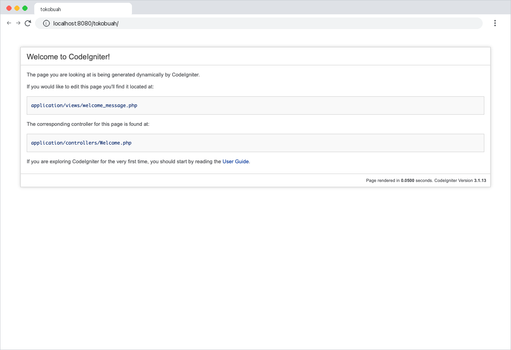

**Struktur direktori CodeIgniter**

| Folder / File | Fungsi |
|---|---|
| `application/` | Tempat semua kode aplikasi kita (controller, model, view, konfigurasi). |
| `system/` | Kode inti CodeIgniter. Jangan diubah; untuk upgrade cukup ganti folder ini. |
| `index.php` | *Front controller*, file pertama yang dijalankan untuk setiap permintaan. |
| `application/config/` | Konfigurasi: `config.php`, `database.php`, `autoload.php`, `routes.php`, `constants.php`. |
| `application/controllers/` | Kelas controller. |
| `application/models/` | Kelas model. |
| `application/views/` | File tampilan (HTML + PHP). |
| `application/core/` | Kelas inti buatan sendiri, misalnya `MY_Controller`. |
| `application/helpers/`, `libraries/` | Helper dan library buatan sendiri. |
| `application/language/` | Teks pesan untuk multibahasa. |
| `application/cache/`, `logs/` | Cache, session, dan log aplikasi. |

**Konfigurasi**

Di tutorial, `base_url` ditulis statis `'http://localhost/tokobuah/'`. Penulis membuatnya dinamis supaya proyek tetap berjalan walaupun nama folder atau port berbeda:

```php
// application/config/config.php
$config['base_url'] = (( ! empty($_SERVER['HTTPS']) && $_SERVER['HTTPS'] !== 'off') ? 'https' : 'http')
	.'://'.(isset($_SERVER['HTTP_HOST']) ? $_SERVER['HTTP_HOST'] : 'localhost')
	.rtrim(str_replace('\\', '/', dirname($_SERVER['SCRIPT_NAME'])), '/').'/';

$config['language']        = 'indonesian';                  // pesan validasi berbahasa Indonesia
$config['sess_save_path']  = APPPATH.'cache/sessions';      // lokasi file session
$config['csrf_protection'] = TRUE;                          // token CSRF di setiap form POST
```

Library dan helper yang sering dipakai dimuat otomatis lewat `autoload.php`, lalu koneksi database diatur di `database.php`:

```php
// application/config/autoload.php
$autoload['libraries'] = array('database', 'session');
$autoload['helper']    = array('url', 'form', 'text');

// application/config/database.php
'hostname' => '127.0.0.1',
'username' => 'root',
'password' => '',
'database' => 'tokobuah',
'char_set' => 'utf8mb4',
'dbcollat' => 'utf8mb4_general_ci',
```

Konstanta nama situs ditambahkan di `constants.php` agar bisa dipakai di semua view:

```php
defined('SITE_NAME') OR define('SITE_NAME', 'Tokobuah');
```

Database dibuat lewat phpMyAdmin. File `database/tokobuah.sql` berisi tabel `products` dan `users` beserta data contoh, cukup diimpor melalui tab **Import**.

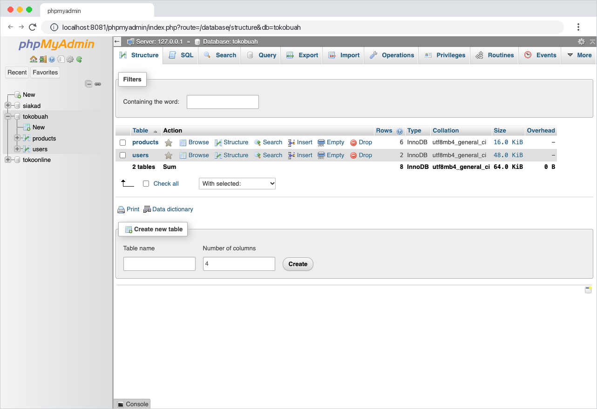

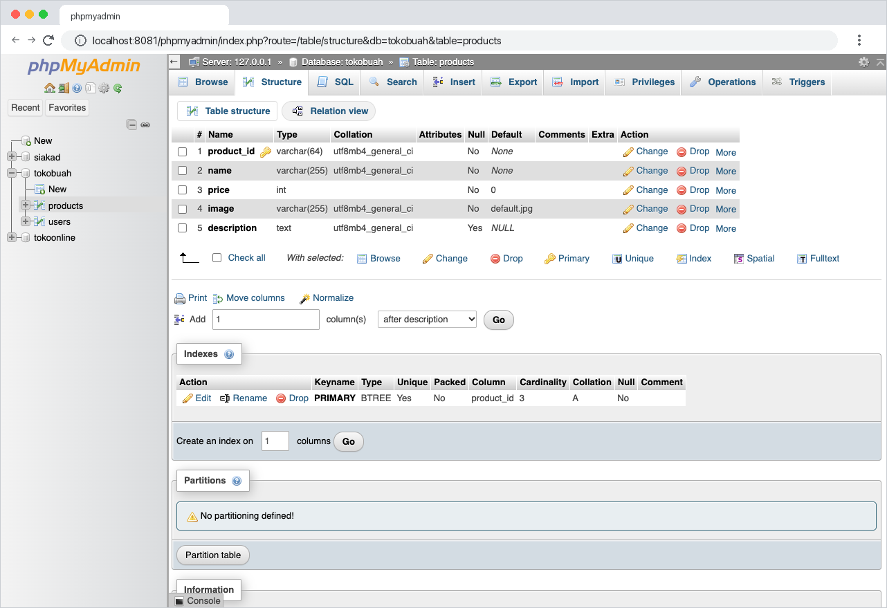

### 5.2 Fungsi Router dan Controller (PBKK 2-2)

**Router** menentukan controller dan method yang dijalankan berdasarkan URL. Pola bawaannya:

```
http://localhost/tokobuah/index.php/[controller]/[method]/[parameter]
```

Contoh: membuka `http://localhost/tokobuah/` menjalankan `Welcome::index()` karena `welcome` adalah `default_controller`. Untuk latihan, penulis membuat controller `Page`:

```php
// application/controllers/Page.php
class Page extends CI_Controller
{
	public function about()
	{
		$data['title'] = 'Tentang Kami';
		$this->load->view('page/about', $data);
	}

	public function hello($name = 'Pengunjung')
	{
		$data['title'] = 'Halo';
		$data['name'] = urldecode($name);
		$this->load->view('page/hello', $data);
	}
}
```

Route kustom ditambahkan di `application/config/routes.php` agar URL lebih pendek:

```php
$route['default_controller'] = 'welcome';
$route['about']   = 'page/about';     // /index.php/about   -> Page::about()
$route['contact'] = 'page/contact';   // /index.php/contact -> Page::contact()
$route['beranda'] = 'page/index';
$route['admin']   = 'admin/overview'; // /index.php/admin   -> controllers/admin/Overview.php
```

| URL | Controller::method | Keterangan |
|---|---|---|
| `/tokobuah/` | `Welcome::index()` | default controller |
| `/index.php/page/about` | `Page::about()` | pola standar |
| `/index.php/about` | `Page::about()` | lewat `$route['about']` |
| `/index.php/page/hello/Faizal` | `Page::hello('Faizal')` | segmen ke-3 jadi parameter |
| `/index.php/admin/products/edit/6540a1b2c3d01` | `Products::edit('6540a1b2c3d01')` | controller di subfolder `admin/` |

Halaman `about` sengaja menampilkan URL, segmen, dan route yang sedang dipakai agar alur router terlihat jelas:

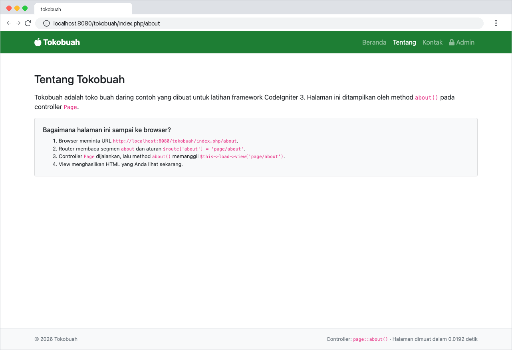

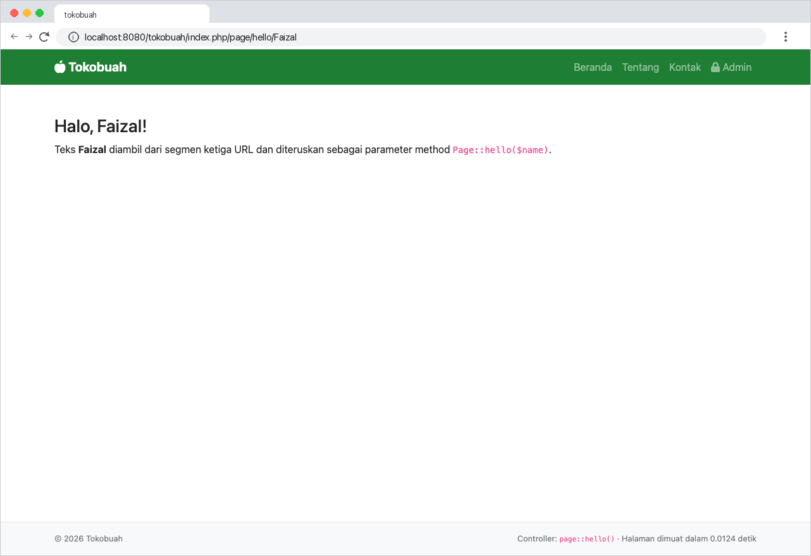

### 5.3 Menggunakan Bootstrap untuk View (PBKK 2-3)

Langkah-langkahnya:

1. Unduh template **SB Admin** (versi 5.1.1, Bootstrap 4) dari Start Bootstrap, lalu ekstrak.
2. Salin aset yang dibutuhkan ke proyek: `vendor/*` menjadi `tokobuah/assets/`, `css/sb-admin.min.css` ke `tokobuah/css/`, dan `js/sb-admin.min.js` ke `tokobuah/js/`. Hanya file `.min` dan font `.woff2` yang disalin agar ukuran proyek kecil.
3. Panggil aset dari view dengan `base_url()` agar alamatnya selalu benar:

```php
<link href="<?php echo base_url('assets/fontawesome-free/css/all.min.css') ?>" rel="stylesheet">
<link href="<?php echo base_url('css/sb-admin.min.css') ?>" rel="stylesheet">
<script src="<?php echo base_url('assets/jquery/jquery.min.js') ?>"></script>
```

Halaman beranda publik memakai komponen Bootstrap (navbar, card, grid) dan menampilkan data buah langsung dari database:

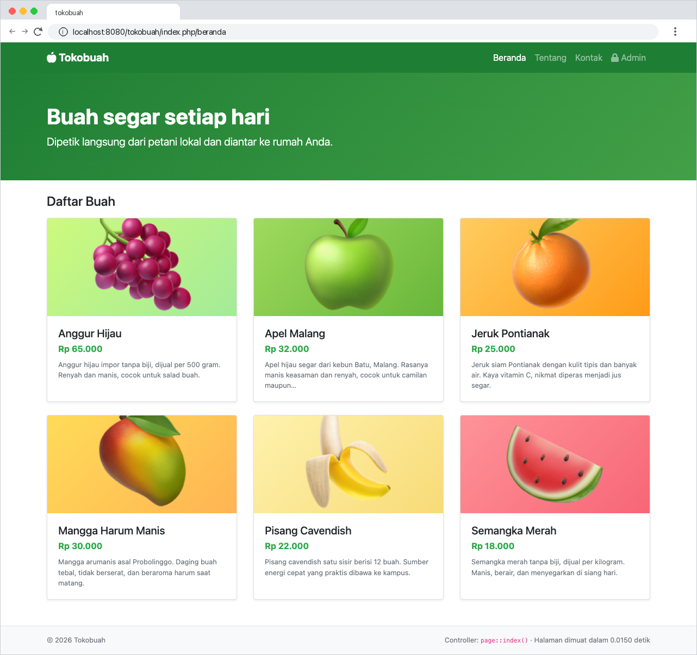

### 5.4 Menggunakan Template SB Admin (PBKK 2-4)

Satu file HTML template dipecah menjadi beberapa **partial view** di `application/views/admin/_partials/` supaya tidak ada kode yang ditulis berulang di setiap halaman:

| Partial | Isi |
|---|---|
| `head.php` | meta, judul halaman, CSS |
| `navbar.php` | navbar atas, kotak pencarian, menu user |
| `sidebar.php` | menu samping (aktif sesuai segmen URL) |
| `breadcrumb.php` | breadcrumb otomatis dari segmen URL + pesan sukses |
| `footer.php` | footer |
| `scrolltop.php`, `modal.php` | tombol ke atas, modal logout & konfirmasi hapus |
| `js.php` | semua file JavaScript |

Setiap halaman admin cukup memanggil partial tersebut:

```php
<!DOCTYPE html>
<html lang="id">
<head>
	<?php $this->load->view('admin/_partials/head.php') ?>
</head>
<body id="page-top">
	<?php $this->load->view('admin/_partials/navbar.php') ?>
	<div id="wrapper">
		<?php $this->load->view('admin/_partials/sidebar.php') ?>
		<div id="content-wrapper">
			<div class="container-fluid">
				<?php $this->load->view('admin/_partials/breadcrumb.php') ?>
				<!-- isi halaman -->
			</div>
			<?php $this->load->view('admin/_partials/footer.php') ?>
		</div>
	</div>
	<?php $this->load->view('admin/_partials/modal.php') ?>
	<?php $this->load->view('admin/_partials/js.php') ?>
</body>
</html>
```

Halaman **Overview** menampilkan kartu ringkasan dan grafik harga produk. Angkanya dihitung oleh model, bukan data contoh bawaan template:

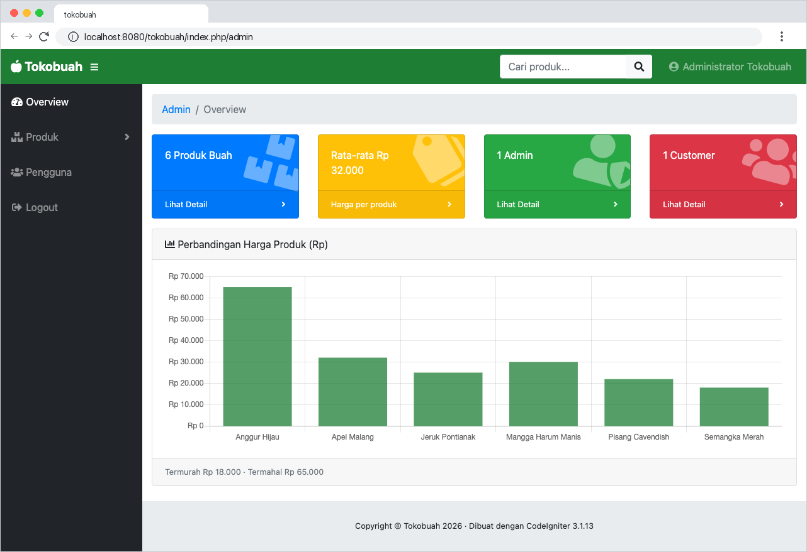

### 5.5 Mengenal Model dan CRUD (PBKK 2-5)

Tabel produk:

```sql
CREATE TABLE products (
  product_id  VARCHAR(64)  NOT NULL,
  name        VARCHAR(255) NOT NULL,
  price       INT          NOT NULL DEFAULT 0,
  image       VARCHAR(255) NOT NULL DEFAULT 'default.jpg',
  description TEXT,
  PRIMARY KEY (product_id)
);
```

**Model** `Product_model` berisi aturan validasi dan operasi database memakai *query builder*:

```php
class Product_model extends CI_Model
{
	private $_table = 'products';

	public function rules()
	{
		return [
			['field' => 'name',        'label' => 'Nama',      'rules' => 'required|max_length[255]'],
			['field' => 'price',       'label' => 'Harga',     'rules' => 'required|is_natural'],
			['field' => 'description', 'label' => 'Deskripsi', 'rules' => 'required'],
		];
	}

	public function getAll()
	{
		return $this->db->order_by('name', 'ASC')->get($this->_table)->result();
	}

	public function getById($id)
	{
		return $this->db->get_where($this->_table, ['product_id' => $id])->row();
	}

	public function delete($id)
	{
		$this->_deleteImage($id);
		return $this->db->delete($this->_table, ['product_id' => $id]);
	}
	// save() dan update() dibahas di subbab upload
}
```

**Controller** `admin/Products` menghubungkan form dengan model:

```php
public function add()
{
	$product = $this->product_model;
	$validation = $this->form_validation;
	$validation->set_rules($product->rules());

	if ($validation->run())
	{
		if ($product->save())
		{
			$this->session->set_flashdata('success', 'Produk "'.$product->name.'" berhasil disimpan.');
			redirect(site_url('admin/products'));
		}
		$data['upload_error'] = $product->upload_error;
	}
	$this->load->view('admin/product/new_form', isset($data) ? $data : []);
}
```

| Operasi | URL | Method |
|---|---|---|
| Read (daftar) | `/admin/products` | `index()` |
| Create | `/admin/products/add` | `add()` |
| Update | `/admin/products/edit/{id}` | `edit($id)` |
| Delete | `/admin/products/delete/{id}` (POST) | `delete($id)` |

Perbedaan dengan tutorial: tombol hapus tidak lagi memakai link GET, melainkan form POST di dalam modal konfirmasi. Dengan begitu aksi hapus ikut terlindungi token CSRF dan tidak bisa dipicu hanya dengan membuka sebuah link.

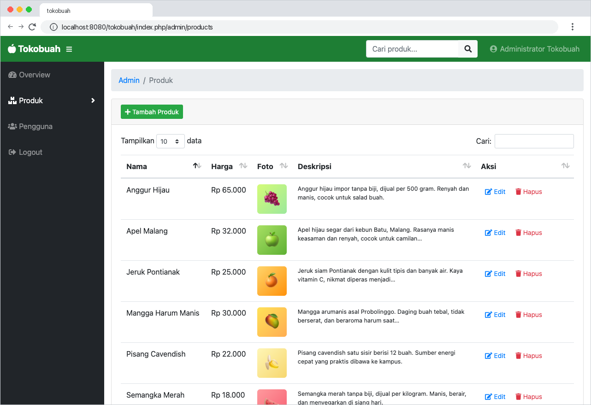

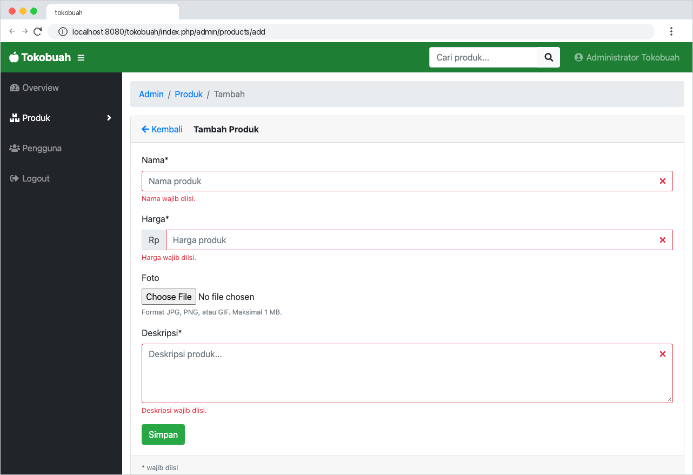

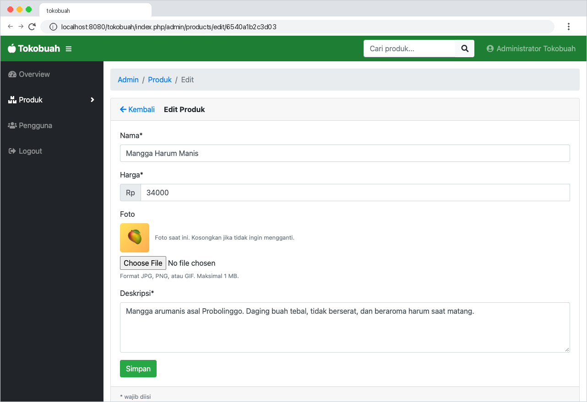


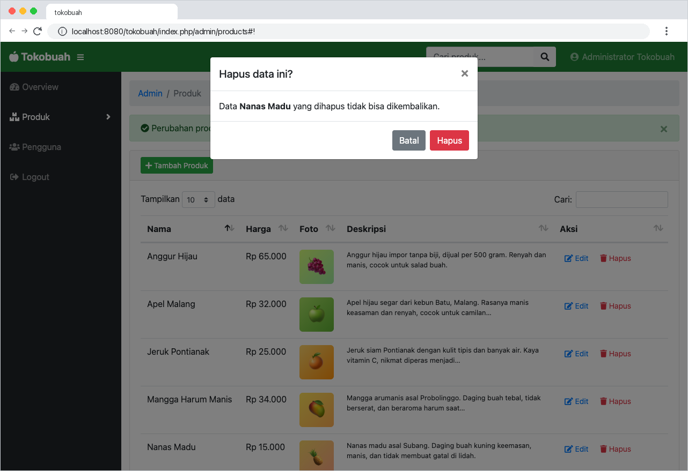

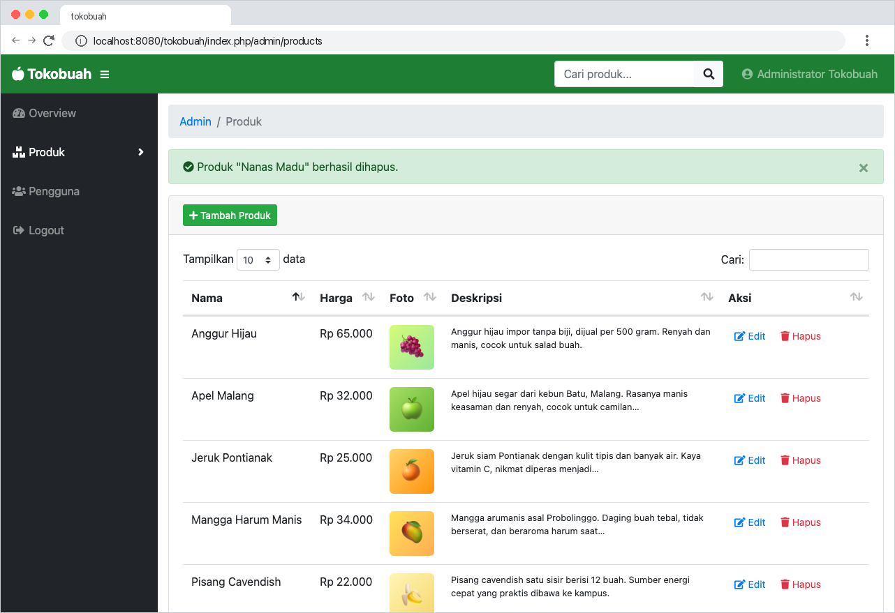

### 5.6 Penanganan File Upload (PBKK 2-6)

Form tambah/edit memakai `form_open_multipart()` agar bisa mengirim file. Upload ditangani library **Upload** di dalam model:

```php
private function _uploadImage()
{
	$config['upload_path']      = './upload/product/';
	$config['allowed_types']    = 'gif|jpg|jpeg|png';
	$config['file_name']        = $this->product_id;   // nama file = id produk
	$config['overwrite']        = TRUE;
	$config['max_size']         = 1024;                // 1 MB
	$config['file_ext_tolower'] = TRUE;

	$this->load->library('upload', $config);

	if ($this->upload->do_upload('image'))
	{
		return $this->upload->data('file_name');
	}

	$this->upload_error = $this->upload->display_errors('', '');
	return FALSE;
}

private function _deleteImage($id)
{
	$product = $this->getById($id);
	if ($product && $product->image !== 'default.jpg')
	{
		$filename = pathinfo($product->image, PATHINFO_FILENAME);
		array_map('unlink', glob(FCPATH."upload/product/$filename.*"));
	}
}
```

Beberapa perbaikan dibanding tutorial:

- Jika upload gagal (tipe file salah atau terlalu besar), pesan error ditampilkan di form, bukan diam-diam diganti `default.jpg`.
- Saat foto diganti dengan ekstensi berbeda (misalnya `.png` menjadi `.jpg`), file lama ikut dihapus.
- Produk tanpa foto memakai gambar `default.jpg`.

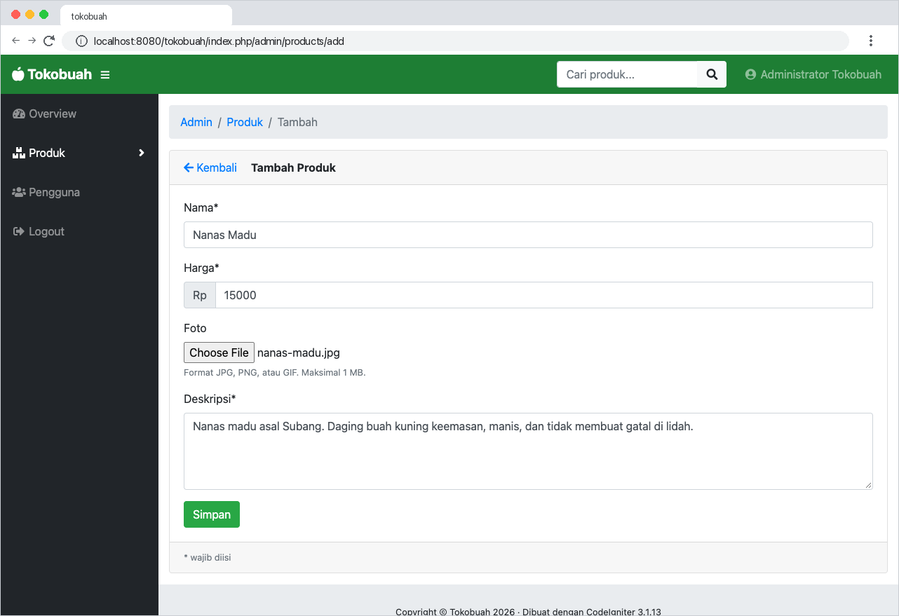


### 5.7 Mengatur Akses User (PBKK 2-7)

Tabel `users` menyimpan akun beserta role (`admin` atau `customer`). Password disimpan dengan `password_hash()`, bukan teks biasa.

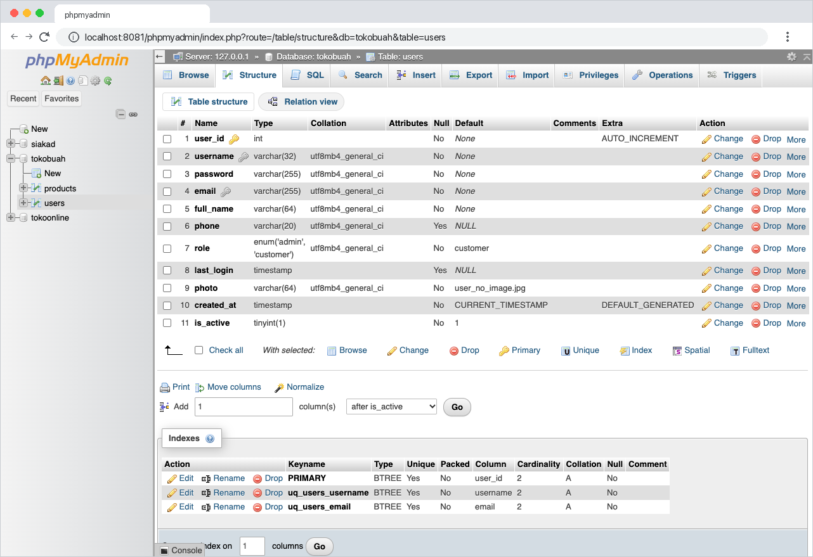

Login diperiksa di `User_model::doLogin()`. Pengguna boleh memakai email **atau** username, dan hanya role `admin` yang boleh masuk:

```php
public function doLogin()
{
	$post = $this->input->post();

	$user = $this->db->group_start()
			->where('email', $post['email'])
			->or_where('username', $post['email'])
		->group_end()
		->get($this->_table)->row();

	if ( ! $user) return 'not_found';
	if ( ! password_verify($post['password'], $user->password)) return 'wrong_password';
	if ($user->role !== 'admin') return 'not_admin';
	if ( ! $user->is_active) return 'inactive';

	$this->session->sess_regenerate(TRUE);   // cegah session fixation
	$this->session->set_userdata('user_logged', [
		'user_id' => $user->user_id, 'username' => $user->username,
		'full_name' => $user->full_name, 'email' => $user->email, 'role' => $user->role,
	]);
	$this->_updateLastLogin($user->user_id);
	return 'ok';
}
```

Di tutorial, pengecekan login ditulis ulang di constructor setiap controller. Penulis memindahkannya ke kelas dasar di `application/core/MY_Controller.php`, sehingga controller admin cukup `extends Admin_Controller`:

```php
class Admin_Controller extends MY_Controller
{
	public function __construct()
	{
		parent::__construct();
		$this->load->model('user_model');
		if ($this->user_model->isNotLogin())
		{
			$this->session->set_flashdata('error', 'Silakan login terlebih dahulu.');
			redirect(site_url('admin/login'));
		}
	}
}

class Products extends Admin_Controller { /* ... */ }
```

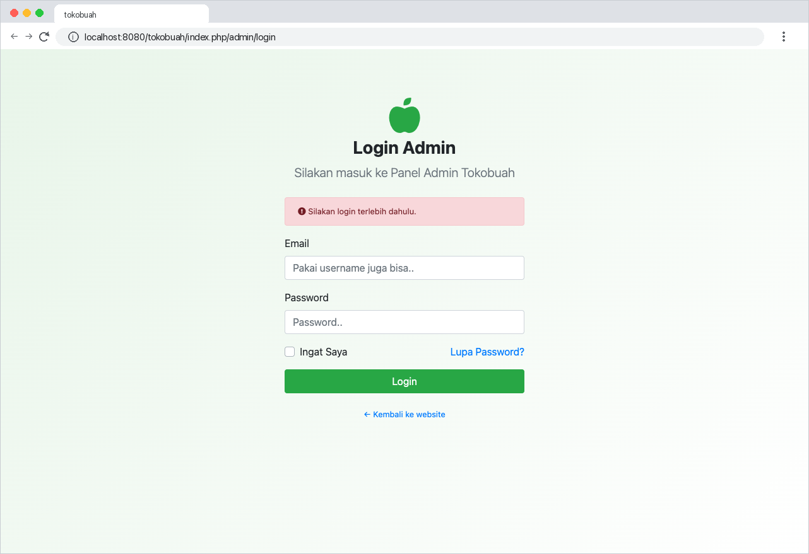

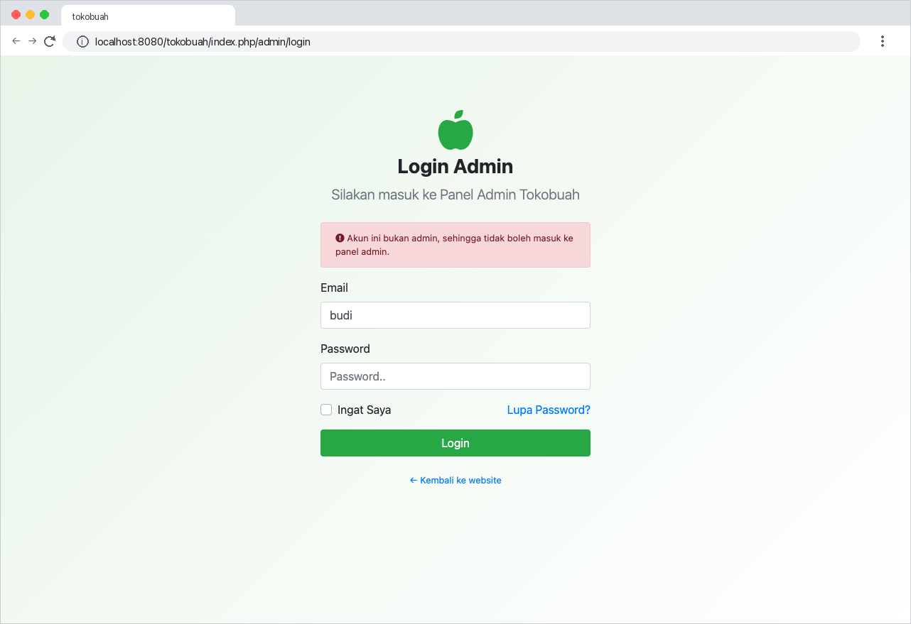

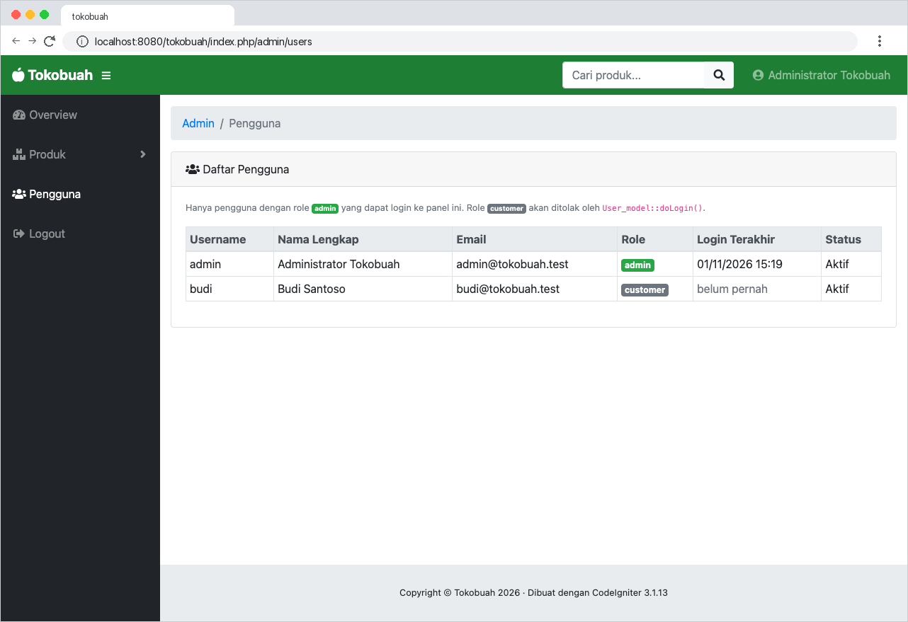

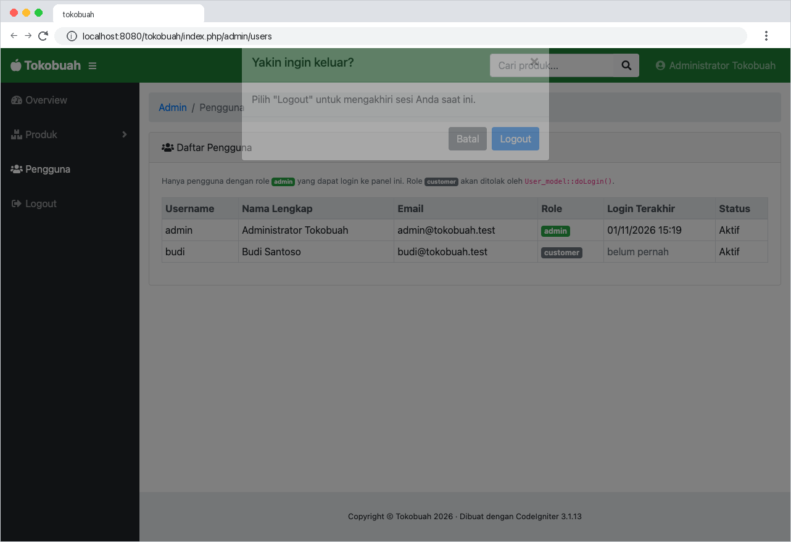

---

## 6. Latihan 2.1: Sistem Informasi Akademik (SIAKAD)

### 6.1 Gambaran Aplikasi

SIAKAD adalah sistem informasi akademik kampus dengan tiga jenis pengguna:

| Role | Login dengan | Hak akses |
|---|---|---|
| **Admin** | username | Mengelola mahasiswa, dosen, mata kuliah, serta membuka kelas dan jadwal |
| **Dosen** | NIP | Melihat jadwal mengajar dan mengisi nilai kelas yang diampu |
| **Mahasiswa** | NRP | Mengisi KRS semester aktif, melihat KHS, IP semester, dan IPK |

Template yang dipakai adalah **SB Admin 2**. Tahun ajaran aktif (`2026/2027 Gasal`) dan batas SKS (`24`) disimpan sebagai konstanta di `constants.php`.

### 6.2 Rancangan Database

| Tabel | Isi | Relasi |
|---|---|---|
| `users` | akun login semua role | – |
| `prodi` | program studi | – |
| `dosen` | data dosen | `user_id` → users, `prodi_id` → prodi |
| `mahasiswa` | data mahasiswa | `user_id` → users, `prodi_id` → prodi, `dosen_wali_id` → dosen |
| `matakuliah` | kode, nama, SKS, semester | – |
| `kelas` | kelas yang dibuka per tahun ajaran (dosen, hari, jam, ruang, kuota) | `matakuliah_id` → matakuliah, `dosen_id` → dosen |
| `krs` | kelas yang diambil mahasiswa + nilai | `mahasiswa_id` → mahasiswa, `kelas_id` → kelas |

Relasi memakai `FOREIGN KEY`. Contohnya, menghapus akun mahasiswa otomatis menghapus data mahasiswa dan KRS-nya (`ON DELETE CASCADE`).

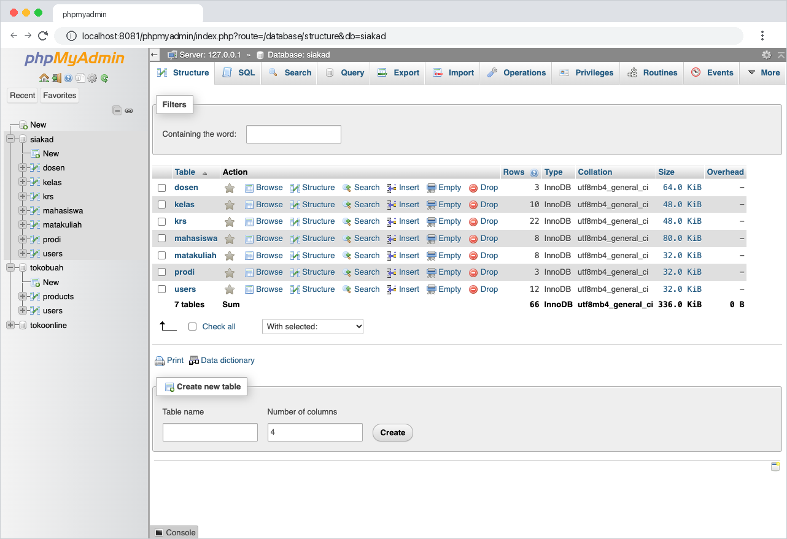

### 6.3 Penerapan MVC

| Bagian | File |
|---|---|
| Core | `MY_Controller` (render template), `Auth_Controller` (wajib login + cek role), `MY_Model` (CRUD umum) |
| Controller | `Auth`, `Dashboard`, `Profil`, `admin/Mahasiswa`, `admin/Dosen`, `admin/Matakuliah`, `admin/Kelas`, `dosen/Nilai`, `mahasiswa/Krs`, `mahasiswa/Khs` |
| Model | `User_model`, `Prodi_model`, `Dosen_model`, `Mahasiswa_model`, `Matakuliah_model`, `Kelas_model`, `Krs_model` |
| Helper | `akademik_helper` (konversi nilai, bobot, format jadwal), `bootstrap_form_helper` (input + pesan validasi) |
| View | `templates/header.php` dan `footer.php` (layout SB Admin 2), lalu satu folder view per modul |

Hak akses cukup diatur dengan satu properti di setiap controller:

```php
class Auth_Controller extends MY_Controller
{
	protected $roles = [];   // kosong = semua role yang sudah login

	public function __construct()
	{
		parent::__construct();
		if ( ! $this->user)
		{
			$this->flash('warning', 'Sesi berakhir atau Anda belum login. Silakan login terlebih dahulu.');
			redirect('login');
		}
		if ($this->roles && ! in_array($this->user['role'], $this->roles, TRUE))
		{
			$this->output->set_status_header(403);
			$this->render('errors/akses/403', ['title' => 'Akses Ditolak', 'roles' => $this->roles]);
			$this->output->_display();
			exit;
		}
	}
}

class Mahasiswa extends Auth_Controller { protected $roles = ['admin']; /* ... */ }
class Krs extends Auth_Controller       { protected $roles = ['mahasiswa']; /* ... */ }
```

`MY_Model` berisi fungsi CRUD umum (`get_all`, `get`, `insert`, `update`, `delete`, `count`, `dropdown`), sehingga model lain cukup mengisi nama tabel:

```php
class Matakuliah_model extends MY_Model
{
	protected $table = 'matakuliah';
	protected $order_by = 'semester, kode';
}
```

### 6.4 Login dan Dashboard Admin

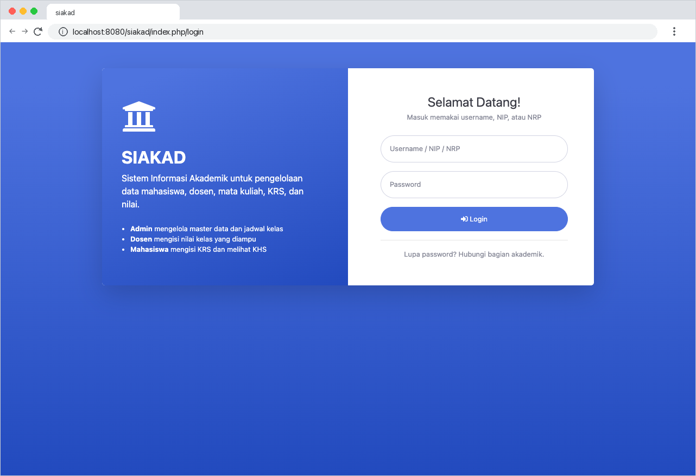

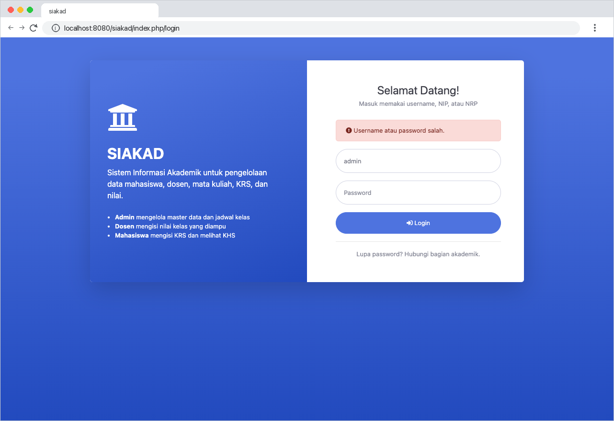

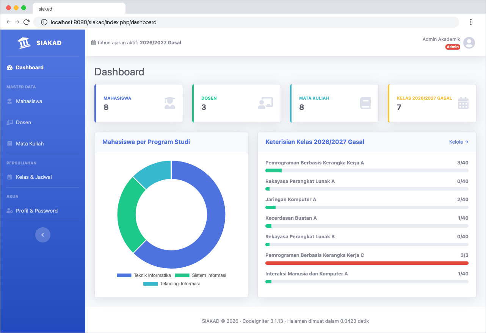

### 6.5 Master Data (Admin)

Saat admin menambah mahasiswa, model membuat akun login dan data mahasiswa sekaligus di dalam satu **transaksi database**. NRP dipakai sebagai username dan password awal.

```php
public function create($data)
{
	$this->db->trans_start();
	$data['user_id'] = $this->user_model->create($data['nrp'], $data['nama'], 'mahasiswa', $data['nrp']);
	$id = $this->insert($data);
	$this->db->trans_complete();
	return $this->db->trans_status() ? $id : FALSE;
}
```

Aturan `is_unique` hanya dipasang jika NRP diubah, sehingga mengedit mahasiswa tanpa mengganti NRP tetap lolos validasi:

```php
$unik = ( ! $mhs || $this->input->post('nrp') !== $mhs->nrp) ? '|is_unique[mahasiswa.nrp]|is_unique[users.username]' : '';
$this->form_validation->set_rules('nrp', 'NRP', 'required|trim|exact_length[10]|numeric'.$unik);
```

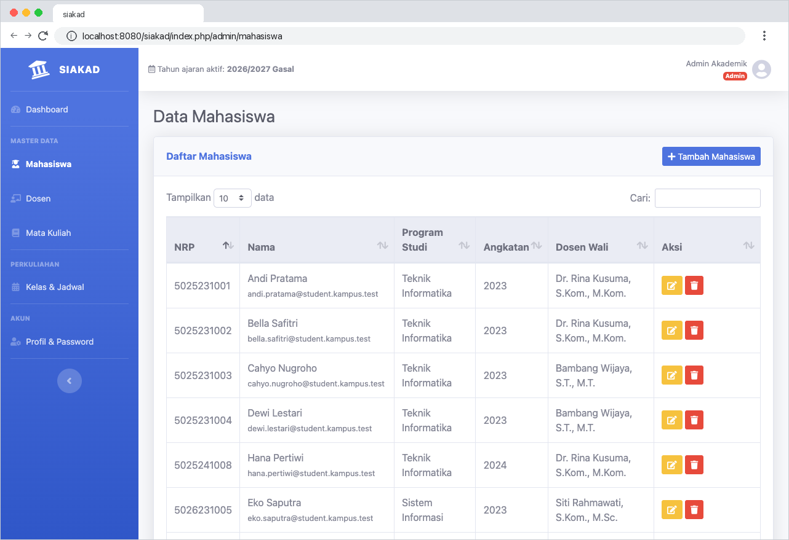

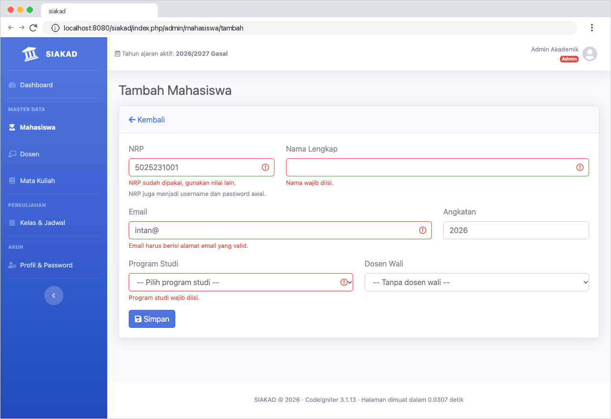

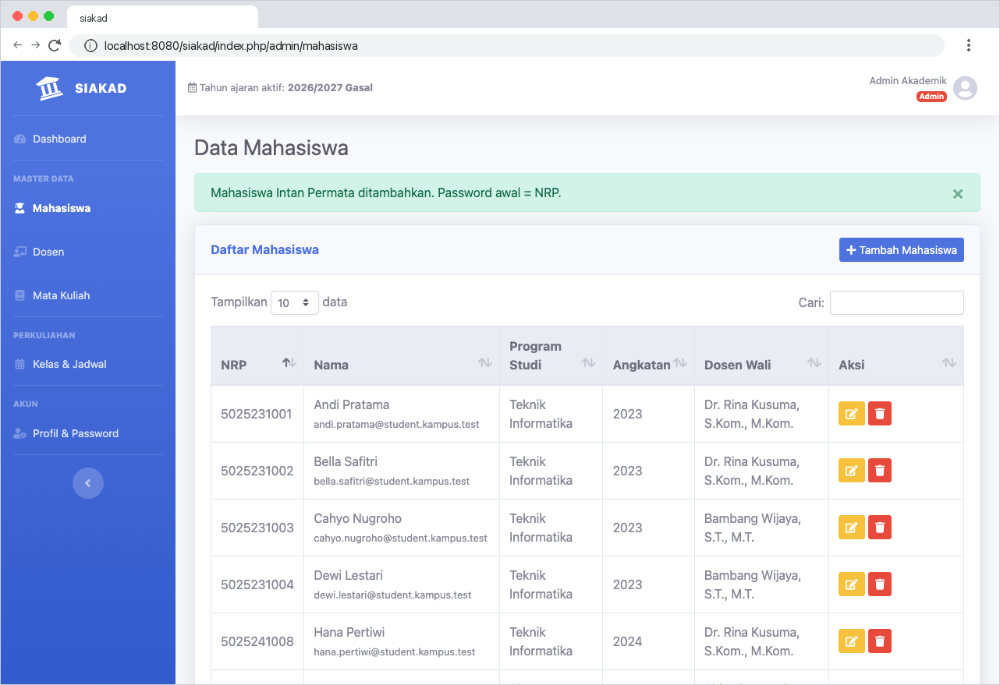

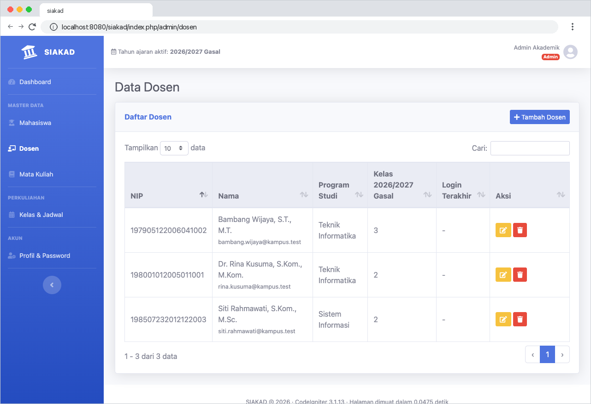

Data yang masih dipakai tidak boleh dihapus. Dosen yang masih mengampu kelas, atau mata kuliah yang sudah dibuka kelasnya, ditolak saat dihapus:

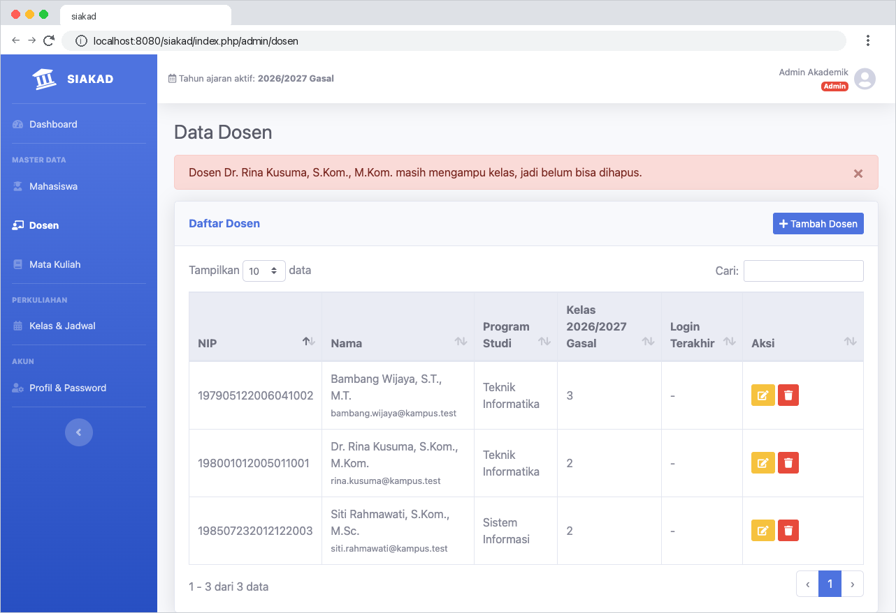

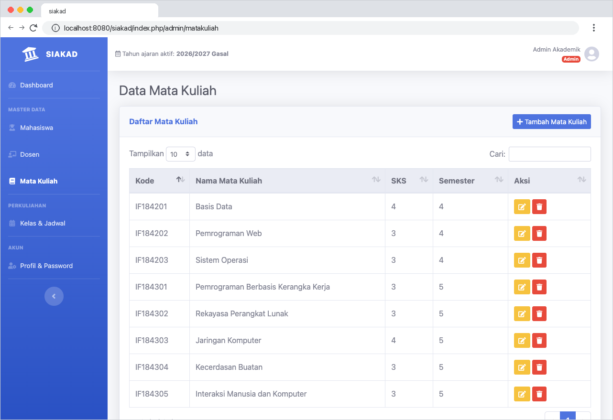

### 6.6 Kelas dan Jadwal

Satu mata kuliah bisa dibuka beberapa kelas (A, B, C) per tahun ajaran. Sebelum menyimpan, sistem memeriksa bentrok: kelas lain di hari yang sama dengan jam yang beririsan **dan** memakai ruang atau dosen yang sama.

```php
public function bentrok($data, $kecuali_id = NULL)
{
	$this->db->from($this->table)
		->where('tahun_ajaran', $data['tahun_ajaran'])
		->where('hari', $data['hari'])
		->where('jam_mulai <', $data['jam_selesai'])
		->where('jam_selesai >', $data['jam_mulai'])
		->group_start()
			->where('ruang', $data['ruang'])
			->or_where('dosen_id', $data['dosen_id'])
		->group_end();
	if ($kecuali_id) $this->db->where('id !=', $kecuali_id);
	return $this->db->get()->row();
}
```

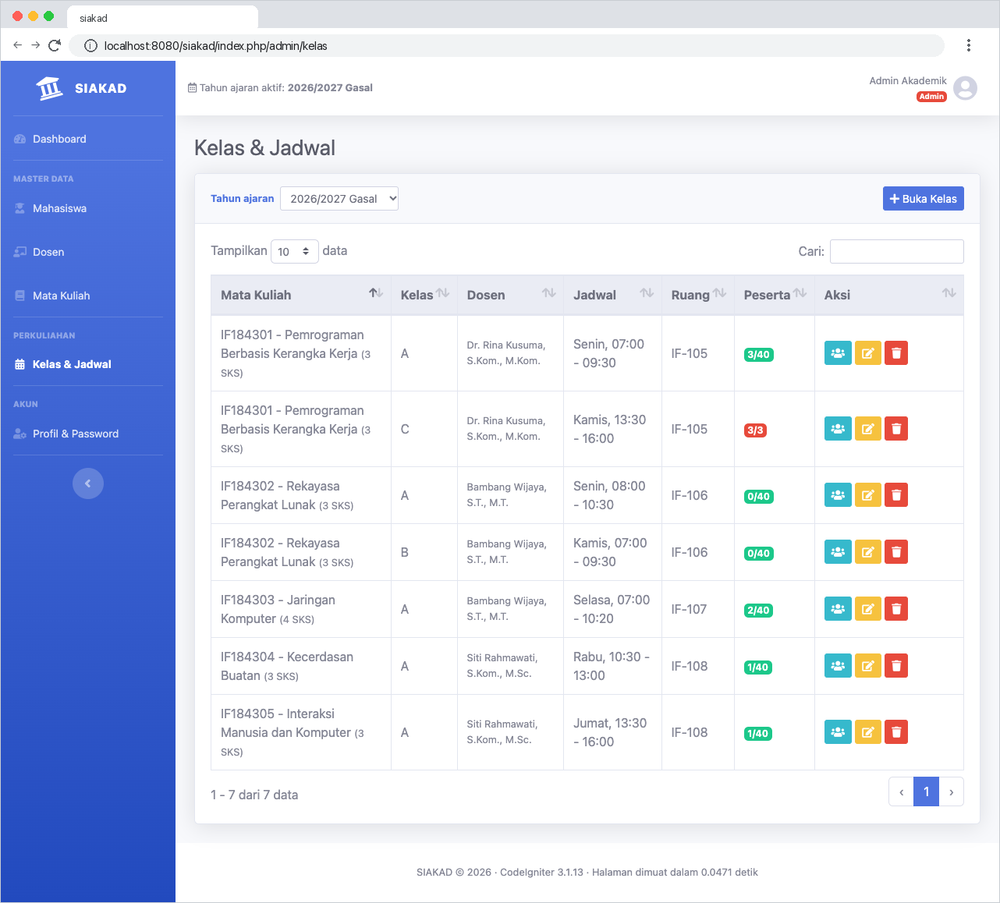

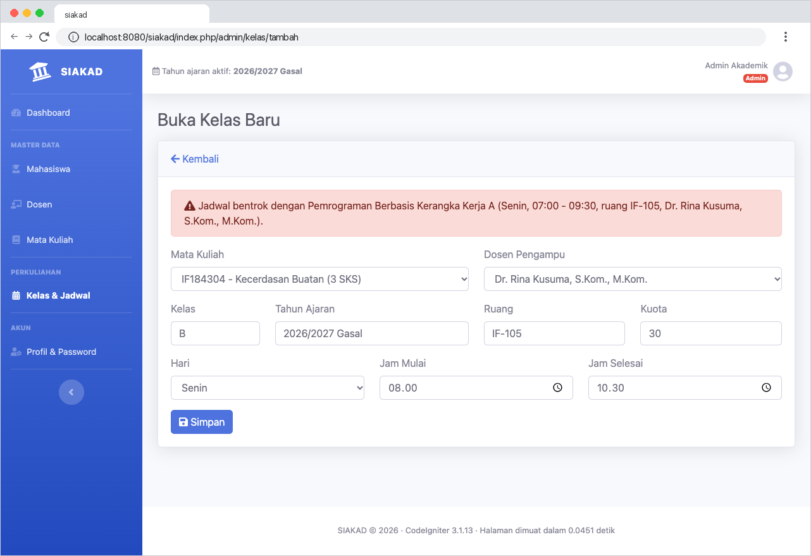

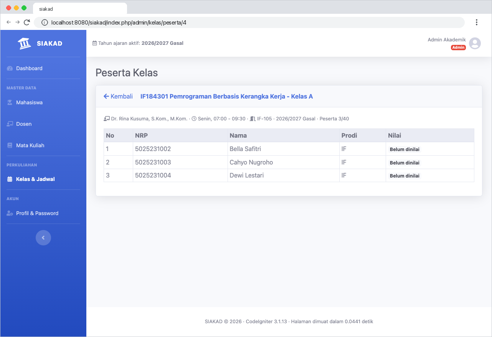

### 6.7 Pengisian KRS (Mahasiswa)

Seluruh aturan KRS berada di `Krs_model::ambil()`. Fungsi ini mengembalikan `TRUE` bila berhasil, atau pesan kesalahan bila melanggar aturan:

```php
public function ambil($mahasiswa_id, $kelas_id)
{
	$kelas = $this->kelas_model->get_lengkap($kelas_id);
	if ( ! $kelas || $kelas->tahun_ajaran !== TA_AKTIF) return 'Kelas tidak tersedia pada tahun ajaran ini.';

	$diambil = $this->get_by_mahasiswa($mahasiswa_id, TA_AKTIF);
	foreach ($diambil as $krs)
	{
		if ($krs->kelas_id == $kelas_id) return 'Kelas ini sudah ada di KRS Anda.';
		if ($krs->kode === $kelas->kode) return 'Mata kuliah '.$kelas->matakuliah.' sudah diambil di kelas '.$krs->nama_kelas.'.';
		if ($krs->hari === $kelas->hari && $krs->jam_mulai < $kelas->jam_selesai && $krs->jam_selesai > $kelas->jam_mulai)
		{
			return 'Jadwal bentrok dengan '.$krs->matakuliah.' ('.jadwal($krs).').';
		}
	}

	if ($kelas->peserta >= $kelas->kuota) return 'Kuota kelas '.$kelas->matakuliah.' '.$kelas->nama_kelas.' sudah penuh.';

	$sks = array_sum(array_column($diambil, 'sks')) + $kelas->sks;
	if ($sks > MAX_SKS) return 'Total SKS akan menjadi '.$sks.', melebihi batas '.MAX_SKS.' SKS.';

	$this->insert(['mahasiswa_id' => $mahasiswa_id, 'kelas_id' => $kelas_id]);
	return TRUE;
}
```

Kelas yang sudah dinilai atau milik mahasiswa lain tidak bisa dibatalkan, karena query pembatalan selalu menyertakan `mahasiswa_id` milik user yang login.

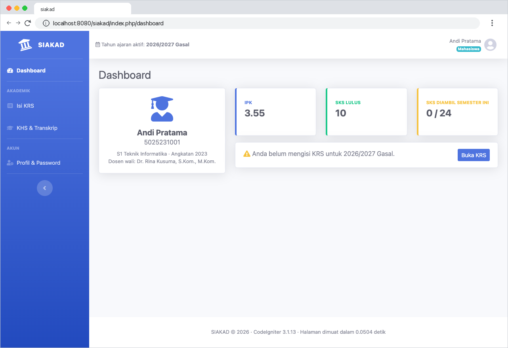

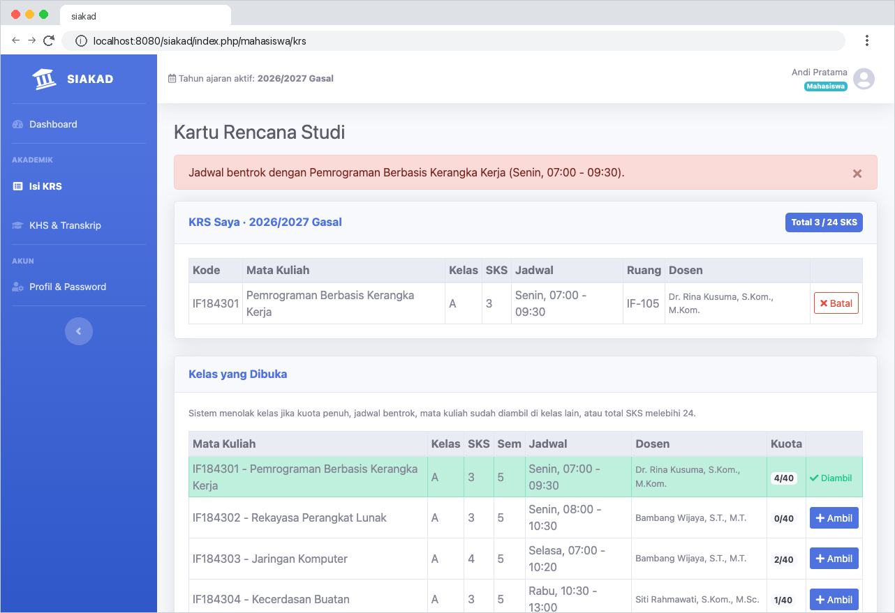

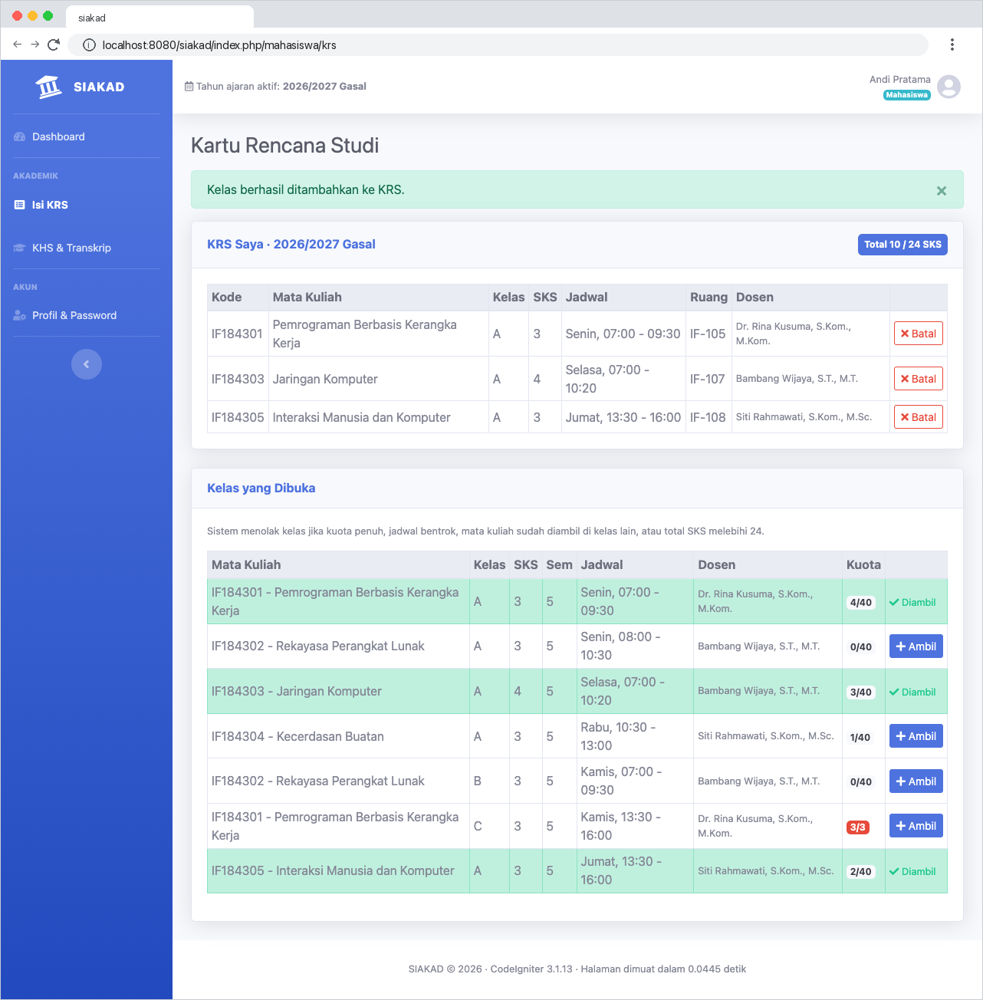

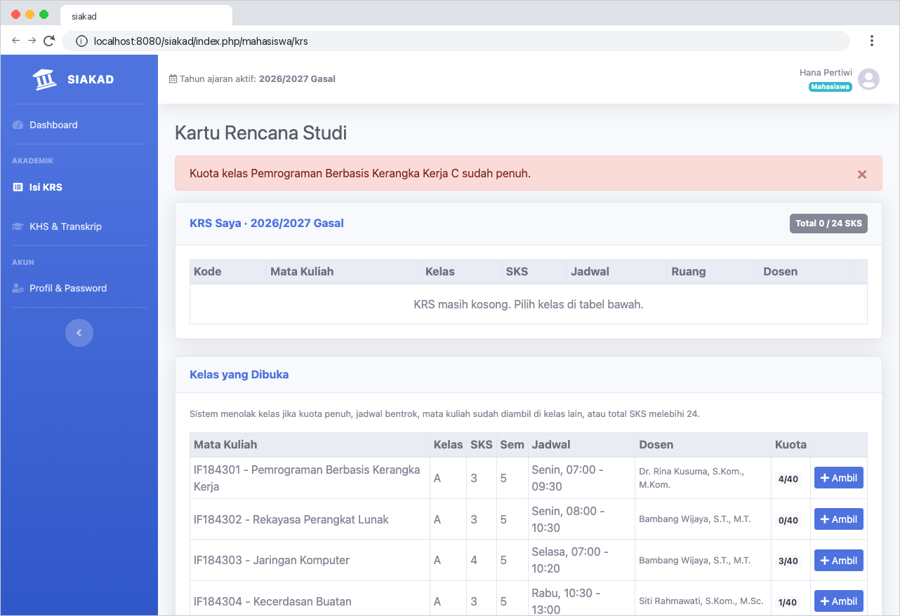

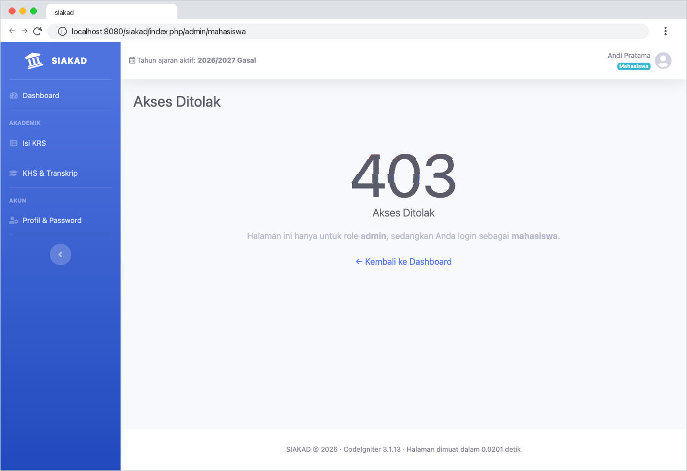

### 6.8 Input Nilai (Dosen) dan KHS

Dosen hanya bisa membuka kelas yang ia ampu. Nilai angka dikonversi ke huruf oleh helper:

```php
function nilai_huruf($angka)
{
	if ($angka === NULL || $angka === '') return NULL;
	$angka = (float) $angka;
	if ($angka >= 86) return 'A';
	if ($angka >= 76) return 'AB';
	if ($angka >= 66) return 'B';
	if ($angka >= 61) return 'BC';
	if ($angka >= 56) return 'C';
	if ($angka >= 41) return 'D';
	return 'E';
}
```

Di halaman input nilai, JavaScript menampilkan pratinjau nilai huruf saat dosen mengetik (aturannya sama dengan helper PHP). Nilai baru benar-benar tersimpan setelah tombol **Simpan Nilai** ditekan.

IP semester dan IPK dihitung di `Krs_model::khs()` dengan rumus `Σ(bobot × SKS) / Σ SKS`, hanya untuk mata kuliah yang sudah dinilai.

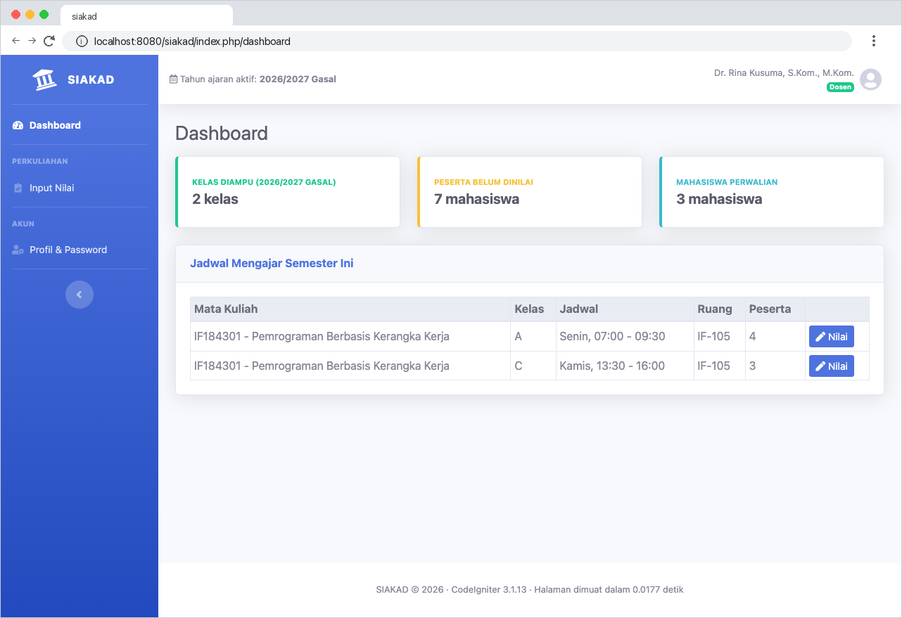

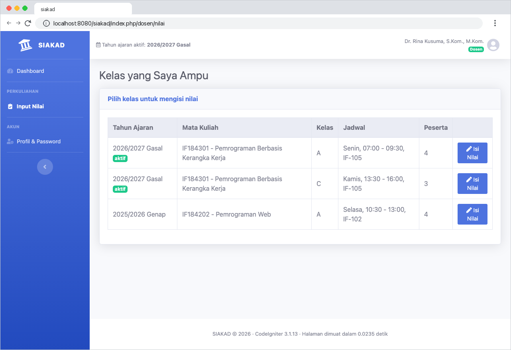

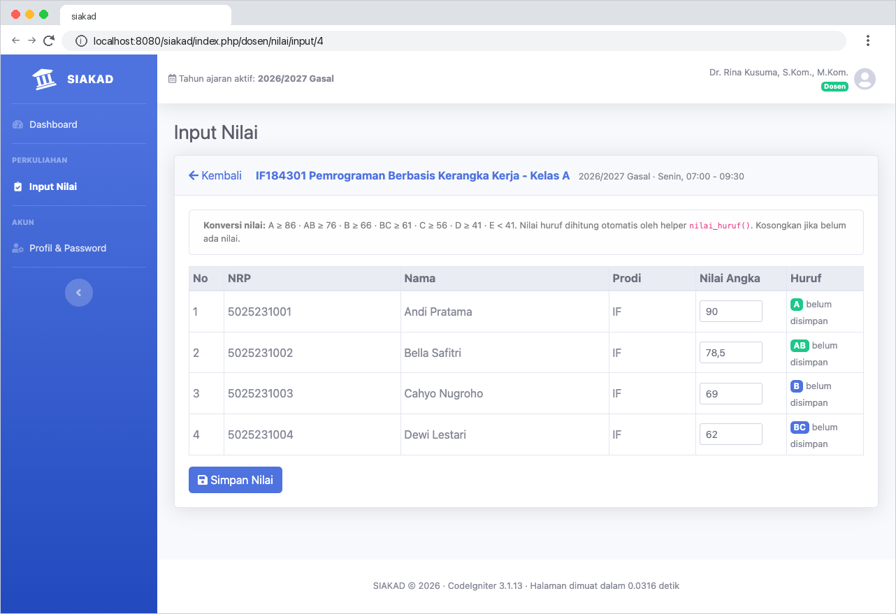

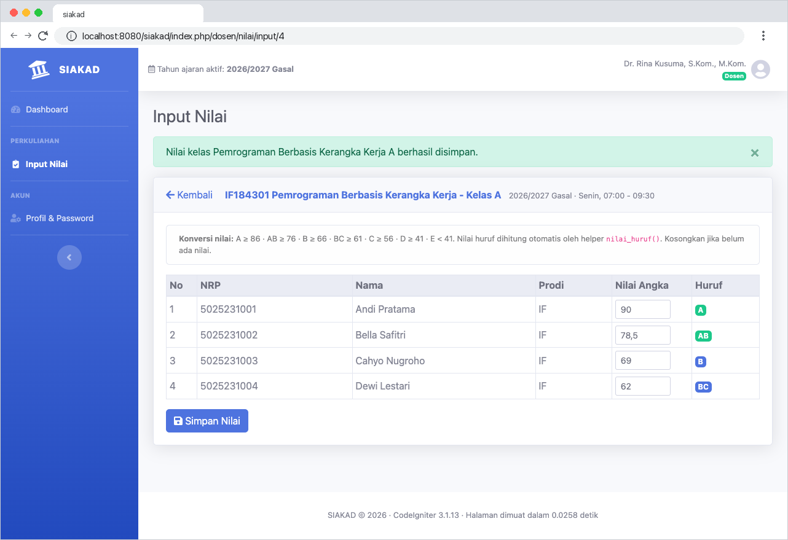

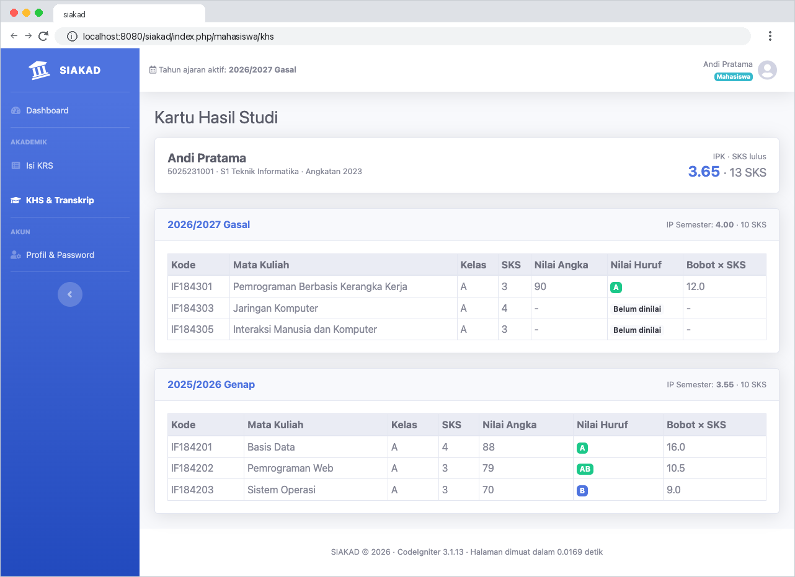

---

## 7. Latihan 2.2: Toko Online KampusMart

### 7.1 Gambaran Aplikasi

**KampusMart** adalah toko online perlengkapan kuliah (alat tulis, buku, tas, elektronik). Alur belanjanya:

```
Lihat katalog → detail produk → tambah ke keranjang → checkout (wajib login)
→ pesanan "Menunggu Pembayaran" → admin ubah status: Diproses → Dikirim → Selesai
```

| Modul | Fungsi |
|---|---|
| Katalog | Beranda, daftar produk per kategori, pencarian, pengurutan, pagination, detail produk |
| Akun | Daftar, masuk, keluar; setelah login pengguna dikembalikan ke halaman tujuan (misalnya checkout) |
| Keranjang | Tambah, ubah jumlah, hapus; jumlah otomatis dibatasi stok |
| Checkout | Alamat pengiriman, metode bayar transfer atau COD, ongkir flat Rp10.000 |
| Pesanan saya | Riwayat dan detail pesanan, pembatalan selama status masih "Menunggu Pembayaran" |
| Panel admin | Dashboard, produk (CRUD + upload gambar), kategori, pesanan (ubah status), pelanggan |

### 7.2 Rancangan Database

| Tabel | Isi |
|---|---|
| `users` | pelanggan dan admin (`role`) |
| `kategori` | nama, slug, ikon |
| `produk` | kategori, nama, slug, harga, stok, gambar, status aktif |
| `pesanan` | kode, pelanggan, alamat, metode bayar, subtotal, ongkir, total, status |
| `pesanan_detail` | produk yang dibeli; nama dan harga **disalin** saat checkout |

Nama dan harga produk disalin ke `pesanan_detail` supaya riwayat pesanan tidak ikut berubah ketika admin mengganti harga produk di kemudian hari.

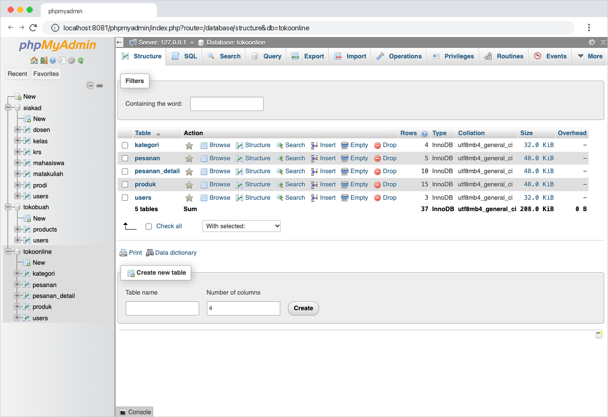

### 7.3 URL Ramah Pengguna

```php
$route['produk']                 = 'katalog/index';
$route['produk/(:num)']          = 'katalog/index/semua/$1';   // halaman ke-n
$route['kategori/(:any)/(:num)'] = 'katalog/index/$1/$2';
$route['kategori/(:any)']        = 'katalog/index/$1';
$route['p/(:any)']               = 'katalog/detail/$1';         // detail produk via slug
$route['keranjang']              = 'cart/index';
$route['masuk']                  = 'akun/login';
$route['daftar']                 = 'akun/register';
$route['admin']                  = 'admin/dashboard';
```

Contoh: `/p/tas-ransel-laptop` menampilkan detail produk berdasarkan *slug*, dan `/kategori/elektronik` menampilkan produk kategori Elektronik.

### 7.4 Katalog dan Pencarian

Daftar produk memakai library **Pagination** CodeIgniter dengan markup Bootstrap 5. Pilihan `reuse_query_string` membuat kata kunci pencarian dan urutan tetap terbawa saat pindah halaman.

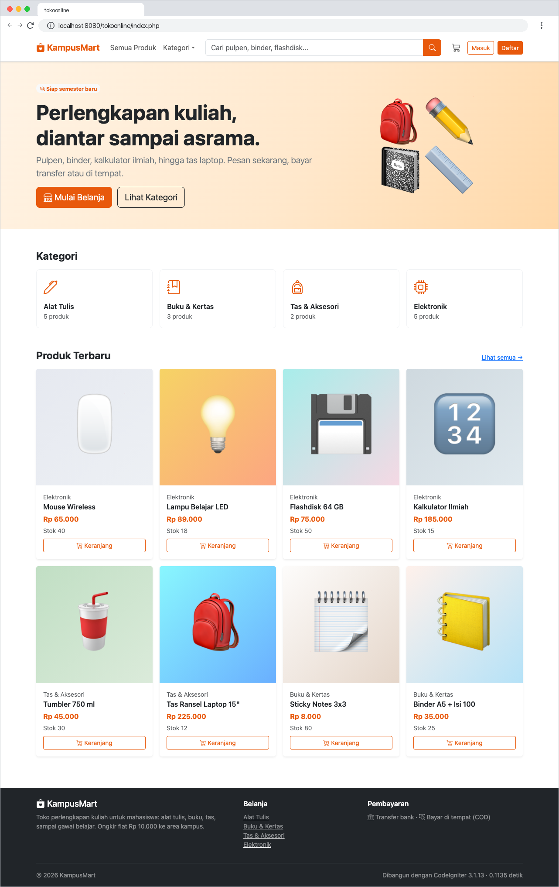

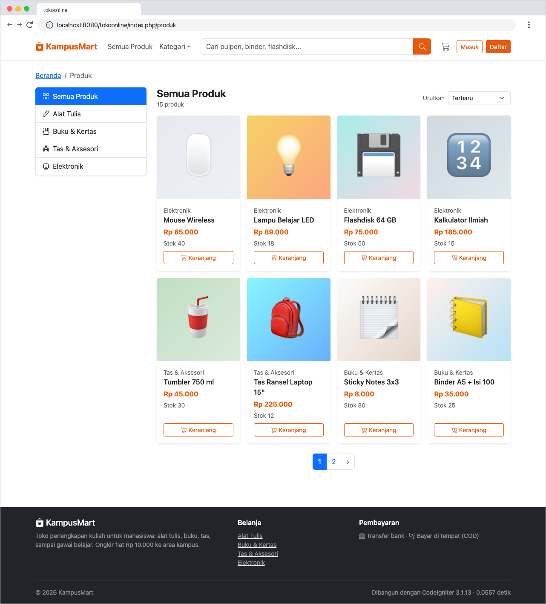

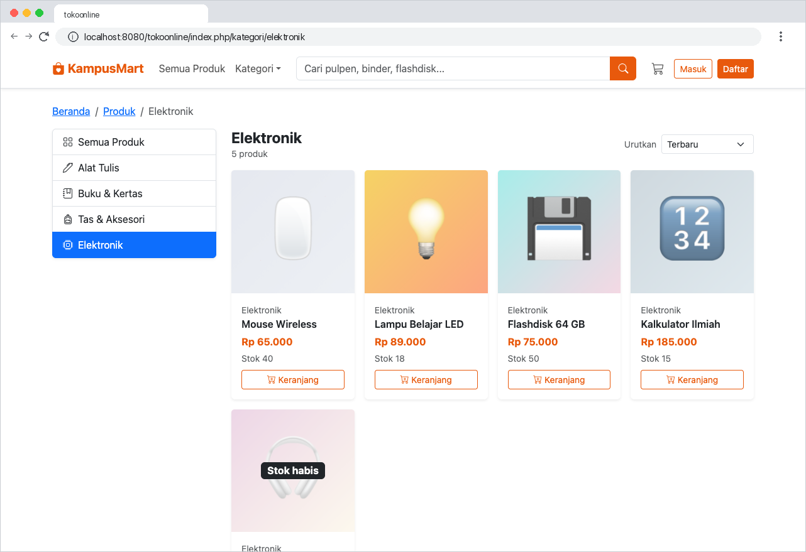

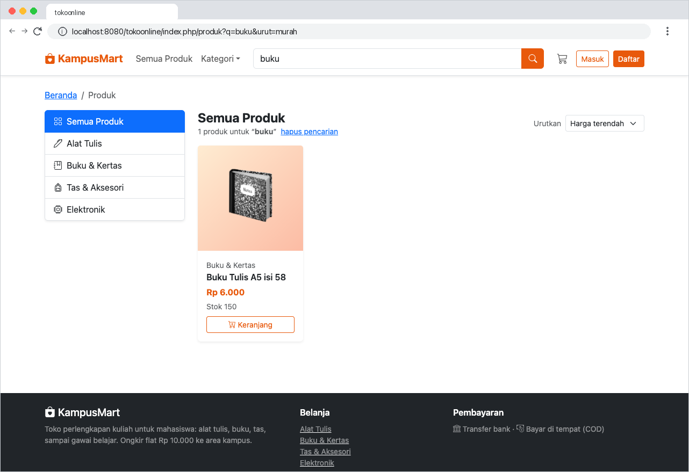

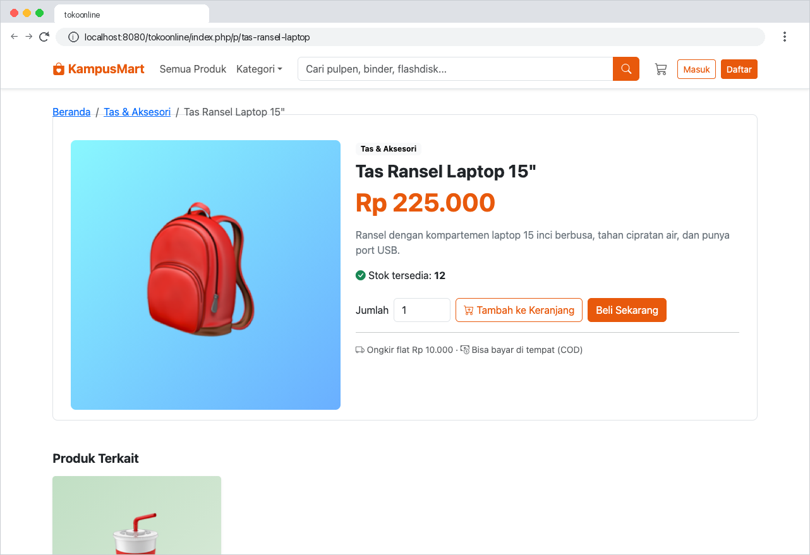

### 7.5 Keranjang (Library Buatan Sendiri)

Keranjang dibuat sebagai library sendiri di `application/libraries/Keranjang.php` dan dimuat lewat `autoload`. Session hanya menyimpan `[produk_id => qty]`; nama, harga, dan stok selalu dibaca ulang dari database.

```php
public function items()
{
	$isi = $this->raw();
	if ( ! $isi) return [];

	$produk = $this->CI->db->where_in('id', array_keys($isi))->where('aktif', 1)->get('produk')->result();
	$items = [];
	$bersih = [];
	foreach ($produk as $p)
	{
		$qty = min($isi[$p->id], $p->stok);   // tidak boleh melebihi stok
		if ($qty <= 0) continue;
		$p->qty = $qty;
		$p->subtotal = $qty * $p->harga;
		$items[] = $p;
		$bersih[$p->id] = $qty;
	}
	if ($bersih !== $isi) $this->simpan($bersih);
	return $items;
}
```

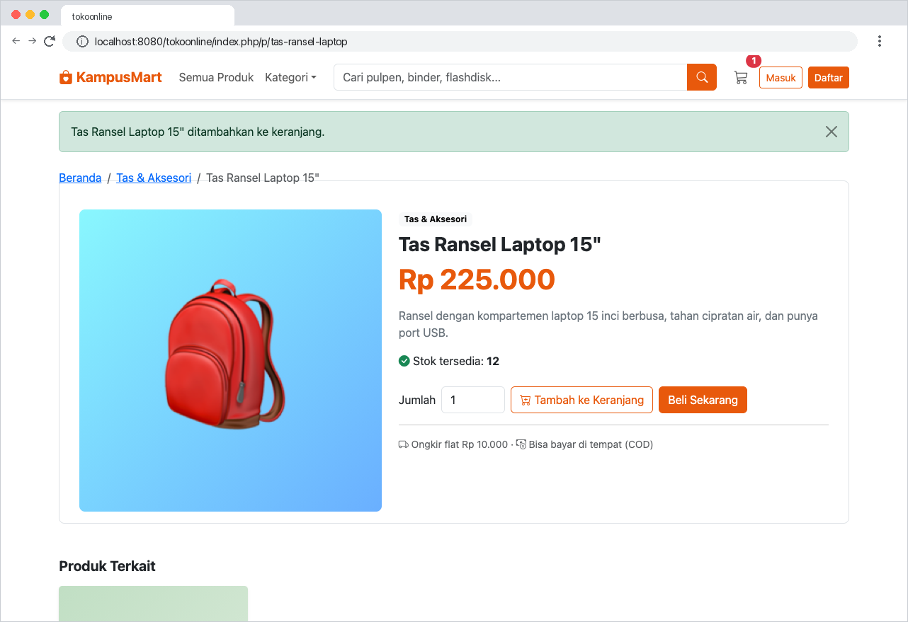

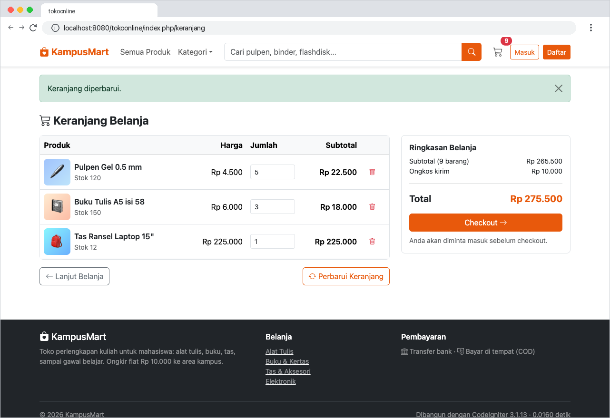

### 7.6 Checkout dengan Transaksi Database

Checkout hanya untuk pengguna yang sudah login (`Customer_Controller`). Pesanan dibuat di dalam satu transaksi. Stok dikunci dengan `SELECT ... FOR UPDATE` agar dua pembeli tidak bisa membeli stok yang sama secara bersamaan, lalu dikurangi. Jika ada stok yang kurang, seluruh transaksi dibatalkan:

```php
$this->db->trans_begin();
foreach ($items as $item)
{
	$p = $this->db->query('SELECT id, nama, harga, stok FROM produk WHERE id = ? AND aktif = 1 FOR UPDATE', [$item->id])->row();
	if ( ! $p || $p->stok < $item->qty)
	{
		$this->db->trans_rollback();
		return 'Stok '.($p ? $p->nama.' tinggal '.$p->stok : 'produk').' tidak mencukupi. Silakan periksa keranjang.';
	}
	$this->db->set('stok', 'stok - '.(int) $item->qty, FALSE)->where('id', $p->id)->update('produk');
	// ... simpan detail
}
// ... insert pesanan + insert_batch pesanan_detail
$this->db->trans_commit();
```

Jika pesanan dibatalkan (oleh pelanggan atau admin), stok dikembalikan. Pesanan yang sudah dibatalkan bersifat final dan tidak bisa diubah lagi statusnya.

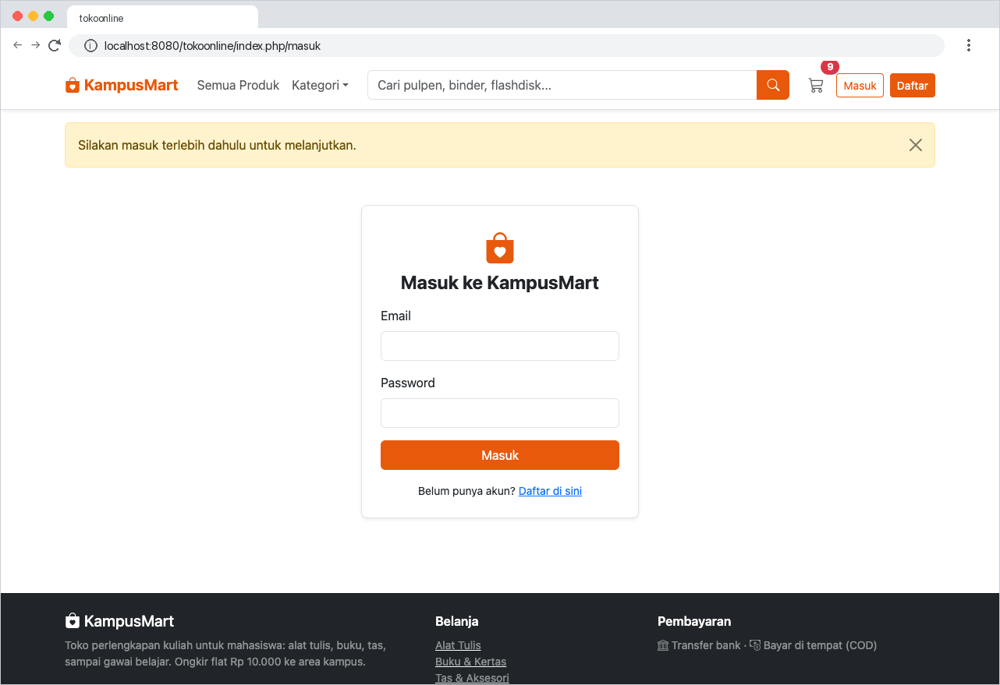


### 7.7 Panel Admin

Dashboard admin menghitung omzet (pesanan berstatus diproses sampai selesai), grafik penjualan 7 hari terakhir, produk terlaris, dan produk yang stoknya menipis.


Upload gambar produk memakai library **Upload** (jpg/png/webp, maks. 2 MB), lalu gambar yang lebih besar dari 800 px diperkecil otomatis dengan library **Image Manipulation**:

```php
$file = $this->upload->data();
if ($file['image_width'] > 800 || $file['image_height'] > 800)
{
	$this->load->library('image_lib', [
		'image_library'  => 'gd2',
		'source_image'   => $file['full_path'],
		'maintain_ratio' => TRUE,
		'width'          => 800,
		'height'         => 800,
	]);
	$this->image_lib->resize();
}
```

Produk yang sudah pernah dipesan tidak dihapus permanen, melainkan dinonaktifkan (disembunyikan dari toko), supaya riwayat pesanan tetap utuh.


---

## 8. Pengujian

Pengujian dilakukan dua kali: secara otomatis dengan `curl` (memeriksa kode HTTP, isi pesan, dan isi database) dan secara visual di Chrome saat mengambil screenshot. Semua skenario di bawah **lulus**.

| No | Aplikasi | Skenario | Hasil yang diharapkan | Hasil |
|---|---|---|---|---|
| 1 | Tokobuah | Buka `/admin/products` tanpa login | Diarahkan ke login + pesan | Lulus |
| 2 | Tokobuah | Login `budi` (customer) | Ditolak: "Akun ini bukan admin" | Lulus |
| 3 | Tokobuah | Kirim form login tanpa token CSRF | HTTP 403 | Lulus |
| 4 | Tokobuah | Tambah produk dengan nama kosong & harga "abc" | Pesan validasi berbahasa Indonesia | Lulus |
| 5 | Tokobuah | Upload file `.txt` sebagai foto | "Tipe file tidak diizinkan" | Lulus |
| 6 | Tokobuah | Tambah, edit, hapus produk Nanas Madu | Data dan file foto ikut berubah/terhapus | Lulus |
| 7 | Tokobuah | Akses `/admin/products/delete/{id}` lewat GET | HTTP 404 (hapus hanya lewat POST) | Lulus |
| 8 | SIAKAD | Dosen membuka `/admin/mahasiswa` | HTTP 403 Akses Ditolak | Lulus |
| 9 | SIAKAD | Dosen membuka input nilai kelas dosen lain | HTTP 404 | Lulus |
| 10 | SIAKAD | Tambah mahasiswa dengan NRP yang sudah ada | "NRP sudah dipakai" | Lulus |
| 11 | SIAKAD | Buka kelas yang bentrok ruang & dosen | Ditolak dengan detail kelas yang bentrok | Lulus |
| 12 | SIAKAD | Hapus dosen yang masih mengampu kelas | Ditolak | Lulus |
| 13 | SIAKAD | KRS: ambil kelas bentrok, mata kuliah ganda, kelas TA lama, kelas penuh | Semua ditolak dengan pesan yang sesuai | Lulus |
| 14 | SIAKAD | Batalkan KRS yang sudah dinilai / milik mahasiswa lain | Ditolak | Lulus |
| 15 | SIAKAD | Input nilai 87,5 / 72 / "abc" | A, B, dan "abc" diabaikan dengan peringatan | Lulus |
| 16 | KampusMart | Tambah produk stok 0 ke keranjang | "Stok habis" | Lulus |
| 17 | KampusMart | Ubah jumlah di keranjang menjadi 99 (stok 15) | Otomatis dipotong menjadi 15 | Lulus |
| 18 | KampusMart | Checkout tanpa login | Diarahkan ke masuk, lalu kembali ke checkout | Lulus |
| 19 | KampusMart | Checkout berhasil | Stok berkurang, keranjang kosong, total = subtotal + ongkir | Lulus |
| 20 | KampusMart | Pelanggan membatalkan pesanan menunggu | Status dibatalkan, stok kembali | Lulus |
| 21 | KampusMart | Pelanggan membuka pesanan milik orang lain | HTTP 404 | Lulus |
| 22 | KampusMart | Admin mengubah pesanan batal menjadi diproses | Ditolak (status batal final) | Lulus |
| 23 | KampusMart | Hapus produk yang pernah dipesan | Produk dinonaktifkan, detail produk jadi 404 | Lulus |
| 24 | KampusMart | Daftar dengan email yang sudah terdaftar | "Email ini sudah terdaftar" | Lulus |

---

## 9. Kendala dan Solusi

Sebagian kendala benar-benar muncul saat pengerjaan (**dialami**), sebagian lain sengaja dicegah sejak awal agar proyek tetap berjalan ketika dibuka di XAMPP lain, misalnya XAMPP Windows (**diantisipasi**).

| Kendala | Status | Penyebab | Solusi |
|---|---|---|---|
| Muncul banyak pesan *"Creation of dynamic property ... is deprecated"* | Dialami | CodeIgniter 3.1.13 dibuat sebelum PHP 8.2, sedangkan XAMPP terbaru memakai PHP 8.2 | Di `index.php` mode development, `error_reporting(E_ALL & ~E_DEPRECATED)`. Folder `system/` tidak diubah. |
| Error *Unknown collation utf8mb4_0900_ai_ci* bila SQL diekspor dari MySQL 8/9 lalu diimpor ke XAMPP | Diantisipasi | Collation bawaan MySQL 8/9 tidak dikenal MariaDB 10.4 (XAMPP) | Semua tabel ditulis eksplisit dengan `utf8mb4_general_ci` |
| Koneksi database gagal walaupun MySQL menyala | Diantisipasi | `hostname => 'localhost'` memakai *socket* yang lokasinya berbeda tiap instalasi | Memakai `127.0.0.1` (koneksi TCP) |
| Waktu dari PHP selisih 6 jam dengan waktu MySQL | Dialami | Zona waktu PHP XAMPP `Europe/Berlin`, MySQL memakai WIB | `date_default_timezone_set('Asia/Jakarta')` di `index.php` |
| Pesan validasi berbahasa Inggris | Dialami | Bahasa bawaan CodeIgniter `english` | Membuat `application/language/indonesian/` dan `$config['language'] = 'indonesian'` |
| Hapus data lewat link GET kurang aman | Diantisipasi | Link bisa terpicu tanpa sengaja dan tidak dilindungi CSRF | Semua aksi hapus memakai form POST dengan token CSRF |
| URL `localhost/.../admin` tidak ditemukan | Diantisipasi | `admin/` adalah subfolder controller, bukan controller | Menambahkan `$route['admin'] = 'admin/overview'` |
| Tanda elipsis tampil sebagai `&#8230;` | Dialami | `character_limiter()` menambahkan entitas HTML yang ikut di-*escape* `html_escape()` | Parameter ketiga diisi karakter `…` biasa |

---

## 10. Kesimpulan

1. CodeIgniter 3 mudah dipasang: cukup diekstrak ke `htdocs`, lalu mengatur `base_url`, `database.php`, dan `autoload.php`.
2. Router menerjemahkan URL menjadi pemanggilan `controller/method/parameter`, dan `routes.php` dapat membuat URL yang lebih pendek dan ramah pengguna.
3. Template Bootstrap (SB Admin) lebih mudah dirawat setelah dipecah menjadi *partial view*. Untuk aplikasi yang lebih besar, fungsi `render()` di `MY_Controller` membuat setiap controller cukup memanggil satu baris untuk menampilkan halaman lengkap.
4. Model dengan *query builder* membuat operasi CRUD singkat sekaligus aman dari SQL injection. Transaksi database menjaga data tetap konsisten, misalnya saat membuat akun mahasiswa atau mengurangi stok saat checkout.
5. Library Upload, Image Manipulation, Pagination, Form Validation, dan Session sangat mempercepat pengembangan fitur yang umum dibutuhkan.
6. Hak akses dapat dipusatkan di kelas dasar (`Admin_Controller`, `Auth_Controller`, `Customer_Controller`), sehingga setiap controller cukup menyebutkan role yang diizinkan.

---

## 11. Referensi

1. [XAMPP Web Server](https://www.apachefriends.org/download.html)
2. [CodeIgniter Download](https://codeigniter.com/download) dan [CodeIgniter 3 User Guide](https://codeigniter.com/userguide3/)
3. [Belajar CodeIgniter untuk Pemula, Petani Kode](https://www.petanikode.com/codeigniter-pemula/)
4. [Tutorial CodeIgniter 3, Petani Kode](https://www.petanikode.com/tutorial/codeigniter/)
5. [Repository petanikode/tutorial-codeigniter](https://github.com/petanikode/tutorial-codeigniter/tree/tutorial-7)
6. [Materi PBKK 2-1 s.d. 2-7, Fajar Baskoro](https://fajarbaskoro.blogspot.com/2020/03/2-1-instalasi-dan-konfigurasi-ci.html)
7. [Start Bootstrap SB Admin](https://github.com/StartBootstrap/startbootstrap-sb-admin) dan [SB Admin 2](https://github.com/StartBootstrap/startbootstrap-sb-admin-2)
8. [Bootstrap 5](https://getbootstrap.com/) dan [Bootstrap Icons](https://icons.getbootstrap.com/)

**Kode program lengkap:** [github.com/fazdy/PBKK---C, folder Tugas Pertemuan 9](https://github.com/fazdy/PBKK---C/tree/main/Tugas/Tugas%20Pertemuan%209)
